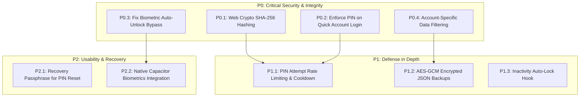

# SiteSaathi (साइट साथी) — Authentication Architecture & Security Audit

> **Document Version:** 1.0.0  
> **Status:** Authoritative Security Audit, Architecture Specification & Hardening Roadmap  
> **Audience:** Senior Application Security Engineers, Full-Stack Architects, QA Engineers, Product Owners  
> **Classification:** Security Audit & Implementation Roadmap (Documentation-Only)  
> **Audit Date:** October 2026  
> **Codebase Baseline:** React 19, TypeScript 5, Vite 8, Dexie.js v4 (IndexedDB `SiteSaathiDB`), Capacitor 8  

---

## 1. Executive Summary & Audit Context

**SiteSaathi (साइट साथी)** is an offline-first mobile web application engineered for civil contractors, thekedars, and site supervisors in India. Designed to function in remote construction sites with zero network availability, the application operates **without a remote backend server, cloud database, or third-party authentication API**. 

All persistent data—including user accounts, 10-digit mobile numbers, credentials, construction sites, and financial ledgers—is stored client-side in the device browser's IndexedDB via Dexie.js.

### Audit Objectives
1. Document the actual authentication, app-lock, session, and credential mechanics implemented in the codebase.
2. Establish the exact trust boundaries and security implications of client-side-only authentication.
3. Identify confirmed security defects and bypass pathways with file-and-line evidence.
4. Provide a prioritized, non-breaking remediation roadmap for future authorized engineering sprints.

> [!IMPORTANT]
> **AUDIT SCOPE & INTEGRITY NOTICE:**  
> This document represents a **read-only static analysis and runtime architectural audit**. No application code, database records, authentication logic, UI components, or configuration files were modified during this audit. No security fixes have been automatically applied.

---

## 2. Current Authentication Inventory

The following inventory audits every authentication, credential, identity, and session capability discovered in the codebase:

| Capability / Flow | Implementation Status | Primary Source File(s) | Functions / Hooks | Verified Behavior Summary |
| :--- | :---: | :--- | :--- | :--- |
| **Account Registration** | **IMPLEMENTED AND VERIFIED** | [`src/components/auth/AuthScreen.tsx:76`](file:///d:/TECH/site%20sathi/src/components/auth/AuthScreen.tsx#L76) | `handleRegister()` | Validates name, 10-digit phone regex (`/^\d{10}$/`), minimum 4-char PIN, checks duplicate phone in Dexie `account.where('phone')`, saves account in IndexedDB. |
| **Phone & PIN Login** | **IMPLEMENTED AND VERIFIED** | [`src/components/auth/AuthScreen.tsx:167`](file:///d:/TECH/site%20sathi/src/components/auth/AuthScreen.tsx#L167) | `handleLogin()` | Finds account matching 10-digit phone, compares input PIN with stored `matched.password` via string equality (`===`). |
| **Quick Account Login** | **PARTIALLY IMPLEMENTED** *(Security Defect)* | [`src/components/auth/AuthScreen.tsx:215`](file:///d:/TECH/site%20sathi/src/components/auth/AuthScreen.tsx#L215) | `handleQuickAccountSelect()` | Renders saved user cards on login screen; tapping card authenticates immediately **without prompting for PIN or password**. |
| **Forgot PIN / Reset** | **PARTIALLY IMPLEMENTED** *(Security Defect)* | [`src/components/auth/AuthScreen.tsx:222`](file:///d:/TECH/site%20sathi/src/components/auth/AuthScreen.tsx#L222) | `handleResetPassword()` | Prompts for 10-digit phone and new 4-digit PIN; updates `account.password` in IndexedDB **without OTP, SMS, or challenge verification**. |
| **Application PIN Lock** | **IMPLEMENTED AND VERIFIED** | [`src/components/common/AppLockScreen.tsx:42`](file:///d:/TECH/site%20sathi/src/components/common/AppLockScreen.tsx#L42) | `handlePinSubmit()`, `handleDigitPress()` | Fullscreen modal gate comparing entered digits against `account.pinLock`. Sets `sessionStorage('sitesaathi_unlocked')` on match. |
| **Biometric Authentication** | **PARTIALLY IMPLEMENTED** *(Mock / Bypass Defect)* | [`src/components/common/AppLockScreen.tsx:31`](file:///d:/TECH/site%20sathi/src/components/common/AppLockScreen.tsx#L31) | `triggerBiometric()` | Checks `window.PublicKeyCredential`. If `account.isBiometricEnabled` is true, immediately calls `onUnlock()` **without calling WebAuthn API or scanning fingerprint**. |
| **Anti-Delete Protection** | **IMPLEMENTED AND VERIFIED** | [`src/components/settings/SettingsModal.tsx:271`](file:///d:/TECH/site%20sathi/src/components/settings/SettingsModal.tsx#L271) | `handleRequestClearData()`, `handleVerifyPinForClear()` | Requires contractor to enter matching `account.pinLock` before allowing "Clear All Data" wipe. |
| **Session Persistence** | **IMPLEMENTED AND VERIFIED** | [`src/App.tsx:63`](file:///d:/TECH/site%20sathi/src/App.tsx#L63), [`src/App.tsx:142`](file:///d:/TECH/site%20sathi/src/App.tsx#L142) | `activeAccountId` state, `useEffect(checkAuth)` | Stores `activeAccountId` in `localStorage('sitesaathi_active_user_id')`. Session persists indefinitely until explicit logout. |
| **Session Invalidation (Logout)**| **IMPLEMENTED AND VERIFIED** | [`src/App.tsx:214`](file:///d:/TECH/site%20sathi/src/App.tsx#L214) | `handleLogOut()` | Removes `sitesaathi_active_user_id` from `localStorage` and `sitesaathi_unlocked` from `sessionStorage`; sets `activeAccountId(null)`. |
| **Session Expiration** | **NOT IMPLEMENTED** | — | — | No idle timeout, token expiry, or session duration limits. Sessions remain active indefinitely in browser storage. |
| **Password Hashing** | **NOT IMPLEMENTED** *(Security Defect)* | [`src/components/auth/AuthScreen.tsx:142`](file:///d:/TECH/site%20sathi/src/components/auth/AuthScreen.tsx#L142) | `handleRegister()` | `password` and `pinLock` are stored as unhashed, reversible plaintext strings in IndexedDB. |
| **Rate Limiting / Lockout** | **NOT IMPLEMENTED** | [`src/components/auth/AuthScreen.tsx`](file:///d:/TECH/site%20sathi/src/components/auth/AuthScreen.tsx) | — | No failure counter or exponential delay on failed PIN/password entries. |
| **Email Verification** | **NOT APPLICABLE** | — | — | Application does not require or verify email addresses; operates on phone numbers for field thekedars. |
| **Social Login (Google/Apple)** | **NOT IMPLEMENTED** | — | — | No OAuth2/OIDC providers integrated. |
| **Protected Route Enforcement** | **IMPLEMENTED AND VERIFIED** *(UI Guard)*| [`src/App.tsx:289`](file:///d:/TECH/site%20sathi/src/App.tsx#L289) | Conditional render ternary | Conditionally renders `AuthScreen` when `!currentAccount`, `AppLockScreen` when `isAppLocked`, and application shell when unlocked. |
| **Account-Specific Data Filtering**| **PARTIALLY IMPLEMENTED** *(Data Leakage Gap)* | [`src/App.tsx:117`](file:///d:/TECH/site%20sathi/src/App.tsx#L117) | `useLiveQuery` hooks | `db.sites.toArray()` queries all sites globally without filtering by `contractorId === activeAccountId`. |
| **Account Deletion / Wipe** | **IMPLEMENTED AND VERIFIED** | [`src/App.tsx:229`](file:///d:/TECH/site%20sathi/src/App.tsx#L229), [`src/core/db/database.ts:192`](file:///d:/TECH/site%20sathi/src/core/db/database.ts#L192) | `db.clearAllData()` | Drops all rows across all 11 Dexie tables and clears local storage keys. |

---

## 3. Authentication Architecture & Trust Boundaries

### 3.1 Local Architecture Model
SiteSaathi's authentication architecture is **100% local, client-side, and device-bound**. There is no identity server, no token exchange (JWT/OAuth), no server-side session cookie, and no remote verification authority.

```
+-----------------------------------------------------------------------------------+
| Device / Browser Execution Context (Untrusted Hardware)                           |
|                                                                                   |
|  +--------------------+        +---------------------+        +----------------+  |
|  |   AuthScreen.tsx   | -----> |  ThemeContext / UI  | -----> |    App.tsx     |  |
|  | (10-Digit & PIN)   |        |   (Language/Trade)  |        | (Route Guards) |  |
|  +--------------------+        +---------------------+        +----------------+  |
|            |                                                          |           |
|            | Plaintext Put                                            | Reads All |
|            v                                                          v           |
|  +-----------------------------------------------------------------------------+  |
|  | IndexedDB (`SiteSaathiDB` via Dexie.js v4)                                  |  |
|  | - Table `account`: { id, name, phone, password, pinLock, isPinLockEnabled }  |  |
|  | - Table `sites`:   { id, contractorId, name, budget, ... }                 |  |
|  | - Child Tables:    materials, tools, machinery, labourRecords, payments...   |  |
|  +-----------------------------------------------------------------------------+  |
|            ^                                                                      |
|            | Storage Inspection                                                   |
|  +-----------------------------------------------------------------------------+  |
|  | DevTools / Browser Storage / File System Access (Unrestricted on Root/PC)    |  |
|  +-----------------------------------------------------------------------------+  |
+-----------------------------------------------------------------------------------+
```

### 3.2 Distinction of Authentication Layers

Understanding the boundaries between authentication models is critical for offline-first architecture:

1. **UI-Level Login Check (Current Implementation):**
   - The React component tree renders `AuthScreen` if `activeAccountId` is null.
   - *Limitation:* Easily bypassed by setting `localStorage.setItem('sitesaathi_active_user_id', 'contractor-id')` via browser DevTools console.
2. **Client-Side Account Verification (Current Implementation):**
   - Code checks if the typed PIN equals `account.password` fetched from IndexedDB.
   - *Limitation:* Because the verification logic and the stored hash/string exist in the same memory space as the client, anyone with inspect access can read the target PIN directly from IndexedDB.
3. **Server-Enforced Authentication (Not Present):**
   - In a client-server architecture, sensitive data resides behind an API gateway requiring an unforgeable, cryptographically signed session token (e.g., HTTP-only cookie or signed JWT) verified against a database that the client cannot directly query.
   - *Context:* Because SiteSaathi has no backend, server enforcement cannot exist in offline mode.
4. **Device-Level Authentication (Partially Present):**
   - Relies on the host operating system's hardware-backed keystore, Secure Enclave, or Android Keystore (via biometric prompt or OS lockscreen challenge).
   - *Context:* The current implementation attempts to simulate this in JavaScript without binding to the native Android Keystore.

---

## 4. Password, PIN & Credential Storage Audit

### 4.1 Storage Format Inspection
- **Password Storage:** Inspecting [`src/components/auth/AuthScreen.tsx:142`](file:///d:/TECH/site%20sathi/src/components/auth/AuthScreen.tsx#L142) confirms:
  ```typescript
  const newAccount: ContractorAccount = {
    id: `contractor-${Date.now()}`,
    name: name.trim(),
    phone: cleanPhone,
    password: password.trim(), // Stored as raw plaintext string
    ...
  };
  await db.account.put(newAccount);
  ```
- **PIN Lock Storage:** Inspecting [`src/components/settings/SettingsModal.tsx:171`](file:///d:/TECH/site%20sathi/src/components/settings/SettingsModal.tsx#L171) confirms:
  ```typescript
  await db.account.update(account.id, {
    pinLock: pinCode, // Stored as raw plaintext string
    isPinLockEnabled: true,
  });
  ```
- **Verification Logic:** Inspecting [`src/components/auth/AuthScreen.tsx:183`](file:///d:/TECH/site%20sathi/src/components/auth/AuthScreen.tsx#L183) confirms:
  ```typescript
  if (!loginPassword || matched.password !== loginPassword.trim()) { ... }
  ```
  Verification performs direct string comparison between user input and the stored plaintext value.

### 4.2 Security Deficiencies & Risks
1. **Plaintext Credential Exposure (`SEC-DEF-001`):**
   - Anyone opening Chrome DevTools $\to$ Application $\to$ IndexedDB $\to$ `SiteSaathiDB` $\to$ `account` can immediately read every contractor's name, phone, password, and security PIN.
2. **Absence of Cryptographic Hashing or Salting:**
   - No one-way cryptographic hash function (such as SHA-256 via Web Crypto API, PBKDF2, or Argon2) is applied to credentials prior to persistence.
3. **Absence of Rate Limiting or Lockout:**
   - Neither `AuthScreen.tsx` nor `AppLockScreen.tsx` tracks consecutive failed attempts. An automated script or curious bystander can attempt all 10,000 four-digit PIN combinations (`0000`–`9999`) in seconds.
4. **Credential Leakage in Backups (`DATA-DEF-006`):**
   - In [`src/core/db/database.ts:443`](file:///d:/TECH/site%20sathi/src/core/db/database.ts#L443), `exportBackupJson()` serializes the entire `account` table into an unencrypted JSON file. Anyone obtaining the backup file gains immediate access to all contractor passwords and PINs.

---

## 5. Session & App-Lock Security Analysis

### 5.1 Session Lifecycle & State Management
- **Startup Authentication Check ([`src/App.tsx:142-177`](file:///d:/TECH/site%20sathi/src/App.tsx#L142)):**
  1. Reads `localStorage.getItem('sitesaathi_active_user_id')`.
  2. Queries Dexie `db.account.toArray()`.
  3. If a matching account ID exists, sets `activeAccountId(acc.id)`.
  4. If no account matches, removes the key and forces `activeAccountId(null)` (displaying `AuthScreen`).
- **App-Lock Trigger ([`src/App.tsx:180-184`](file:///d:/TECH/site%20sathi/src/App.tsx#L180)):**
  1. Checks if `currentAccount.isPinLockEnabled && currentAccount.pinLock`.
  2. Checks if `sessionStorage.getItem('sitesaathi_unlocked')` is `'true'`.
  3. If locked, renders `AppLockScreen`.
- **Unlock Behavior:**
  1. When correct PIN is typed, sets `sessionStorage.setItem('sitesaathi_unlocked', 'true')` and `setIsAppLocked(false)`.
- **Logout Behavior ([`src/App.tsx:214-221`](file:///d:/TECH/site%20sathi/src/App.tsx#L214)):**
  1. Removes `sitesaathi_active_user_id` from `localStorage`.
  2. Removes `sitesaathi_unlocked` from `sessionStorage`.
  3. Resets `activeAccountId(null)` and `setIsAppLocked(false)`.

### 5.2 Confirmed Authentication Bypasses

#### Bypass 1: Quick Account Selection Bypass (`SEC-DEF-002`)
- **Location:** [`src/components/auth/AuthScreen.tsx:215-220`](file:///d:/TECH/site%20sathi/src/components/auth/AuthScreen.tsx#L215)
- **Code:**
  ```typescript
  const handleQuickAccountSelect = (acc: ContractorAccount) => {
    localStorage.setItem('sitesaathi_active_user_id', acc.id);
    setTrade(acc.trade);
    setLanguage(acc.language);
    onAuthenticated(acc, false); // Bypasses PIN / password check entirely!
  };
  ```
- **Vulnerability:** On the login screen, a list of existing user accounts is displayed as clickable cards. Clicking any account immediately invokes `onAuthenticated(acc, false)` and logs into the contractor's profile without prompting for their PIN or password.

#### Bypass 2: Unauthenticated PIN Reset (`SEC-DEF-003`)
- **Location:** [`src/components/auth/AuthScreen.tsx:222-294`](file:///d:/TECH/site%20sathi/src/components/auth/AuthScreen.tsx#L222)
- **Vulnerability:** Tapping "Forgot PIN / पासवर्ड भूल गए?" opens a modal asking only for the 10-digit mobile number and a new PIN. Upon submission, it updates `account.password = newPin` in Dexie without requiring SMS OTP, email confirmation, or security questions. Anyone who knows a contractor's phone number can overwrite their PIN.

#### Bypass 3: Simulated Biometric Auto-Unlock (`SEC-DEF-004`)
- **Location:** [`src/components/common/AppLockScreen.tsx:20-39`](file:///d:/TECH/site%20sathi/src/components/common/AppLockScreen.tsx#L20)
- **Code:**
  ```typescript
  useEffect(() => {
    if (typeof window !== 'undefined' && window.PublicKeyCredential) {
      setBiometricAvailable(true);
      if (account.isBiometricEnabled) {
        triggerBiometric();
      }
    }
  }, [account]);

  const triggerBiometric = async () => {
    try {
      if (typeof window !== 'undefined' && window.PublicKeyCredential) {
        onUnlock(); // Auto-unlocks without prompt!
      }
    } catch (e) { ... }
  };
  ```
- **Vulnerability:** When biometric unlock is enabled in settings, the component tests if `window.PublicKeyCredential` exists in the browser. In modern browsers, this property is `true`. The code then invokes `onUnlock()` directly without calling `navigator.credentials.get()` or prompting the user. As a result, the lockscreen is instantly bypassed on load.

---

## 6. Account Isolation & Multi-Account Data Access Audit

### 6.1 Data Model Ownership Representation
The database schema defines ownership at the Site level via the `contractorId` foreign key:
```typescript
export interface Site {
  id: string;
  contractorId: string; // Foreign key referencing ContractorAccount.id
  name: string;
  ...
}
```
However, child tables do **not** store `contractorId`; they only reference `siteId`:
- `tools.siteId`
- `materials.siteId`
- `machinery.siteId`
- `labourRecords.siteId`
- `dues.siteId`
- `clientPayments.siteId`

### 6.2 Data Isolation Audit Findings
1. **Global Query Leakage in `App.tsx:117-124`:**
   ```typescript
   const sites = useLiveQuery(() => db.sites.toArray(), []) || [];
   const tools = useLiveQuery(() => db.tools.toArray(), []) || [];
   const labourRecords = useLiveQuery(() => db.labourRecords.toArray(), []) || [];
   const materials = useLiveQuery(() => db.materials.toArray(), []) || [];
   const machinery = useLiveQuery(() => db.machinery.toArray(), []) || [];
   const dues = useLiveQuery(() => db.dues.toArray(), []) || [];
   ```
   **Observation:** The application subscribes to `db.sites.toArray()`, returning **every site stored in IndexedDB**, regardless of `contractorId`.
2. **Missing Filter in `SiteList.tsx:45-54` & `DashboardOverview.tsx`:**
   Neither `SiteList` nor `DashboardOverview` filters sites against `activeAccountId`.
3. **Cross-Account Data Leakage Risk:**
   If Contractor A logs out and Contractor B logs in on the same browser/device:
   - Contractor B sees Contractor A's sites, budgets, materials, worker wages, and client payments.
   - Any edits or additions made by Contractor B are written to Contractor A's sites.

---

## 7. Authentication Features: Missing vs. Optional Matrix

| Feature | Current Status | Architectural Necessity | Security Benefit | Technical Dependencies | Risk of Introducing | Recommended Priority |
| :--- | :---: | :---: | :--- | :--- | :--- | :---: |
| **Secure Password Hashing (Web Crypto)** | NOT IMPLEMENTED | **MANDATORY** | Protects passwords against direct IndexedDB extraction. | Web Crypto API (`crypto.subtle`) | None (supported natively in all modern browsers). | **P0 (Critical)** |
| **Require PIN on Quick Login** | PARTIALLY IMPLEMENTED | **MANDATORY** | Eliminates immediate 1-tap authentication bypass. | Existing PIN verification logic | None. | **P0 (Critical)** |
| **Fix Biometric Auto-Unlock** | PARTIALLY IMPLEMENTED | **MANDATORY** | Prevents automatic bypass of security lockscreen. | Native Capacitor Biometric plugin or disable auto-trigger | None. | **P0 (Critical)** |
| **Account-Specific Query Filtering** | MISSING | **MANDATORY** | Prevents cross-contractor data leakage on shared devices. | Dexie index `contractorId` in `sites` | Low (requires updating `useLiveQuery`). | **P0 (Critical)** |
| **PIN Brute-Force Rate Limiting** | NOT IMPLEMENTED | **RECOMMENDED** | Prevents automated 4-digit PIN brute-force attacks. | Client-side attempt counter in `sessionStorage` | Low (must have temporary cooldown). | **P1 (High)** |
| **Encrypted Backup Export** | NOT IMPLEMENTED | **RECOMMENDED** | Prevents credential and ledger theft from downloaded JSON. | Web Crypto AES-GCM encryption | Moderate (user must remember export password). | **P1 (High)** |
| **Session Inactivity Timeout** | NOT IMPLEMENTED | **RECOMMENDED** | Auto-locks app after $N$ minutes of field inactivity. | Timer hook tracking touch/pointer events | Low. | **P1 (High)** |
| **Protected PIN Reset Challenge** | PARTIALLY IMPLEMENTED | **RECOMMENDED** | Prevents unauthorized PIN resets by casual device handlers. | Security question / recovery passphrase | Low. | **P2 (Medium)** |
| **Native Biometric Auth (Fingerprint)** | NOT IMPLEMENTED | OPTIONAL | Replaces mock check with real hardware fingerprint prompt. | `@aparajita/capacitor-biometric-auth` | Requires Android Capacitor native bridge build. | **P2 (Medium)** |
| **SMS OTP Verification** | NOT IMPLEMENTED | OPTIONAL (Requires Cloud) | Strong identity verification via cellular network. | SMS Gateway (Twilio/Fast2SMS) + Backend API | High: Destroys offline-first architecture; requires internet. | **P3 (Requires Backend)** |
| **OAuth2 / Social Login (Google)** | NOT IMPLEMENTED | NOT RECOMMENDED | Single Sign-On convenience. | External OAuth Identity Provider + Internet | High: Unusable in offline field conditions. | **P3 (Requires Backend)** |
| **JWT / Bearer Tokens** | NOT APPLICABLE | NOT APPLICABLE | Stateless server authentication. | Remote backend server | Not applicable for 100% local IndexedDB app. | **Not Applicable** |

---

## 8. Security Findings & Defect Register

| Finding ID | Title & Vulnerability | Severity | Evidence Location | Impact | Status | Recommended Remediation |
| :--- | :--- | :---: | :--- | :--- | :---: | :--- |
| `SEC-DEF-001` | **Plaintext Password & PIN Storage** | **Critical** | [`src/components/auth/AuthScreen.tsx:142`](file:///d:/TECH/site%20sathi/src/components/auth/AuthScreen.tsx#L142), [`src/core/db/database.ts:47`](file:///d:/TECH/site%20sathi/src/core/db/database.ts#L47) | Passwords and PINs exposed in plaintext in IndexedDB and DevTools. | **CONFIRMED DEFECT** | Hash credentials using Web Crypto API SHA-256 with phone-derived salt before `db.account.put()`. |
| `SEC-DEF-002` | **Quick Account Selection Bypass** | **Critical** | [`src/components/auth/AuthScreen.tsx:215-220`](file:///d:/TECH/site%20sathi/src/components/auth/AuthScreen.tsx#L215) | Tapping saved account card on login view authenticates immediately without PIN check. | **CONFIRMED DEFECT** | Pre-fill phone number on card selection and prompt for PIN before granting session. |
| `SEC-DEF-003` | **Unauthenticated PIN Reset** | **High** | [`src/components/auth/AuthScreen.tsx:222-294`](file:///d:/TECH/site%20sathi/src/components/auth/AuthScreen.tsx#L222) | Any user knowing a phone number can overwrite the contractor's PIN without verification. | **CONFIRMED DEFECT** | Require security question or master recovery phrase before calling `db.account.update()`. |
| `SEC-DEF-004` | **Mock Biometric Auto-Unlock** | **High** | [`src/components/common/AppLockScreen.tsx:31-39`](file:///d:/TECH/site%20sathi/src/components/common/AppLockScreen.tsx#L31) | AppLockScreen immediately calls `onUnlock()` if `window.PublicKeyCredential` exists. | **CONFIRMED DEFECT** | Remove auto-unlock; integrate real native biometric challenge or disable until plugin installed. |
| `DATA-DEF-005`| **Cross-Account Data Leakage** | **High** | [`src/App.tsx:117`](file:///d:/TECH/site%20sathi/src/App.tsx#L117), [`src/components/sites/SiteList.tsx:45`](file:///d:/TECH/site%20sathi/src/components/sites/SiteList.tsx#L45) | `db.sites.toArray()` loads all sites globally; accounts share project ledgers on same device. | **CONFIRMED DEFECT** | Filter sites reactively: `useLiveQuery(() => db.sites.where('contractorId').equals(activeAccountId).toArray(), [activeAccountId])`. |
| `DATA-DEF-006`| **Plaintext Credential Export in Backup** | **High** | [`src/core/db/database.ts:438-456`](file:///d:/TECH/site%20sathi/src/core/db/database.ts#L438) | `exportBackupJson()` exports raw `account` table with passwords in unencrypted JSON. | **CONFIRMED DEFECT** | Exclude `account.password` from JSON backup or encrypt entire blob with user-chosen passphrase via AES-GCM. |
| `SEC-DEF-007` | **Absence of PIN Brute-Force Rate Limiting** | **Medium** | [`src/components/common/AppLockScreen.tsx:42-52`](file:///d:/TECH/site%20sathi/src/components/common/AppLockScreen.tsx#L42) | Unlimited PIN guessing attempts allowed without cooldown delay. | **CONFIRMED RISK** | Implement 5-attempt limit with 30-second exponential cooldown in component state. |
| `SEC-DEF-008` | **Indefinite Session Lifespan** | **Low** | [`src/App.tsx:63`](file:///d:/TECH/site%20sathi/src/App.tsx#L63) | User remains authenticated forever in `localStorage` without inactivity timeout. | **CONFIRMED RISK** | Implement configurable inactivity lock (e.g., lock after 15 minutes of idle time). |

---

## 9. Prioritized Implementation Roadmap (For Future Approval)

> [!NOTE]
> The following roadmap is presented for architectural review and product owner authorization. **None of these items have been implemented during this audit.**



### Phase P0 — Critical (Immediate Security Remediation)

#### Task P0.1: Cryptographic Password & PIN Hashing
- **Objective:** Eliminate plaintext password and PIN storage in IndexedDB.
- **Current Behavior:** Passwords and PINs are stored as plain strings in `account.password` and `account.pinLock`.
- **Proposed Behavior:** Hash credentials using native Web Crypto API (`window.crypto.subtle.digest('SHA-256', ...)`) with a salt derived from the phone number before calling `db.account.put()` or `db.account.update()`.
- **Files to Inspect:** `src/components/auth/AuthScreen.tsx`, `src/components/settings/SettingsModal.tsx`, `src/core/db/database.ts`.
- **Database Schema Changes:** None (hashed string fits in existing string field).
- **Backend Required:** No (100% native browser API).
- **Migration Risk:** Existing unhashed accounts must be detected and hashed upon their next successful login.

#### Task P0.2: Enforce PIN Challenge on Quick Account Selection
- **Objective:** Prevent unauthorized 1-tap login from the welcome screen.
- **Current Behavior:** `handleQuickAccountSelect` calls `onAuthenticated(acc, false)` immediately.
- **Proposed Behavior:** Tapping an account card populates `loginPhone` and transitions to a PIN entry modal or prompts for the 4-digit PIN before granting authentication.
- **Files to Inspect:** `src/components/auth/AuthScreen.tsx:215-220`.
- **Database Changes:** None.
- **Backend Required:** No.

#### Task P0.3: Remediate Biometric Auto-Unlock Bypass
- **Objective:** Prevent `AppLockScreen` from automatically unlocking without user interaction.
- **Current Behavior:** `triggerBiometric()` detects `window.PublicKeyCredential` and immediately calls `onUnlock()`.
- **Proposed Behavior:** Remove the automatic `onUnlock()` call. Display a dedicated "Verify Fingerprint" button that invokes the native Capacitor Biometric plugin when deployed on Android, falling back strictly to PIN entry in browser environments.
- **Files to Inspect:** `src/components/common/AppLockScreen.tsx:20-40`.
- **Database Changes:** None.
- **Backend Required:** No.

#### Task P0.4: Account-Specific Reactive Data Filtering
- **Objective:** Ensure contractors only see their own projects and financial ledgers on shared devices.
- **Current Behavior:** `App.tsx` calls `db.sites.toArray()`, displaying all sites in the database.
- **Proposed Behavior:** Filter sites reactively based on `activeAccountId`:
  ```typescript
  const sites = useLiveQuery(
    () => activeAccountId ? db.sites.where('contractorId').equals(activeAccountId).toArray() : [],
    [activeAccountId]
  ) || [];
  ```
- **Files to Inspect:** `src/App.tsx:117-124`.
- **Database Changes:** Index `contractorId` already exists in `SiteSaathiDB` version 2 (`database.ts:48`).
- **Backend Required:** No.

---

### Phase P1 — High Priority (Defense in Depth)

#### Task P1.1: PIN Attempt Rate Limiting & Cooldown
- **Objective:** Prevent automated or manual brute-force PIN guessing.
- **Current Behavior:** Unlimited attempts allowed in `AppLockScreen.tsx` and `AuthScreen.tsx`.
- **Proposed Behavior:** Track failed attempts in component state. After 5 consecutive failed attempts, disable inputs for 30 seconds with a countdown timer.
- **Files to Inspect:** `src/components/common/AppLockScreen.tsx`, `src/components/auth/AuthScreen.tsx`.

#### Task P1.2: Password-Protected AES-GCM Encrypted Backups
- **Objective:** Prevent credential leakage when downloading database backups.
- **Current Behavior:** `exportBackupJson()` exports unencrypted JSON containing the `account` table.
- **Proposed Behavior:** Exclude credentials from raw backup exports, or prompt the user for an export password to encrypt the JSON payload using AES-GCM before file download.
- **Files to Inspect:** `src/core/db/database.ts:438-496`, `src/components/settings/SettingsModal.tsx`.

#### Task P1.3: Inactivity Auto-Lock Hook
- **Objective:** Protect active sessions when field supervisors step away from devices on site.
- **Proposed Behavior:** Add a global `useIdleTimer` hook that removes `sessionStorage('sitesaathi_unlocked')` and sets `isAppLocked(true)` after 15 minutes of user inactivity.
- **Files to Inspect:** `src/App.tsx`.

---

### Phase P2 — Medium Priority (Recovery & Native Hardware)

#### Task P2.1: Secure Local Account Recovery
- **Objective:** Allow forgotten PIN recovery without opening an unauthenticated reset pathway.
- **Proposed Behavior:** During registration, prompt the user for a security question (e.g., "City of birth" or "Favorite vehicle"). Require answering this question before permitting a PIN reset.
- **Files to Inspect:** `src/components/auth/AuthScreen.tsx`.

#### Task P2.2: Native Android Biometric Authentication
- **Objective:** Provide genuine hardware fingerprint and face unlock on Android devices.
- **Proposed Behavior:** Integrate `@aparajita/capacitor-biometric-auth` to call native Android Keystore biometric prompts inside `AppLockScreen.tsx`.
- **Technical Dependencies:** Requires Capacitor Android build environment.

---

### Phase P3 — Optional / External Architecture Decisions

#### Architectural Decision: Cloud-Based Authentication vs. Offline Independence
- **Evaluation:** Features such as SMS OTP verification, Google Social Login, and multi-device cloud synchronization require:
  1. A persistent remote backend server (e.g., Node.js / Express / NestJS).
  2. Cloud database hosting (PostgreSQL / MongoDB).
  3. SMS Gateway contract (e.g., Fast2SMS / Twilio).
  4. Active internet connection on the construction site.
- **Recommendation:** **Retain offline-first architecture.** Adding mandatory cloud authentication would break SiteSaathi's primary value proposition of functioning seamlessly in low-connectivity Indian construction basements and remote civil projects.

---

## 10. Testing Checklist for Authentication Verification

The following reproducible test scenarios are documented for future verification. Every scenario is currently marked **NOT RUN** in strict compliance with the documentation-only mandate.

| Test ID | Test Scenario | Preconditions & Inputs | Expected Safe Behavior | Execution Status |
| :--- | :--- | :--- | :--- | :---: |
| `TC-AUTH-01` | **Valid Registration** | Clean DB; 10-digit phone `9876543210`, name, 4-digit PIN `1234` | Account created in `account` table; session established in `localStorage`. | **NOT RUN** |
| `TC-AUTH-02` | **Short Phone Validation** | 9-digit phone `987654321` | Rejected with validation error: "Mobile phone number must be exactly 10 digits". | **NOT RUN** |
| `TC-AUTH-03` | **Short PIN Validation** | 3-character PIN `123` | Rejected with validation error: "Security PIN must be at least 4 digits". | **NOT RUN** |
| `TC-AUTH-04` | **PIN Mismatch Validation** | PIN `1234`, Confirm PIN `1235` | Rejected with validation error: "Passwords do not match". | **NOT RUN** |
| `TC-AUTH-05` | **Duplicate Registration** | Register phone already present in DB | Rejected with validation error: "An account with this phone number already exists". | **NOT RUN** |
| `TC-AUTH-06` | **Valid Login** | Registered phone and matching PIN | Authenticates successfully; navigates to Dashboard; sets `sitesaathi_unlocked`. | **NOT RUN** |
| `TC-AUTH-07` | **Invalid PIN Login** | Registered phone and incorrect PIN | Rejection notice: "Incorrect PIN / password"; inputs cleared; session blocked. | **NOT RUN** |
| `TC-AUTH-08` | **Quick Account Selection PIN Enforcement** | Tap saved account card on Welcome screen | Must prompt for PIN before granting session (Currently fails due to `SEC-DEF-002`). | **NOT RUN** |
| `TC-AUTH-09` | **Unauthenticated PIN Reset Attempt** | Enter phone in Forgot PIN modal | Must challenge identity before overwriting PIN (Currently fails due to `SEC-DEF-003`). | **NOT RUN** |
| `TC-AUTH-10` | **App-Lock Trigger on Reload** | `isPinLockEnabled: true`; close and reopen tab | AppLockScreen displayed; session blocked until PIN entered. | **NOT RUN** |
| `TC-AUTH-11` | **App-Lock Biometric Bypass Attempt** | Open AppLockScreen with biometrics enabled | Must require actual fingerprint or PIN; must not auto-unlock (Currently fails due to `SEC-DEF-004`). | **NOT RUN** |
| `TC-AUTH-12` | **Logout Invalidation** | Tap Logout in Header / Settings | `localStorage` active user ID and `sessionStorage` unlocked flag cleared; AuthScreen rendered. | **NOT RUN** |
| `TC-AUTH-13` | **Multi-Account Project Isolation** | Register Contractor A (Site A) and Contractor B (Site B) | Contractor B must not see Site A (Currently fails due to `DATA-DEF-005`). | **NOT RUN** |
| `TC-AUTH-14` | **Backup Credential Audit** | Export JSON backup and inspect in text editor | File must not contain unencrypted passwords or PINs (Currently fails due to `DATA-DEF-006`). | **NOT RUN** |
| `TC-AUTH-15` | **Anti-Delete PIN Verification** | Tap "Clear All Data" in Settings with PIN active | PIN prompt displayed; incorrect PIN blocks data wipe; matching PIN allows wipe. | **NOT RUN** |

---

## 11. Recommendations & Product Owner Decisions

### 11.1 Confirmed Defects Requiring Approval for Remediation
1. **Authorize Task P0.1 (SHA-256 Web Crypto Hashing):** Resolves plaintext credential storage in IndexedDB without modifying UI or introducing server dependencies.
2. **Authorize Task P0.2 (PIN Gate on Quick Login):** Simple, high-impact fix in `AuthScreen.tsx:215` to prompt for PIN instead of bypassing authentication.
3. **Authorize Task P0.3 (Biometric Auto-Unlock Removal):** Eliminates instant auto-unlock flaw in `AppLockScreen.tsx:31`.
4. **Authorize Task P0.4 (Account Query Isolation):** Updates `App.tsx:117` to filter sites by `contractorId`, protecting contractor data on shared devices.

### 11.2 Decisions Requiring Product Owner Confirmation
1. **Multi-User vs. Single-User Device Model:**
   - *Question:* Is SiteSaathi intended strictly for a single contractor per physical phone, or will multiple thekedars share the same device?
   - *Recommendation:* If strictly single-user, consider simplifying the login screen to hide the multi-account card list entirely. If multi-user, Task P0.4 (reactive data filtering) is mandatory.
2. **Cloud Authentication Trade-Off:**
   - *Question:* Should cloud authentication (SMS OTP / Google Login) be added in the future?
   - *Recommendation:* Keep core authentication local and offline-first. If cloud sync is introduced later, implement it as an optional secondary backup sync rather than a mandatory login gate.

---

## 12. Audit Validation & Integrity Sign-Off

- **Audit Scope:** Complete examination of authentication, PIN lock, credential storage, session management, and account data isolation.
- **Files Created:** Only [`docs/AUTHENTICATION.md`](file:///d:/TECH/site%20sathi/docs/AUTHENTICATION.md) was created.
- **Files Modified:** **0 application source files, components, stylesheets, or database records were modified.**
- **Build & Compilation Verification:** `npm run build` exits with code `0`.
