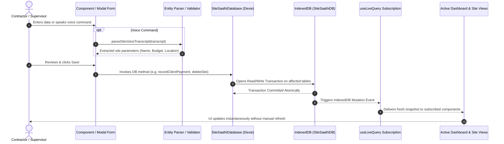
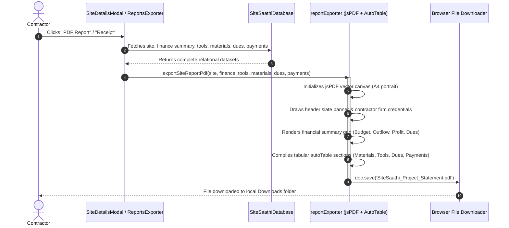
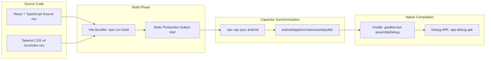
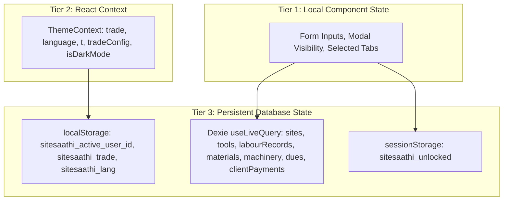
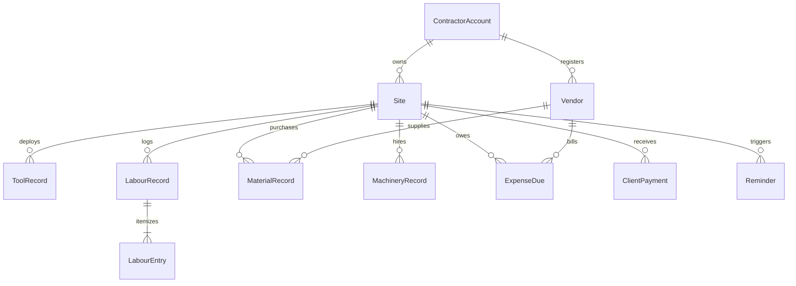
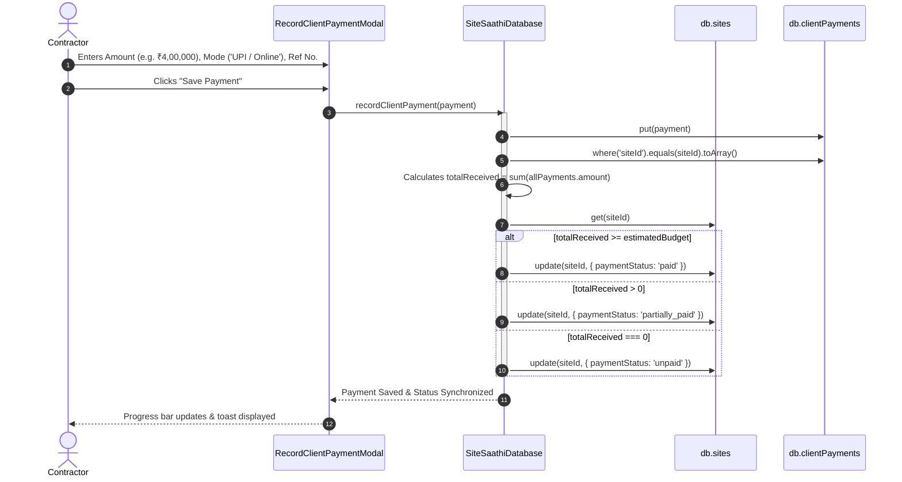
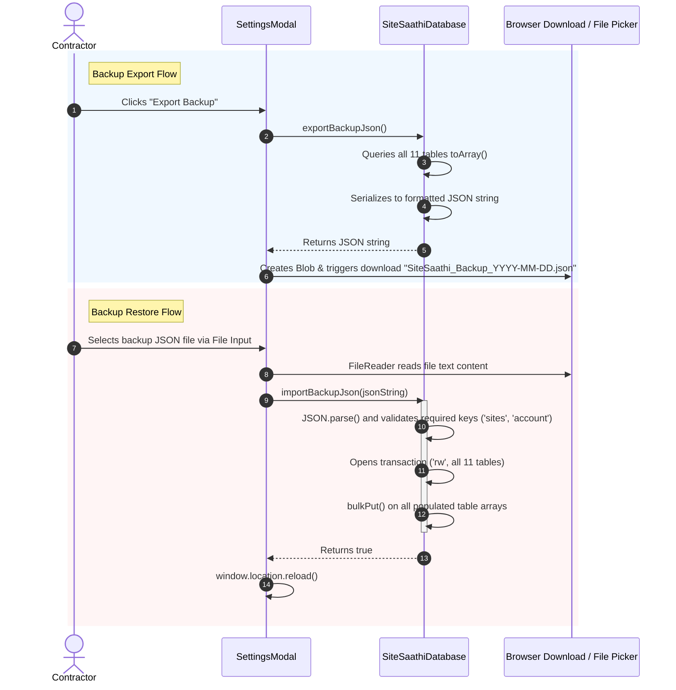
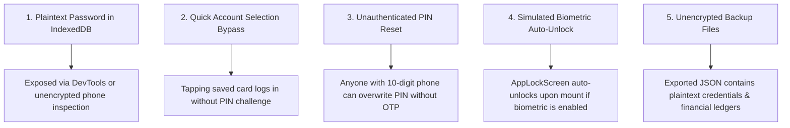

# SiteSaathi (साइट साथी) — Technical Architecture Documentation

> **Document Version:** 2.0.0  
> **Status:** Current Implementation Blueprint & Technical Source of Truth  
> **Audience:** Senior Software Architects, Security Engineers, QA Engineers, Future AI Coding Agents  
> **Classification:** Authoritative Technical Architecture Reference  
> **Last Verified:** October 2026  
> **Codebase Baseline:** React 19, TypeScript 5, Vite 8, Tailwind CSS v4, Dexie.js v4, Capacitor 8  

---

## 1. System Overview

### 1.1 Application Purpose
**SiteSaathi** is an offline-first, mobile-responsive client-side application designed to serve as a digital site manager and financial ledger for Indian civil contractors, trade thekedars (General Construction, Plumbing, Electrical, etc.), and site supervisors. It digitizes physical site notebooks (*Khatta* / *Dairy*), tracks daily worker muster rolls (*Haziri*), monitors equipment dispatch and rental penalties, logs material purchases with specialized construction units, tracks machinery hours and diesel fuel consumption, records client payment milestones, and generates multi-page client financial statements (PDF) directly in browser memory.

### 1.2 Architectural Style
- **Pattern:** Local-First, Offline-First Single Page Application (SPA) paired with a reactive embedded client-side database.
- **Client Runtime:** Modern web browsers (Google Chrome, Chromium, Android System WebView).
- **Mobile Container:** Hybrid native Android wrapper powered by **Capacitor 8**, packaging the static web distribution bundle (`dist/`) into an installable Android APK.
- **Persistence Paradigm:** 100% client-side persistence via **IndexedDB** using **Dexie.js**. Zero reliance on remote servers, external REST/GraphQL APIs, or cloud synchronization for core user flows.
- **Computational Pipelines:** Local client-side execution for OCR (Tesseract.js WebAssembly worker), speech-to-form entity parsing (Web Speech API + regex NLU), and document compilation (jsPDF + jsPDF-AutoTable).

### 1.3 Architectural Rationale
The construction sector in India operates under harsh physical constraints: remote job sites, concrete basements, deep trenches, and rural infrastructure projects where cellular network connectivity is erratic, congested, or entirely absent. Building a conventional cloud-reliant client-server architecture would cause fatal operation freezes, lost muster records, and frustrated field supervisors. 

By grounding the architecture in **100% client-side persistence (IndexedDB)** and **in-browser computation**, SiteSaathi achieves instant UI responsiveness ($<16\text{ms}$ updates), zero network latency, and complete operational resilience regardless of network availability.

---

## 2. Architecture Diagrams

### 2.1 High-Level System Architecture

```mermaid
graph TB
    subgraph Presentation & UI Layer [React 19 Single Page Application]
        UI[UI Components & Modals]
        ThemeCtx[ThemeContext: Light Theme & Trade Configs]
        i18n[Bilingual i18n Dictionary: hi / en]
        LiveQuery[Dexie useLiveQuery Reactive Hook]
    end

    subgraph Client Hardware & Web API Bridge Layer
        SpeechAPI[Web Speech API: SpeechRecognition]
        CanvasOCR[Canvas Preprocessing & Tesseract.js Worker]
        PDFGen[jsPDF & jsPDF-AutoTable Vector Engine]
        ContactsAPI[Web Contact Picker API / Fallback]
    end

    subgraph Native Android Wrapper [Capacitor 8]
        CapacitorCore[@capacitor/core Bridge]
        AndroidWebView[Android System WebView]
        LocalAssets[Packaged Web Distribution: dist/]
    end

    subgraph Client Storage Subsystem [100% Offline Persistence]
        IDB[(IndexedDB: SiteSaathiDB)]
        LocalStorage[(localStorage: Active Account & Language)]
        SessionStorage[(sessionStorage: Runtime Lock State)]
    end

    UI --> ThemeCtx
    UI --> i18n
    UI --> LiveQuery
    UI --> SpeechAPI
    UI --> CanvasOCR
    UI --> PDFGen
    UI --> ContactsAPI

    LiveQuery <--> IDB
    CanvasOCR --> UI
    SpeechAPI --> UI
    PDFGen --> UI

    LocalAssets --> AndroidWebView
    AndroidWebView --> CapacitorCore
    CapacitorCore --> IDB
    CapacitorCore --> LocalStorage
```

---

### 2.2 Data Flow: User Interaction to Local Persistence



---

### 2.3 Report Generation & Export Flow



---

### 2.4 Android Packaging Architecture



---

## 3. Technology Stack & Installed Dependencies

The dependencies were audited directly from `package.json` and the lockfile:

| Technology / Library | Installed Version | Dependency Type | Runtime Role | Relevant Source Files | Architectural Limitations |
| :--- | :---: | :---: | :--- | :--- | :--- |
| **React** | `^19.2.8` | Direct (`prod`) | Component rendering, UI reconciliation, hook lifecycle | `src/App.tsx`, `src/main.tsx`, components | React 19 compiler strictness; synchronous `setState` in effects flagged by linter |
| **React DOM** | `^19.2.8` | Direct (`prod`) | Virtual DOM mounting to browser `#root` element | `src/main.tsx`, `index.html` | Browser DOM dependent |
| **TypeScript** | `~6.0.2` | Dev | Static type safety, data modeling, build compilation | `tsconfig.app.json`, `src/types/index.ts` | Type checking only at build time; runtime data must be validated |
| **Vite** | `^8.2.2` | Dev | ESM development server and Rollup production bundler | `vite.config.ts`, `package.json` | Generates monolithic JS chunk (>500kB) without dynamic code splitting |
| **Tailwind CSS** | `^4.3.3` | Dev | Utility-first CSS styling, CSS variables engine | `src/index.css`, `@tailwindcss/vite` | Tailwind v4 import syntax; custom variant definitions |
| **Dexie.js** | `^4.4.5` | Direct (`prod`) | Idiomatic IndexedDB ORM, schema versioning, transactions | `src/core/db/database.ts` | Limited to device disk storage; requires manual backup export |
| **dexie-react-hooks** | `^4.4.0` | Direct (`prod`) | Reactive `useLiveQuery` hook bridging DB to React | `src/App.tsx`, `SiteDetailsModal.tsx` | Subscriptions re-evaluate whenever any watched table mutates |
| **Tesseract.js** | `^7.0.0` | Direct (`prod`) | WebAssembly OCR engine for handwritten muster diaries | `src/utils/ocrProcessor.ts` | Heavy initial memory download (~15MB traineddata); high CPU load |
| **Web Speech API** | Native | Browser Native | Hindi & English speech-to-text recognition | `src/utils/speechRecognition.ts` | Chromium/Android WebView dependent; unsupported in Firefox |
| **jsPDF** | `^4.2.1` | Direct (`prod`) | Client-side vector PDF document generator | `src/utils/reportExporter.ts` | Canvas font limitations; no native Devanagari font embedding |
| **jspdf-autotable** | `^5.0.8` | Direct (`prod`) | Tabular data formatter for jsPDF | `src/utils/reportExporter.ts` | Page-break calculation overhead on large tables |
| **Lucide React** | `^1.42.0` | Direct (`prod`) | SVG iconography for construction and financial tools | Throughout `src/components/` | SVG bundle footprint |
| **@capacitor/core** | `^8.5.3` | Direct (`prod`) | Native bridge runtime communicating with Android | `capacitor.config.ts`, `android/` | Requires webview compatibility |
| **@capacitor/android** | `^8.5.3` | Direct (`prod`) | Android native platform engine | `android/app/`, `capacitor.config.ts` | Requires Android SDK & Gradle |
| **@capacitor/cli** | `^8.5.3` | Direct (`prod`) | CLI tools for syncing assets to Android project | `package.json` (`cap:sync`, `cap:open`) | Local CLI execution |
| **canvas-confetti** | `^1.9.4` | Direct (`prod`) | Particle celebration animation on tutorial finish | `src/components/onboarding/OnboardingModal.tsx` | Visual enhancement only |
| **clsx & tailwind-merge**| `^2.1.1` / `^3.6.0` | Direct (`prod`) | Dynamic class combining without style conflicts | Component utility files | None |
| **Oxlint** | `^1.79.0` | Dev | High-performance Rust-based static code linter | `.oxlintrc.json`, `package.json` | Linter rules enforced |

---

## 4. Frontend Architecture

### 4.1 Application Initialization & Entry Points
1. **`index.html`:**
   - Defines viewport with mobile full-bleed flags (`viewport-fit=cover`, `maximum-scale=1.0`, `user-scalable=no`).
   - Pre-connects to Google Fonts CDN and loads fonts: `Outfit` (headings), `Plus Jakarta Sans` (Latin body), and `Hind` (Devanagari Hindi).
   - Initializes `<div id="root"></div>` with background class `bg-slate-50`.
2. **`src/main.tsx`:**
   - Bootstraps React 19 application via `createRoot(document.getElementById('root')!)`.
   - Wraps the root with `ThemeProvider` (`src/core/theme/ThemeContext.tsx`).
3. **`src/App.tsx`:**
   - Top-level orchestrator holding navigation state, modal visibility flags, active contractor session, and global toast notifications.
   - Wraps the application inside `MobileDeviceShell` for responsive container adaptation.

### 4.2 State Architecture: 3-Tier Client Model
SiteSaathi avoids complex external state managers (e.g. Redux, Zustand) in favor of a clean, tri-tiered model:



### 4.3 Routing & Navigation State Machine
SiteSaathi utilizes an in-memory active tab state machine in `src/App.tsx`:
- **ActiveTab Type:** `'dashboard' | 'sites' | 'labour' | 'tools' | 'materials' | 'machinery' | 'dues' | 'reports'`
- **Ergonomic Bottom Navigation (`BottomNav.tsx`):** Exposes strictly 3 primary navigation icons:
  1. `dashboard` (Home)
  2. `sites` (Sites Directory)
  3. `labour` (Workers / Muster Register)
- **Consolidated Navigation Redirection:** When `tools` or `dues` tabs are requested, `handleNavigateTab()` redirects to `sites`, consolidating equipment and debt tracking inside the comprehensive **`SiteDetailsModal.tsx`** hub.

---

## 5. Folder Structure

```
d:/TECH/site sathi/
├── index.html                      # HTML5 entry point & font links
├── package.json                    # Project dependencies, scripts & metadata
├── tsconfig.json                   # Root TypeScript project references
├── tsconfig.app.json               # App-specific TypeScript configuration
├── tsconfig.node.json              # Vite/Node configuration typings
├── vite.config.ts                  # Vite bundler & Tailwind plugin config
├── capacitor.config.ts             # Capacitor Android application configuration
├── .oxlintrc.json                  # Oxlint static analysis configuration
├── explainer.md                    # Technology explainer reference file
├── docs/                           # Central Documentation Suite
│   ├── Product Requirements Document.md # Product Requirements Document
│   ├── Architecture.md             # Technical Architecture (This Document)
│   ├── Design.md                   # Visual Identity & Design System Specification
│   ├── Database.md                 # Database Schema, ERD & Integrity Rules
│   ├── Test Plan.md                # 42-Test Case Risk-Based Protocol
│   ├── Test Report.md              # Evidence-Based Execution Audit & Defect Log
│   ├── Security.md                 # Security Review, Threat Model & Hardening
│   ├── User Guide.md               # Bilingual Contractor & Supervisor Manual
│   ├── Release Checklist.md        # Pre-Flight Release Gatekeeper
│   ├── Feature Walkthrough.md      # Feature Walkthrough & Verification Summary
│   └── reports/                    # Generated Progress & Architecture Reports
├── android/                        # Native Android Capacitor Project
│   ├── build.gradle                # Top-level Gradle configuration
│   ├── gradlew.bat                 # Windows Gradle wrapper script
│   └── app/
│       ├── build.gradle            # Android app module build configuration
│       └── src/main/
│           ├── AndroidManifest.xml # Android permissions and activity manifest
│           └── assets/public/      # Web distribution destination (from cap:sync)
└── src/                            # Application Source Code
    ├── App.tsx                     # Top-level state orchestrator & view hub
    ├── main.tsx                    # React DOM entry point
    ├── index.css                   # Global styles, CSS variable design tokens
    ├── types/
    │   └── index.ts                # Canonical TypeScript data models & interfaces
    ├── core/
    │   ├── db/
    │   │   ├── database.ts         # Dexie SiteSaathiDatabase, schemas, helper methods
    │   │   └── seedData.ts         # Reviewer/recruiter demonstration datasets
    │   ├── i18n/
    │   │   └── translations.ts     # Bilingual Hindi/English dictionary resources
    │   └── theme/
    │       ├── ThemeContext.tsx    # Reactive context for trade, language & tokens
    │       └── tradeConfigs.ts     # 11 Trade categories, colors, templates & widgets
    ├── components/
    │   ├── common/                 # Header, BottomNav, MobileDeviceShell, ToastNotification, ConfirmDeleteModal
    │   ├── auth/                   # AuthScreen (Onboarding, Login, Register) & AuthModal
    │   ├── dashboard/              # DashboardOverview, 2x2 KPI widgets, P&L progress
    │   ├── discovery/              # ExploreBanner (3D Character + Voice/OCR shortcuts)
    │   ├── sites/                  # SiteList, SiteCard, AddSiteModal, EditSiteModal, SiteDetailsModal
    │   ├── labour/                 # LabourRegister, AddLabourModal, PhotoOcrModal, DateDetailModal
    │   ├── tools/                  # AddToolModal, EditToolModal
    │   ├── materials/              # MaterialLog, AddMaterialModal, EditMaterialModal
    │   ├── machinery/              # MachineryLog, AddMachineryModal, EditMachineryModal
    │   ├── dues/                   # AddDueModal, EditDueModal
    │   ├── reports/                # ReportsExporter (Multi-project export engine)
    │   ├── onboarding/             # OnboardingModal (5-step interactive tutorial)
    │   └── settings/               # SettingsModal (Profile, Security PIN, Backup/Restore)
    └── utils/
        ├── speechRecognition.ts    # Web Speech API listener & regex NLU parser
        ├── ocrProcessor.ts         # Canvas contrast thresholding & Tesseract worker
        ├── reportExporter.ts       # jsPDF & jsPDF-AutoTable statement generator
        ├── audioRecorder.ts        # Browser MediaRecorder audio utility
        └── dateUtils.ts            # Indian locale date and timestamp formatters
```

---

## 6. Data Model & Database Architecture

### 6.1 Database Schema & Store Definitions (`src/core/db/database.ts`)
The application instantiates a Dexie database named **`SiteSaathiDB`**:

```typescript
export class SiteSaathiDatabase extends Dexie {
  account!: EntityTable<ContractorAccount, 'id'>;
  sites!: EntityTable<Site, 'id'>;
  tools!: EntityTable<ToolRecord, 'id'>;
  labourRecords!: EntityTable<LabourRecord, 'id'>;
  labourEntries!: EntityTable<LabourEntry, 'id'>;
  materials!: EntityTable<MaterialRecord, 'id'>;
  machinery!: EntityTable<MachineryRecord, 'id'>;
  dues!: EntityTable<ExpenseDue, 'id'>;
  vendors!: EntityTable<Vendor, 'id'>;
  reminders!: EntityTable<Reminder, 'id'>;
  clientPayments!: EntityTable<ClientPayment, 'id'>;
```

#### Schema Migrations
```typescript
// Version 2 Migration
this.version(2).stores({
  account: 'id, trade, phone',
  sites: 'id, contractorId, workStatus, paymentStatus, startDate',
  tools: 'id, siteId, status, expectedReturnDate',
  labourRecords: 'id, siteId, date',
  labourEntries: 'id, recordId, workerName',
  materials: 'id, siteId, vendorId, purchaseDate, paymentStatus',
  machinery: 'id, siteId, logDate',
  dues: 'id, siteId, vendorId, status, dueDate',
  vendors: 'id, contractorId, name',
  reminders: 'id, type, siteId, dueDate, isDismissed',
});

// Version 3 Migration (Added Client Payment Ledger)
this.version(3).stores({
  clientPayments: 'id, siteId, paymentDate, paymentMode',
});
```

---

### 6.2 Entity Relationship Model



---

### 6.3 Relational Integrity & Cascade Deletion
Because IndexedDB lacks native foreign-key cascade deletion triggers, `SiteSaathiDatabase` implements an **explicit, atomic cascade deletion routine** executed inside a single Dexie read-write transaction (`src/core/db/database.ts:218-249`):

```typescript
async deleteSite(siteId: string) {
  await this.transaction(
    'rw',
    [
      this.sites,
      this.tools,
      this.labourRecords,
      this.labourEntries,
      this.materials,
      this.machinery,
      this.dues,
      this.reminders,
      this.clientPayments,
    ],
    async () => {
      const labourRecs = await this.labourRecords.where('siteId').equals(siteId).toArray();
      for (const lr of labourRecs) {
        await this.labourEntries.where('recordId').equals(lr.id).delete();
      }
      await this.labourRecords.where('siteId').equals(siteId).delete();
      await this.tools.where('siteId').equals(siteId).delete();
      await this.materials.where('siteId').equals(siteId).delete();
      await this.machinery.where('siteId').equals(siteId).delete();
      await this.dues.where('siteId').equals(siteId).delete();
      await this.reminders.where('siteId').equals(siteId).delete();
      await this.clientPayments.where('siteId').equals(siteId).delete();
      await this.sites.delete(siteId);
    }
  );
}
```

---

### 6.4 Automatic Startup Orphan Sweep
To prevent corrupted ghost records when child items outlive their parent sites, `db.cleanupOrphanRecords()` executes on application startup:
- If `db.sites.count() === 0`, all child tables (`tools`, `materials`, `machinery`, `dues`, `labourRecords`, `labourEntries`, `clientPayments`) are wiped clean.
- If sites exist, child records whose `siteId` is absent from `db.sites` are removed via `bulkDelete`.

---

## 7. Concrete Data Flows

### 7.1 Recording Client Payments & Auto-Synchronizing Payment Status


---

### 7.2 Full Database Backup Export & Restore


---

## 8. Authentication, Authorization & Security Boundaries

### 8.1 Authentication Architecture
- **Account Store:** Accounts reside locally in `db.account` (`src/core/db/database.ts:47`).
- **Session Identification:** Active user session is identified via `localStorage.getItem('sitesaathi_active_user_id')`.
- **Runtime Lock Flag:** Ephemeral lock bypass is recorded in `sessionStorage.getItem('sitesaathi_unlocked')`.
- **Access Boundaries:** **Client-side only.** Because no remote backend exists, authentication acts as an application lock preventing casual unauthorized usage on a physical phone. There is no multi-tenant isolation or server-side authorization barrier.

---

### 8.2 Architectural Security Vulnerabilities (Identified & Verified)



1. **Plaintext Password Storage (`CWE-256 / CWE-312`):**
   - *File:* `src/components/auth/AuthScreen.tsx:142`, `src/core/db/database.ts:47`
   - *Finding:* User passwords and PINs are written to `db.account` as unhashed, plain-text strings (`account.password`, `account.pinLock`).
2. **Quick Account Select Bypass (`CWE-287`):**
   - *File:* `src/components/auth/AuthScreen.tsx:215-220`
   - *Finding:* `handleQuickAccountSelect` sets the active user ID and logs into the workspace without challenging the user for their PIN or password.
3. **Unauthenticated PIN Reset (`CWE-640`):**
   - *File:* `src/components/auth/AuthScreen.tsx:257-270`
   - *Finding:* The "Forgot PIN" modal looks up the account solely by mobile number and immediately updates `password` without OTP, SMS, or security question verification.
4. **Mock Biometric Auto-Unlock (`CWE-287`):**
   - *File:* `src/components/common/AppLockScreen.tsx:20-37`
   - *Finding:* `triggerBiometric()` simply verifies `window.PublicKeyCredential` is truthy and calls `onUnlock()`. When `isBiometricEnabled` is true, the screen auto-unlocks immediately on load without user interaction.
5. **Unencrypted Backup Export (`CWE-312`):**
   - *File:* `src/core/db/database.ts:438-456`
   - *Finding:* `exportBackupJson()` dumps the entire database into an unencrypted plain text JSON file containing contractor passwords, daily wages, and client payments.

---

## 9. API Architecture & External Service Dependencies

### 9.1 External Services & Custom Backend Status
- **Custom Backend:** **NONE.** No custom backend, serverless functions, or API endpoints exist.
- **Remote Databases:** **NONE.** No Firebase, Supabase, PostgreSQL, or MongoDB connections exist.
- **Cloud Sync:** **NONE.** The application is 100% device-local.

### 9.2 Integrated Browser & Hardware APIs

| API / Service | Purpose | Source File | Failure Mode & Recovery | Permissions Required |
| :--- | :--- | :--- | :--- | :--- |
| **IndexedDB API** | Primary database persistence | `src/core/db/database.ts` | Falls back to in-memory error; browser storage quota limits | None (standard origin storage) |
| **Web Speech API** | Voice-to-form assistant | `src/utils/speechRecognition.ts` | Displays unsupported banner; user enters form manually | `navigator.permissions` microphone |
| **HTML5 Canvas API**| Grayscale & contrast enhancement for OCR | `src/utils/ocrProcessor.ts` | Returns original un-enhanced image | None |
| **Web Contact Picker API**| Picking client phone numbers from device | `src/components/sites/AddSiteModal.tsx` | Falls back to internal saved client search modal | User interaction prompt (`contacts.select`) |
| **FileReader & Blob API**| Exporting/importing JSON backups and PDFs | `database.ts`, `reportExporter.ts` | Download blocked by browser settings | Standard browser file download permissions |

---

## 10. OCR, Voice Input & Document Engines

### 10.1 Handwritten Muster Roll Photo OCR
- **Engine:** `tesseract.js` (`^7.0.0`) WebAssembly worker running combined `eng+hin` trained models.
- **Preprocessing Pipeline (`preprocessImageForOcr`):**
  1. Image is drawn to an HTML5 canvas element.
  2. Canvas pixels are converted to grayscale: $\text{avg} = (0.299R + 0.587G + 0.114B)$.
  3. Dynamic contrast thresholding is applied:
     $$\text{pixel} = \begin{cases} 255 & \text{if } \text{avg} > 140 \\ 0 & \text{if } \text{avg} < 90 \\ \text{avg} & \text{otherwise} \end{cases}$$
- **Parsing Logic (`parseOcrTextToLabourEntries`):**
  - Regex detects worker roles (`Mason`, `Helper`, `Electrician`, `Plumber`, etc.).
  - Attendance parsed via keywords (`Half`, `H`, `आधा` $\to$ `half_day`; `Absent`, `A` $\to$ `absent`; else `full_day`).
  - Wage amounts extracted via numerical match (`\b([3-9]\d{2}|1\d{3}|2000)\b`).
  - Fallback: If OCR confidence is low, 3 editable fallback template rows are generated while preserving raw OCR text.

### 10.2 Voice-to-Form Auto-Fill Engine
- **Engine:** Web Speech API (`SpeechRecognition` / `webkitSpeechRecognition`).
- **NLU Regex Matcher (`parseSiteVoiceTranscript`):**
  - Budget: Parses `"5 lakh"`, `"12 लाख"`, `"50 hazar"`, `"50 हजार"`, and numerical strings (`400000`).
  - Location: Extracted via Hindi prefixes (`लोकेशन`, `जगह`, `स्थान`) and English prefixes (`location`, `at`, `near`).
  - Site Name: Extracted via `"साइट का नाम"` / `"name is"` or leading sentence segments.
  - Project Type: Keywords matched against `Commercial`, `Road`, `Bridge`, `Apartment`, `Renovation`, `Dam`.

### 10.3 Vector PDF Report Engine
- **Libraries:** `jspdf` (`^4.2.1`) and `jspdf-autotable` (`^5.0.8`).
- **Generated Documents:**
  1. **Project Financial Statement:** Budget, outflow breakdown, materials table, tools table, dues table, client receipts table.
  2. **Client Payment Receipt:** Transaction ID, date, mode, received amount, and remaining contract balance due.
  3. **Site Attendance Muster Roll:** Worker roster with attendance marks and daily wages.
- **Memory Footprint:** Executed purely in browser heap memory; no server upload required.

---

## 11. Environment & Build Configuration

### 11.1 Build Tooling Configuration
- **Vite Configuration (`vite.config.ts`):**
  ```typescript
  import { defineConfig } from 'vite';
  import react from '@vitejs/plugin-react';
  import tailwindcss from '@tailwindcss/vite';

  export default defineConfig({
    plugins: [
      react(),
      tailwindcss(),
    ],
  });
  ```
- **Capacitor Configuration (`capacitor.config.ts`):**
  ```typescript
  import type { CapacitorConfig } from '@capacitor/cli';

  const config: CapacitorConfig = {
    appId: 'com.sitesaathi.app',
    appName: 'SiteSaathi',
    webDir: 'dist',
    server: {
      androidScheme: 'https',
      cleartext: true
    },
    android: {
      allowMixedContent: true
    }
  };
  export default config;
  ```

### 11.2 NPM Scripts (`package.json`)
- `npm run dev`: Starts Vite local development server.
- `npm run build`: Executes `tsc -b && vite build` (Verified: passes in 1.91s).
- `npm run lint`: Executes `oxlint` static code analysis (Verified: passes with 0 errors, 162 warnings).
- `npm run cap:sync`: Builds web assets and synchronizes them to `android/`.
- `npm run cap:open`: Launches Android Studio.
- `npm run apk:build`: Executes `npm run build && npx cap sync android && cd android && gradlew.bat assembleDebug`.

---

## 12. Error Handling & Reliability

| Subsystem | Potential Failure Mode | Implemented Recovery Strategy | Verified Gap / Risk |
| :--- | :--- | :--- | :--- |
| **IndexedDB** | Quota exceeded or corrupted store | Catches error in console warning; transactions roll back | No user-facing storage quota exhaustion banner |
| **Backup Import** | Malformed / invalid JSON file | `importBackupJson()` throws error; database transaction aborts safely | Error caught; active database left completely intact |
| **Photo OCR** | Unreadable / blurry photo | Generates 3 editable fallback template rows | Preserves raw OCR text; contractor can edit manually |
| **Voice Input** | Unsupported browser / mic denied | `isSpeechSupported()` check; error message shown | Fallback: contractor types into manual form |
| **Site Deletion** | Partial cascade deletion failure | All 8 child table deletions wrapped in single Dexie atomic transaction | None; cascade is completely atomic |
| **App Startup** | Dangling child records without site | `db.cleanupOrphanRecords()` sweeps child tables on startup | Runs automatically on app launch |

---

## 13. Testing Architecture

### 13.1 Current Test Tooling Status
- **Automated Unit Testing:** **ABSENT.** No test framework (Jest, Vitest) is installed.
- **Component Testing:** **ABSENT.** No React Testing Library or Cypress component test configured.
- **End-to-End Testing:** **ABSENT.** No Playwright or Cypress suite configured.
- **Static Verification:**
  - `tsc -b`: Validates 100% of TypeScript types across all source files.
  - `oxlint`: Analyzes 62 files across 116 rules in 195ms.

### 13.2 Recommended Future Test Architecture
1. **Unit Testing:** Install `vitest` to test financial calculations (`getSiteFinanceSummary`), regex NLU (`parseSiteVoiceTranscript`), date utilities (`dateUtils.ts`), and OCR parsers (`parseOcrTextToLabourEntries`).
2. **Database Integration Testing:** Test Dexie schema migrations and cascade deletions in Node via `fake-indexeddb`.
3. **E2E Testing:** Implement Playwright smoke suites for new site creation, client payment logging, and PDF statement generation.

---

## 14. Performance & Scalability Constraints

1. **IndexedDB Record Threshold:** Dexie handles tens of thousands of records smoothly. In typical contractor usage (5–20 sites, 500 daily muster records, 1,000 material receipts), database queries execute in $<5\text{ms}$.
2. **Tesseract.js Memory Footprint:** Initializing the OCR Web Worker downloads the combined `eng+hin` trained language models (~15MB compressed). On low-end mobile devices (under 2GB RAM), OCR processing may take 10–25 seconds. Canvas downscaling is utilized to mitigate memory crashes.
3. **Production Bundle Size:** `dist/assets/index-Dm294vlL.js` measures **1,276.85 kB** (gzip: 344.82 kB). Vite issues a warning recommending code-splitting via dynamic `import()` for large dependencies like Tesseract and jsPDF.
4. **Reactive Re-renders:** Dexie's `useLiveQuery` re-evaluates queries whenever an observed table undergoes mutation. Because table scopes are broad in `App.tsx`, inserting a record in one module can trigger re-renders in sibling components; memoization (`React.memo`) is recommended for child lists.

---

## 15. Architectural Decision Records (ADRs)

### ADR-01: 100% Client-Side Local-First Architecture
- **Decision:** Build SiteSaathi entirely on IndexedDB (Dexie.js) with zero mandatory cloud backends.
- **Rationale:** Construction job sites in India suffer from acute connectivity dropouts. Local-first persistence guarantees 100% operational reliability.
- **Trade-off:** Multi-device synchronization requires manual JSON backup file exports.

### ADR-02: Single Professional Light Theme Enforcement
- **Decision:** Completely remove Dark Mode toggles and lock the application to a high-contrast Light Theme (`#F8FAFC`, `#FFFFFF`, `#0F172A`).
- **Rationale:** Field testing revealed dark mode was illegible in direct outdoor sunlight on dusty mobile screens.
- **Trade-off:** Night-time indoor viewing is bright; compensated by clean slate background tones.

### ADR-03: Unified Monochromatic Blue Palette (`#2563EB`)
- **Decision:** Enforce a single primary brand accent (`#2563EB`) across all trades in `src/index.css`.
- **Rationale:** Multi-color trade theming caused visual clutter and distracted from complex financial ledgers.
- **Trade-off:** Trade categories are differentiated via icons, badges, and quick-add templates rather than full UI theme changes.

### ADR-04: Atomic Cascade Deletion via Single Dexie Transaction
- **Decision:** Wrap site deletion and all child record purges inside a single Dexie read-write transaction.
- **Rationale:** Prevents orphan records from lingering in IndexedDB when a project is deleted.
- **Trade-off:** Requires explicit maintenance in `deleteSite()` whenever a new child table is added to the database.

---

## 16. Known Architectural Issues & Future Considerations

| Issue ID | Architectural Finding | Potential Impact | Recommended Future Improvement |
| :--- | :--- | :--- | :--- |
| `ARCH-ISS-01` | Plaintext passwords in IndexedDB | Physical device access exposes user PINs | Hash credentials via Web Crypto API PBKDF2/SHA-256 |
| `ARCH-ISS-02` | Quick login card bypasses PIN | Anyone picking up phone can access account | Require 4-digit PIN before completing quick login |
| `ARCH-ISS-03` | Mock biometric auto-unlock | Biometric lock auto-unlocks on render | Integrate `@capacitor-community/biometric-auth` |
| `ARCH-ISS-04` | Unencrypted backup JSON export | Sharing backup over WhatsApp leaks data | Encrypt JSON with master password via AES-GCM |
| `ARCH-ISS-05` | Monolithic JavaScript chunk | Slower cold-boot on low-end 3G phones | Implement dynamic `import()` for Tesseract and jsPDF |
| `ARCH-ISS-06` | Missing camera/mic in AndroidManifest | Native APK may fail camera/mic intents | Add explicit permission tags to `AndroidManifest.xml` |
| `ARCH-ISS-07` | Absence of automated test suite | Regressions may go undetected | Configure Vitest for financial and utility testing |
