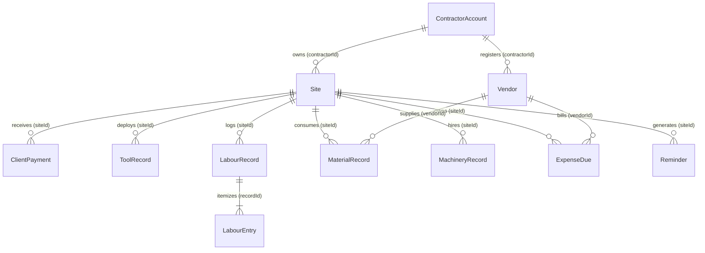
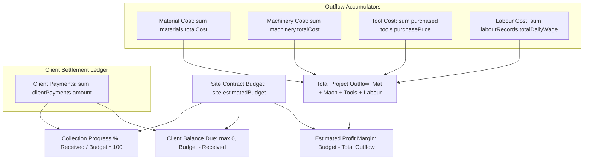

# SiteSaathi (साइट साथी) — Database Architecture & Data Model Documentation

> **Document Version:** 1.0.0  
> **Status:** Authoritative Database Reference & Source of Truth  
> **Target Audience:** Database Engineers, Full-Stack Architects, Security Auditors, Future AI Agents  
> **Classification:** Technical Reference Document  
> **Last Verified:** October 2026  
> **Codebase Baseline:** Dexie.js v4.4.5, dexie-react-hooks v4.4.0, IndexedDB API, TypeScript ~6.0.2  

---

## 1. Database Overview

### 1.1 Technology & Storage Architecture
- **Engine:** **IndexedDB** (W3C standard transactional client-side database).
- **ORM / Abstraction Layer:** **Dexie.js** (`v4.4.5`) coupled with **dexie-react-hooks** (`v4.4.0`).
- **Database Name:** `'SiteSaathiDB'` (`src/core/db/database.ts:45`).
- **Storage Subsystem:** Local file-backed storage sandbox managed by the client runtime:
  - **Desktop / Mobile Browsers:** Origin-partitioned storage (e.g. `IndexedDB/http_localhost_5173/` or production domain).
  - **Android APK (Capacitor):** Android System WebView application data directory (`/data/data/com.sitesaathi.app/app_webview/IndexedDB/`).
- **Cloud / Remote Synchronization:** **NONE.** The application is strictly 100% offline-first. There is no remote PostgreSQL, MySQL, MongoDB, Firebase, Supabase, or REST/GraphQL server persistence.
- **Active Schema Versions:**
  - **Version 2:** 10 core tables (`account`, `sites`, `tools`, `labourRecords`, `labourEntries`, `materials`, `machinery`, `dues`, `vendors`, `reminders`).
  - **Version 3:** Adds the `clientPayments` table for milestone cash-flow tracking.

### 1.2 Storage Lifecycle & Quota Considerations
- **Persistence Duration:** Data persists indefinitely across browser tabs, page reloads, device restarts, and airplane mode transitions.
- **Eviction Risk:** In Chromium and Android WebView, IndexedDB data is typically marked as "best-effort" storage unless persistent storage permission is requested via `navigator.storage.persist()`. If the host device faces critical disk storage shortages, browser engines may clear unpersisted site data.
- **Uninstallation Impact:** In an Android APK packaged via Capacitor, uninstalling the application permanently deletes the internal WebView data directory, destroying all IndexedDB data unless the contractor has previously generated a JSON backup file.

---

## 2. Complete Schema & Table Inventory

The database declares **11 entity tables** managed by the `SiteSaathiDatabase` class:

```mermaid
classDiagram
    class ContractorAccount {
        +string id [PK]
        +string name
        +string phone [Index]
        +TradeCategory trade [Index]
        +Language language
        +ThemeMode themeMode
        +string companyName
        +string password
        +string pinLock
        +boolean isPinLockEnabled
        +boolean isBiometricEnabled
        +boolean isAntiDeleteEnabled
        +boolean tutorialCompleted
        +string createdAt
    }

    class Site {
        +string id [PK]
        +string contractorId [Index]
        +string name
        +string location
        +string siteType
        +number estimatedBudget
        +SiteWorkStatus workStatus [Index]
        +SitePaymentStatus paymentStatus [Index]
        +string clientName
        +string clientPhone
        +string startDate [Index]
        +string expectedEndDate
        +string completedDate
        +string notes
        +string coverPhoto
        +string voiceNoteUrl
        +string createdAt
        +string updatedAt
    }

    class ClientPayment {
        +string id [PK]
        +string siteId [Index]
        +number amount
        +string paymentDate [Index]
        +PaymentMode paymentMode [Index]
        +string payerName
        +string referenceNo
        +string notes
        +string createdAt
    }

    class ToolRecord {
        +string id [PK]
        +string siteId [Index]
        +string name
        +number quantity
        +string size
        +string dateSent
        +string expectedReturnDate [Index]
        +string actualReturnDate
        +string sourceType
        +number purchasePrice
        +number rentOrRepairCost
        +string status [Index]
        +string notes
        +string photoUrl
    }

    class LabourRecord {
        +string id [PK]
        +string siteId [Index]
        +string date [Index]
        +string rawPhotoUrl
        +string ocrRawText
        +number totalWorkers
        +number totalDailyWage
        +number totalPaid
        +string notes
        +string voiceNoteUrl
    }

    class LabourEntry {
        +string id [PK]
        +string recordId [Index]
        +string workerName [Index]
        +string role
        +string attendanceStatus
        +number dailyWage
        +number paidAmount
        +number balanceDue
        +string paymentStatus
    }

    class MaterialRecord {
        +string id [PK]
        +string siteId [Index]
        +string vendorId [Index]
        +string itemName
        +number quantity
        +string unit
        +number unitPrice
        +number totalCost
        +string purchaseDate [Index]
        +string paymentStatus [Index]
        +number paidAmount
        +string receiptPhoto
        +string notes
    }

    class MachineryRecord {
        +string id [PK]
        +string siteId [Index]
        +string machineType
        +number fuelLitres
        +number fuelCost
        +number rentalHoursOrDays
        +number rentalCost
        +number totalCost
        +string logDate [Index]
        +string notes
    }

    class ExpenseDue {
        +string id [PK]
        +string siteId [Index]
        +string vendorId [Index]
        +string title
        +string category
        +number amountDue
        +number amountPaid
        +string dueDate [Index]
        +string status [Index]
        +string notes
    }

    class Vendor {
        +string id [PK]
        +string contractorId [Index]
        +string name [Index]
        +string phone
        +string tradeSpecialty
        +string[] materialsSupplied
        +number totalUdhaarBalance
    }

    class Reminder {
        +string id [PK]
        +string type [Index]
        +string siteId [Index]
        +string siteName
        +string title
        +string description
        +string dueDate [Index]
        +number amount
        +boolean isDismissed [Index]
    }
```



---

### 2.1 Table Specifications

#### 1. `account` Table
- **Dexie Index Spec:** `'id, trade, phone'`
- **TypeScript Model:** `ContractorAccount` (`src/types/index.ts:19-35`)
- **Primary Key:** `id: string` (e.g. `"contractor-1729210000000"`)
- **Indexes:** `id` (PK), `trade`, `phone`
- **Fields:**
  - `id` (string, required): Unique contractor identifier.
  - `name` (string, required): Contractor full name.
  - `phone` (string, required, indexed): 10-digit mobile number.
  - `trade` (TradeCategory, required, indexed): Primary trade (e.g., `'construction'`, `'plumbing'`).
  - `language` (Language, required): UI language preference (`'hi'` | `'en'`).
  - `themeMode` (ThemeMode, required): Theme mode setting (`'light'`).
  - `companyName` (string, optional): Firm / Company business name for PDF letterheads.
  - `email` (string, optional): Email contact.
  - `password` (string, optional): Plaintext password string (**Critical Security Vulnerability**).
  - `pinLock` (string, optional): 4-digit security PIN (**Critical Security Vulnerability**).
  - `isPinLockEnabled` (boolean, optional): Toggle for application lock screen.
  - `isBiometricEnabled` (boolean, optional): Toggle for biometric unlock.
  - `isAntiDeleteEnabled` (boolean, optional): Restricts database wipes behind a PIN challenge.
  - `tutorialCompleted` (boolean, required): Flag indicating if 5-step tutorial was finished.
  - `createdAt` (string, required): ISO-8601 creation timestamp.

---

#### 2. `sites` Table
- **Dexie Index Spec:** `'id, contractorId, workStatus, paymentStatus, startDate'`
- **TypeScript Model:** `Site` (`src/types/index.ts:51-70`)
- **Primary Key:** `id: string` (e.g. `"site-1729210000000"`)
- **Indexes:** `id` (PK), `contractorId`, `workStatus`, `paymentStatus`, `startDate`
- **Fields:**
  - `id` (string, required): Unique project identifier.
  - `contractorId` (string, required, indexed): References `account.id`.
  - `name` (string, required): Project / Site title (e.g., `"Sharma Villa"`).
  - `location` (string, required): Physical job location.
  - `siteType` (string, required): Category (`'Building'` | `'Residential'` | `'Commercial'` | `'Road'` | `'Dam'` | `'Bridge'` | `'Renovation'` | `'Industrial'` | `'Apartment'` | `'Other'`).
  - `estimatedBudget` (number, required): Total client contract amount in Rupees.
  - `workStatus` (SiteWorkStatus, required, indexed): `'planning'` | `'ongoing'` | `'completed'` | `'on_hold'`.
  - `paymentStatus` (SitePaymentStatus, required, indexed): `'unpaid'` | `'partially_paid'` | `'paid'`.
  - `clientName` (string, optional): Property owner or client name.
  - `clientPhone` (string, optional): Contact telephone number.
  - `startDate` (string, required, indexed): ISO or `YYYY-MM-DD` date.
  - `expectedEndDate` (string, optional): Target completion date.
  - `completedDate` (string, optional): Date marked completed.
  - `notes` (string, optional): Field notes and remarks.
  - `coverPhoto` (string, optional): Base64 or local photo URI.
  - `voiceNoteUrl` (string, optional): Audio recording attachment URI.
  - `createdAt` (string, required): ISO-8601 creation timestamp.
  - `updatedAt` (string, optional): Last modified timestamp.

---

#### 3. `clientPayments` Table (Added in Schema Version 3)
- **Dexie Index Spec:** `'id, siteId, paymentDate, paymentMode'`
- **TypeScript Model:** `ClientPayment` (`src/types/index.ts:39-49`)
- **Primary Key:** `id: string`
- **Indexes:** `id` (PK), `siteId`, `paymentDate`, `paymentMode`
- **Fields:**
  - `id` (string, required): Unique transaction record identifier.
  - `siteId` (string, required, indexed): References `sites.id`.
  - `amount` (number, required): Received payment amount in Rupees.
  - `paymentDate` (string, required, indexed): Date received (`YYYY-MM-DD`).
  - `paymentMode` (PaymentMode, required, indexed): `'UPI / Online'` | `'Cash'` | `'Bank Transfer'` | `'Cheque'`.
  - `payerName` (string, optional): Name of individual or entity paying.
  - `referenceNo` (string, optional): UTR, check number, or UPI transaction ID.
  - `notes` (string, optional): Milestone remarks (e.g. `"Roof Slab Advance"`).
  - `createdAt` (string, required): ISO-8601 timestamp.

---

#### 4. `tools` Table
- **Dexie Index Spec:** `'id, siteId, status, expectedReturnDate'`
- **TypeScript Model:** `ToolRecord` (`src/types/index.ts:72-87`)
- **Primary Key:** `id: string`
- **Indexes:** `id` (PK), `siteId`, `status`, `expectedReturnDate`
- **Fields:**
  - `id` (string, required): Tool entry ID.
  - `siteId` (string, required, indexed): Target job site (`sites.id`).
  - `name` (string, required): Equipment description (*"Shuttering Plates"*, *"Vibrator"*).
  - `quantity` (number, required): Number of units dispatched.
  - `size` (string, optional): Dimensions (*"4x4"*, *"2-inch"*).
  - `dateSent` (string, required): Date dispatched from warehouse.
  - `expectedReturnDate` (string, required, indexed): Scheduled return deadline.
  - `actualReturnDate` (string | null, optional): Date returned to warehouse.
  - `sourceType` (string, optional): `'self_owned'` | `'purchased_for_site'`.
  - `purchasePrice` (number, optional): Cost if purchased specifically for site.
  - `rentOrRepairCost` (number, optional): Rental fee or repair cost.
  - `status` (string, required, indexed): `'on_site'` | `'returned'` | `'overdue'`.
  - `notes` (string, optional): Maintenance or handling remarks.
  - `photoUrl` (string, optional): Picture of equipment.

---

#### 5. `labourRecords` Table
- **Dexie Index Spec:** `'id, siteId, date'`
- **TypeScript Model:** `LabourRecord` (`src/types/index.ts:101-113`)
- **Primary Key:** `id: string`
- **Indexes:** `id` (PK), `siteId`, `date`
- **Fields:**
  - `id` (string, required): Daily muster roll header ID.
  - `siteId` (string, required, indexed): Associated project site (`sites.id`).
  - `date` (string, required, indexed): Date of work (`YYYY-MM-DD`).
  - `rawPhotoUrl` (string, optional): Canvas bitmap of paper muster sheet.
  - `ocrRawText` (string, optional): Raw unparsed OCR text preserved from scan.
  - `totalWorkers` (number, required): Aggregate headcount for the day.
  - `totalDailyWage` (number, required): Total wages earned across all workers.
  - `totalPaid` (number, required): Total cash paid out as advances/wages today.
  - `notes` (string, optional): Supervisor notes.
  - `voiceNoteUrl` (string, optional): Voice note memo URI.

---

#### 6. `labourEntries` Table
- **Dexie Index Spec:** `'id, recordId, workerName'`
- **TypeScript Model:** `LabourEntry` (`src/types/index.ts:89-99`)
- **Primary Key:** `id: string`
- **Indexes:** `id` (PK), `recordId`, `workerName`
- **Fields:**
  - `id` (string, required): Individual worker row ID.
  - `recordId` (string, required, indexed): References `labourRecords.id`.
  - `workerName` (string, required, indexed): Full name of the worker.
  - `role` (string, required): `'Mason'` | `'Helper'` | `'Electrician'` | `'Plumber'` | `'Plasterer'` | `'Welder'` | `'Carpenter'` | `'Painter'` | `'Supervisor'`.
  - `attendanceStatus` (string, required): `'full_day'` (1.0x) | `'half_day'` (0.5x) | `'absent'` (0.0x) | `'overtime'`.
  - `dailyWage` (number, required): Base daily rate in Rupees.
  - `paidAmount` (number, required): Cash paid today.
  - `balanceDue` (number, required): Calculated as `dailyWage - paidAmount`.
  - `paymentStatus` (string, optional): `'paid'` | `'unpaid'` | `'advance'` | `'pending'`.

---

#### 7. `materials` Table
- **Dexie Index Spec:** `'id, siteId, vendorId, purchaseDate, paymentStatus'`
- **TypeScript Model:** `MaterialRecord` (`src/types/index.ts:115-129`)
- **Primary Key:** `id: string`
- **Indexes:** `id` (PK), `siteId`, `vendorId`, `purchaseDate`, `paymentStatus`
- **Fields:**
  - `id` (string, required): Material purchase ID.
  - `siteId` (string, required, indexed): Linked project site (`sites.id`).
  - `vendorId` (string, optional, indexed): Optional supplier reference (`vendors.id`).
  - `itemName` (string, required): Item name (*"Ultratech Cement"*, *"TMT Steel"*).
  - `quantity` (number, required): Quantity purchased.
  - `unit` (string, required): Measurement unit (`'plates (4x4)'` | `'bags'` | `'meters'` | `'kg'` | `'brass'` | `'truck'` | `'pieces'`).
  - `unitPrice` (number, required): Price per unit.
  - `totalCost` (number, required): Calculated as `quantity * unitPrice`.
  - `purchaseDate` (string, required, indexed): Purchase date (`YYYY-MM-DD`).
  - `paymentStatus` (string, required, indexed): `'paid'` | `'pending'` | `'partial'`.
  - `paidAmount` (number, required): Amount settled at time of purchase.
  - `receiptPhoto` (string, optional): Bill / delivery challan photo.
  - `notes` (string, optional): Quality or supplier notes.

---

#### 8. `machinery` Table
- **Dexie Index Spec:** `'id, siteId, logDate'`
- **TypeScript Model:** `MachineryRecord` (`src/types/index.ts:131-142`)
- **Primary Key:** `id: string`
- **Indexes:** `id` (PK), `siteId`, `logDate`
- **Fields:**
  - `id` (string, required): Machinery log entry ID.
  - `siteId` (string, required, indexed): Project site reference (`sites.id`).
  - `machineType` (string, required): `'Concrete Mixer'` | `'Tractor'` | `'JCB Excavator'` | `'Tower Crane'` | `'Generator'` | `'Breaker'` | `'Pipe Threader'` | `'Cable Puller'` | `'Other'`.
  - `fuelLitres` (number, optional): Diesel litres consumed.
  - `fuelCost` (number, optional): Fuel expense in Rupees.
  - `rentalHoursOrDays` (number, optional): Usage hours or operational days.
  - `rentalCost` (number, optional): Equipment hire charges.
  - `totalCost` (number, required): Total cost (`(fuelCost || 0) + (rentalCost || 0)`).
  - `logDate` (string, required, indexed): Operating date (`YYYY-MM-DD`).
  - `notes` (string, optional): Operator name or equipment remarks.

---

#### 9. `dues` Table
- **Dexie Index Spec:** `'id, siteId, vendorId, status, dueDate'`
- **TypeScript Model:** `ExpenseDue` (`src/types/index.ts:144-155`)
- **Primary Key:** `id: string`
- **Indexes:** `id` (PK), `siteId`, `vendorId`, `status`, `dueDate`
- **Fields:**
  - `id` (string, required): Payable entry ID.
  - `siteId` (string, required, indexed): Associated project site (`sites.id`).
  - `vendorId` (string, optional, indexed): Optional supplier link (`vendors.id`).
  - `title` (string, required): Payable description (*"Sand Supplier Payment"*).
  - `category` (string, required): `'material'` | `'tool_rent'` | `'machinery'` | `'labour'` | `'subcontract'` | `'other'`.
  - `amountDue` (number, required): Total bill amount.
  - `amountPaid` (number, required): Amount paid towards this bill.
  - `dueDate` (string, required, indexed): Promised settlement date (`YYYY-MM-DD`).
  - `status` (string, required, indexed): `'pending'` | `'paid'` | `'overdue'`.
  - `notes` (string, optional): Invoice or account notes.

---

#### 10. `vendors` Table
- **Dexie Index Spec:** `'id, contractorId, name'`
- **TypeScript Model:** `Vendor` (`src/types/index.ts:157-165`)
- **Primary Key:** `id: string`
- **Indexes:** `id` (PK), `contractorId`, `name`
- **Fields:**
  - `id` (string, required): Supplier profile ID.
  - `contractorId` (string, required, indexed): Contractor ownership link.
  - `name` (string, required, indexed): Supplier firm name.
  - `phone` (string, required): Contact mobile number.
  - `tradeSpecialty` (string, required): Material specialty (*"Building Materials"*, *"Electricals"*).
  - `materialsSupplied` (string[], optional): Item category tags.
  - `totalUdhaarBalance` (number, required): Running cumulative credit balance.

---

#### 11. `reminders` Table
- **Dexie Index Spec:** `'id, type, siteId, dueDate, isDismissed'`
- **TypeScript Model:** `Reminder` (`src/types/index.ts:167-177`)
- **Primary Key:** `id: string`
- **Indexes:** `id` (PK), `type`, `siteId`, `dueDate`, `isDismissed`
- **Fields:**
  - `id` (string, required): Reminder notification ID.
  - `type` (string, required, indexed): `'tool_overdue'` | `'payment_due'` | `'completed_site_due'` | `'labour_wage'`.
  - `siteId` (string, required, indexed): Linked site ID.
  - `siteName` (string, required): Denormalized site name for fast banner display.
  - `title` (string, required): Notification headline.
  - `description` (string, required): Body explanation.
  - `dueDate` (string, required, indexed): Trigger date.
  - `amount` (number, optional): Financial sum associated with reminder.
  - `isDismissed` (boolean, optional, indexed): Dismissal state.

---

## 3. Entity-Relationship Model & Referential Mechanics



### Referential Integrity Realities in IndexedDB
> [!IMPORTANT]
> **No Native Foreign Key Enforcement:** IndexedDB is an object-store engine, not a relational SQL database. It does not enforce `FOREIGN KEY REFERENCES`, `ON DELETE CASCADE`, or `CHECK` constraints at the storage layer. 

**Application-Level Enforcement:**
1. **Atomic Cascade Deletion (`database.ts:218-249`):** When `db.deleteSite(siteId)` is invoked, an explicit Dexie transaction locks all 9 child tables and systematically purges all rows matching `siteId`.
2. **Labour Entry Cascade (`database.ts:298-303`):** When `deleteLabourRecord(recordId)` is called, child `labourEntries` where `recordId == recordId` are deleted before removing the parent `labourRecord`.
3. **Startup Orphan Cleanup Sweep (`database.ts:64-114`):** If a child record's parent `siteId` is deleted outside a transaction, `db.cleanupOrphanRecords()` detects and deletes the orphaned record on next app launch.

---

## 4. Financial Calculation Engine & Mathematical Integrity

Financial summaries are derived dynamically in `db.getSiteFinanceSummary(siteId)` (`src/core/db/database.ts:310-364`) to prevent stale denormalized totals:



### Derived Financial Formulas

$$\text{Total Expense} = \sum \text{materials.totalCost} + \sum \text{machinery.totalCost} + \sum \text{tools.purchasePrice} + \sum \text{labourRecords.totalDailyWage}$$

$$\text{Estimated Profit} = \text{estimatedBudget} - \text{Total Expense}$$

$$\text{Profit Margin \%} = \begin{cases} \frac{\text{Estimated Profit}}{\text{estimatedBudget}} \times 100 & \text{if } \text{estimatedBudget} > 0 \\ 0 & \text{otherwise} \end{cases}$$

$$\text{Client Balance Due} = \max(0, \text{estimatedBudget} - \sum \text{clientPayments.amount})$$

$$\text{Unpaid Dues} = \sum_{\text{status} \neq \text{'paid'}} (\text{amountDue} - \text{amountPaid})$$

---

## 5. Backup, Restore & Data Migration Engine

### 5.1 JSON Backup Serialization (`exportBackupJson`)
`src/core/db/database.ts:438-456` produces a formatted JSON payload containing the entire client database:

```json
{
  "app": "SiteSaathi",
  "version": 2,
  "exportedAt": "2026-10-18T00:00:00.000Z",
  "account": [ /* ContractorAccount records */ ],
  "sites": [ /* Site records */ ],
  "tools": [ /* ToolRecord records */ ],
  "labourRecords": [ /* LabourRecord records */ ],
  "labourEntries": [ /* LabourEntry records */ ],
  "materials": [ /* MaterialRecord records */ ],
  "machinery": [ /* MachineryRecord records */ ],
  "dues": [ /* ExpenseDue records */ ],
  "vendors": [ /* Vendor records */ ],
  "reminders": [ /* Reminder records */ ],
  "clientPayments": [ /* ClientPayment records */ ]
}
```

### 5.2 JSON Backup Restoration (`importBackupJson`)
- **Validation:** Verifies that parsed JSON is valid and contains `data.sites` and `data.account`. Throws `'Invalid backup file format'` if missing.
- **Transaction:** Wraps all 11 tables in a single atomic read-write transaction (`'rw'`).
- **Insertion Strategy:** Uses `bulkPut` across all arrays. This acts as an **upsert** (inserts new IDs, updates existing matching IDs), preserving non-conflicting records while restoring backup state.
- **Reload:** Triggers `window.location.reload()` upon completion to refresh all reactive UI subscriptions.

---

## 6. Authentication & Cross-Account Isolation Vulnerabilities

### 6.1 Logical Account Partitioning vs Storage Sandbox
- **Implementation Reality:** Contractor records use `contractorId` on `sites` and `vendors`.
- **Query Isolation Gap:** All accounts on a device reside within the **same single IndexedDB database (`SiteSaathiDB`)**.
- **No Cryptographic Isolation:** While `src/App.tsx` filters records using `activeAccountId`, any JavaScript execution or DevTools inspection can query the entirety of `SiteSaathiDB` across all contractor accounts.

### 6.2 Credential Storage Finding (`SEC-DEF-001`)
- **Audit:** Passwords (`account.password`) and security PINs (`account.pinLock`) are written to IndexedDB as unhashed plaintext strings.
- **Impact:** Anyone with device access or a copy of the exported JSON backup file can immediately view the user's plain text credentials.

---

## 7. Data Access Patterns & Calling Modules Matrix

| Table Name | Insert Module / Calling File | Primary Query Pattern | Delete Trigger |
| :--- | :--- | :--- | :--- |
| **`account`** | `AuthScreen.tsx:151` (`put`) | `.where('phone').equals(cleanPhone)` | `SettingsModal.tsx` (`clearAllData`) |
| **`sites`** | `AddSiteModal.tsx:162`, `VoiceInputModal.tsx` (`put`) | `.toArray()` / `.get(siteId)` | `App.tsx:246` $\to$ `db.deleteSite(siteId)` |
| **`clientPayments`**| `RecordClientPaymentModal.tsx:88` | `.where('siteId').equals(siteId)` | `SiteDetailsModal.tsx` $\to$ `deleteClientPayment` |
| **`tools`** | `AddToolModal.tsx:112` (`put`) | `.where('siteId').equals(siteId)` | `db.deleteTool(id)` or `deleteSite(siteId)` |
| **`labourRecords`**| `AddLabourModal.tsx:142`, `PhotoOcrModal.tsx` | `.where('siteId').equals(siteId)` | `db.deleteLabourRecord(id)` or `deleteSite` |
| **`labourEntries`**| `AddLabourModal.tsx:151` (`bulkPut`) | `.where('recordId').equals(recId)` | Cascaded via `deleteLabourRecord` or `deleteSite` |
| **`materials`** | `AddMaterialModal.tsx:135` (`put`) | `.where('siteId').equals(siteId)` | `db.deleteMaterial(id)` or `deleteSite` |
| **`machinery`** | `AddMachineryModal.tsx:120` (`put`) | `.where('siteId').equals(siteId)` | `db.deleteMachinery(id)` or `deleteSite` |
| **`dues`** | `AddDueModal.tsx:115` (`put`) | `.where('siteId').equals(siteId)` | `db.deleteDue(id)` or `deleteSite` |
| **`vendors`** | `database.ts:177` (seed) / Settings | `.where('contractorId').equals(id)`| `clearAllData()` |
| **`reminders`** | `database.ts:178` (seed) / Insights | `.where('siteId').equals(siteId)` | `deleteSite` / `clearAllData()` |

---

## 8. Database Maintenance Guidelines for Future Developers

> [!IMPORTANT]
> **GUIDELINES FOR FUTURE SCHEMA CHANGES:**
> When adding tables or modifying indexes, future developers and AI agents must follow these rules:

1. **Never Change Schema In-Place Without Incrementing Version:**
   - Always add a new version call (e.g. `this.version(4).stores({ ... })`). Modifying existing version strings breaks IndexedDB on active user devices.
2. **Update Cascade Deletion Routine:**
   - If a new child table referencing `siteId` is introduced, it **must** be added to `db.deleteSite()` inside the atomic transaction array and delete loop.
3. **Update Backup Export & Import Lists:**
   - Add new tables to both `exportBackupJson()` and `importBackupJson()` to ensure user data remains fully exportable.
4. **Update Orphan Sweep Routine:**
   - Add new child tables to `cleanupOrphanRecords()` to maintain zero-orphan storage hygiene.
5. **Preserve String Primary Keys:**
   - Use string-based timestamp/random keys (e.g. `'rec-' + Date.now() + '-' + Math.random()`) to avoid auto-increment collisions during backup imports.
