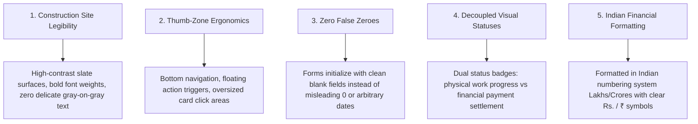
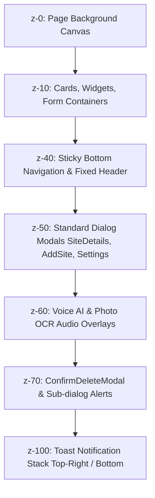
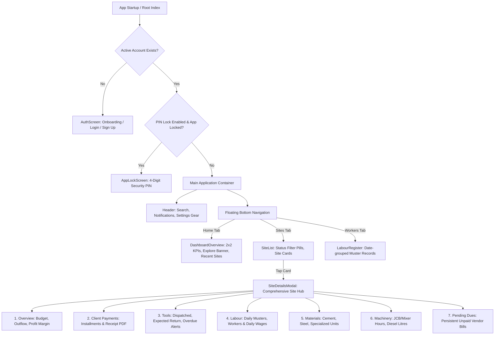
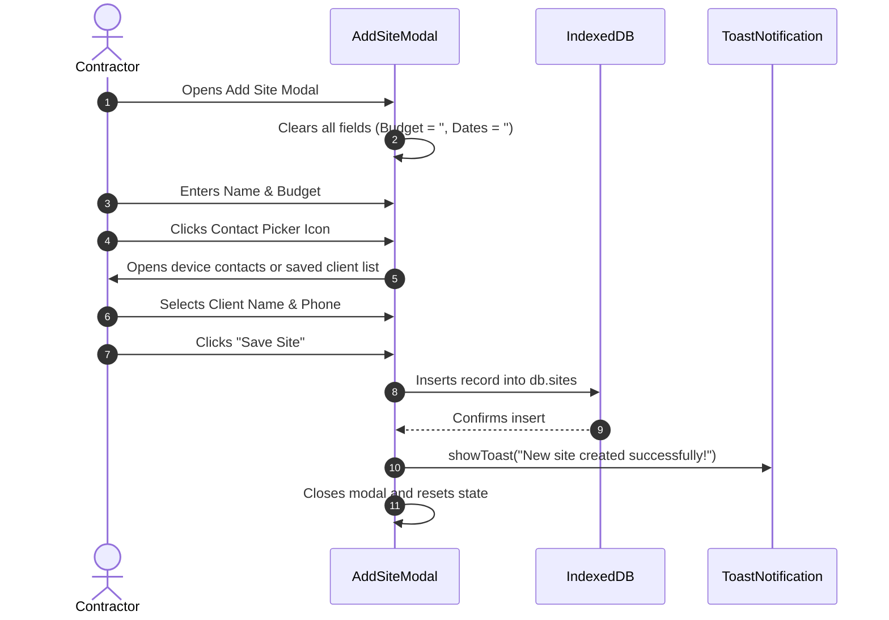

# SiteSaathi (साइट साथी) — Design System & UI/UX Documentation

> **Document Version:** 1.0.0  
> **Status:** Authoritative Design Source of Truth  
> **Audience:** UI/UX Designers, Frontend Engineers, QA Engineers, Future AI Coding Agents  
> **Classification:** Baseline Design System Documentation  
> **Last Verified:** October 2026  
> **Codebase Stack:** React 19, TypeScript 5, Vite 8, Tailwind CSS v4, Dexie.js v4, Lucide React, Capacitor 8  

---

## 1. Executive Summary & Core Design Philosophy

**SiteSaathi** is a specialized, mobile-first construction site-management application built specifically for Indian civil contractors, trade thekedars, and site supervisors.

The physical operating environment of construction sites—bright outdoor sunlight, dust, wet hands, noisy machinery, and intermittent cellular connectivity—dictates the entire visual and interaction architecture of SiteSaathi:
1. **High-Contrast Outdoor Readability:** Eliminates low-contrast text and muddy dark modes in favor of a crisp, daylight-optimized **Unified Professional Light Theme** with high contrast ratios.
2. **Tactile Touch Targets:** All interactive buttons and cards feature generous touch targets (minimum $44 \times 44\text{px}$) with tactile active feedback (`transform: scale(0.97)`).
3. **Frictionless Fast Entry:** Bypasses tedious multi-field mobile typing through **Natural Hindi/English Voice-to-Form Auto-Fill** and **Handwritten Diary Photo OCR**.
4. **Bilingual Devanagari Parity:** Treats Hindi (`हिंदी`) and English as first-class peers using specialized typography (`Hind` font family for Devanagari script).
5. **Unified Monochromatic Aesthetic with Single Accent:** The core interface relies on clean neutral slate surfaces (`#F8FAFC`, `#FFFFFF`, `#0F172A`) unified by exactly **one primary brand accent color** (Professional Blue `#2563EB`), preserving visual calmness across complex financial ledgers.

---

## 2. Visual Direction & Design Principles

### 2.1 The 5 Non-Negotiable Design Pillars



1. **Construction Site Legibility:** Designed for supervisors standing under bright mid-day sun. Surfaces use solid white (`#FFFFFF`) or subtle slate (`#F8FAFC`) with crisp borders (`#E2E8F0`) and dark headings (`#0F172A`).
2. **Thumb-Zone Ergonomics:** Key navigation resides in a floating, pill-shaped bottom bar. Critical creation actions (New Site, Scan, Voice Log) are accessible from the top dashboard hero banner.
3. **Zero False Zeroes ("0" Suppression):** When creating a new site or logging items, numeric inputs (budget, rate, target dates) start completely blank, preventing accidental `₹0` commits or unintentional target date saves.
4. **Decoupled Visual Statuses:** Physical job progress (`Ongoing`, `Completed`, `Planning`, `On Hold`) is visually decoupled from financial settlement (`Unpaid`, `Partially Paid`, `Paid`) using independent badge colorways.
5. **Indian Financial Formatting:** All currency amounts use Indian Lakh / Thousand separators (`₹15,00,000`, `₹45,000`) with legible tabular numerals.

---

## 3. Color Architecture & Design Tokens

### 3.1 CSS Custom Properties (`src/index.css`)

The application defines its token system in `src/index.css` under the `@layer base` root selector:

```css
:root {
  /* Unified Monochromatic Theme System with Exactly 1 Accent Color (Professional Blue #2563EB) */
  --theme-name: 'unified-pro';
  --font-heading: 'Outfit', -apple-system, BlinkMacSystemFont, 'Segoe UI', sans-serif;
  --font-body: 'Plus Jakarta Sans', 'Hind', -apple-system, BlinkMacSystemFont, sans-serif;

  /* Primary Accent Token Scale */
  --color-primary: #2563EB;        /* Tailwind blue-600 */
  --color-primary-hover: #1D4ED8;  /* Tailwind blue-700 */
  --color-primary-dark: #1E40AF;   /* Tailwind blue-800 */
  --color-primary-light: #EFF6FF;  /* Tailwind blue-50 */
  --color-primary-glow: rgba(37, 99, 235, 0.12);

  /* Secondary & Brand Base */
  --color-secondary: #0F172A;      /* Tailwind slate-900 */
  --color-secondary-hover: #1E293B;/* Tailwind slate-800 */
  --color-accent: #2563EB;

  /* Background & Surface Tokens (Light Mode Baseline) */
  --color-bg-base: #F8FAFC;        /* Slate-50 */
  --color-bg-surface: #FFFFFF;     /* Pure White */
  --color-bg-card: #FFFFFF;        /* Pure White Card */
  --color-bg-elevated: #F1F5F9;    /* Slate-100 */
  --color-bg-subtle: #F8FAFC;      /* Slate-50 */

  /* Border & Divider Tokens */
  --color-border: #E2E8F0;        /* Slate-200 */
  --color-border-hover: #CBD5E1;  /* Slate-300 */
  --color-border-focus: #2563EB;  /* Blue-600 */

  /* Typography Text Color Tokens */
  --color-text-main: #0F172A;      /* Slate-900 (High contrast) */
  --color-text-muted: #64748B;     /* Slate-500 */
  --color-text-subtle: #94A3B8;    /* Slate-400 */
  --color-text-inverse: #FFFFFF;   /* White */

  /* Trade Badge Defaults */
  --trade-badge-bg: #EFF6FF;       /* Blue-50 */
  --trade-badge-text: #1D4ED8;     /* Blue-700 */
  --trade-badge-border: #DBEAFE;   /* Blue-100 */

  /* Border Radii Tokens */
  --radius-sm: 0.375rem;           /* 6px */
  --radius-md: 0.5rem;             /* 8px */
  --radius-lg: 0.75rem;            /* 12px */
  --radius-xl: 1rem;               /* 16px */
}
```

### 3.2 Semantic Status & Feedback Color Palette

| Status Type | Background Class | Text Class | Border Class | Icon / Dot Indicator | Usage |
| :--- | :--- | :--- | :--- | :--- | :--- |
| **Work: Ongoing** | `bg-amber-50` (`#FFFBEB`) | `text-amber-700` (`#B45309`) | `border-amber-200` | Pulsing amber dot (`bg-amber-500 animate-pulse`) | Active site construction |
| **Work: Completed** | `bg-emerald-50` (`#ECFDF5`) | `text-emerald-700` (`#047857`) | `border-emerald-200`| CheckCircle2 (`text-emerald-600`) | Finished project work |
| **Work: Planning** | `bg-blue-50` (`#EFF6FF`) | `text-blue-700` (`#1D4ED8`) | `border-blue-200` | Clock icon (`w-3 h-3`) | Mobilization phase |
| **Work: On Hold** | `bg-slate-100` (`#F1F5F9`) | `text-slate-700` (`#334155`) | `border-slate-300` | Static gray pill | Temporarily paused |
| **Payment: Unpaid** | `bg-red-50` (`#FEF2F2`) | `text-red-600` (`#DC2626`) | `border-red-200` | Solid red badge | Zero client payments received |
| **Payment: Partial** | `bg-orange-50` (`#FFF7ED`)| `text-orange-700` (`#C2410C`)| `border-orange-200`| Amber badge | Advance payments logged |
| **Payment: Paid** | `bg-green-50` (`#F0FDF4`) | `text-green-700` (`#15803D`) | `border-green-200` | Green badge | Full contract budget settled |
| **Alert: Overdue** | `bg-rose-50` (`#FFF1F2`) | `text-rose-700` (`#BE123C`) | `border-rose-200` | AlertCircle | Equipment past return date |

### 3.3 Trade Visual Configurations (`src/core/theme/tradeConfigs.ts`)

While global buttons adhere to the unified Blue `#2563EB` accent, the 11 construction trades feature distinct visual identities in onboarding, settings, and quick-add categories:

| Trade ID | English Label | Hindi Label | Canonical Primary Accent | Badge BG / Text | Icon |
| :--- | :--- | :--- | :---: | :--- | :--- |
| `construction` | General Construction | सामान्य निर्माण (सिविल) | `#2563EB` (Blue) | `#EFF6FF` / `#1D4ED8` | `Building2` |
| `plumbing` | Plumbing & Sanitary | प्लंबिंग व सेनेटरी | `#0284C7` (Sky/Aqua) | `#F0F9FF` / `#0369A1` | `Wrench` |
| `electrical` | Electrical & Wiring | इलेक्ट्रिकल व वायरिंग | `#D97706` (Amber) | `#FFFBEB` / `#B45309` | `Zap` |
| `painting` | Painting & Polishing | पेंटिंग, पुट्टी व पॉलिश | `#7C3AED` (Purple) | `#F5F3FF` / `#6D28D9` | `Paintbrush` |
| `carpentry` | Carpentry & Woodwork | बढ़ई व फर्नीचर | `#B45309` (Warm Amber)| `#FEF3C7` / `#92400E` | `Hammer` |
| `fabrication`| Fabrication & Welding | फैब्रिकेशन व लोहार | `#475569` (Slate) | `#F1F5F9` / `#334155` | `Shield` |
| `flooring` | Tiling & Marble | टाइल, मार्बल व ग्रेनाइट | `#0D9488` (Teal) | `#F0FDFA` / `#0F766E` | `Layers` |
| `ceiling` | POP & False Ceiling | पीओपी व फॉल्स सीलिंग | `#6366F1` (Indigo) | `#EEF2FF` / `#4338CA` | `Grid` |
| `hvac` | HVAC & Air Conditioning| एसी व वेंटिलेशन | `#0EA5E9` (Cyan) | `#F0F9FF` / `#0284C7` | `Wind` |
| `interior` | Interior Fit-out | इंटीरियर व डेकोरेशन | `#EC4899` (Pink) | `#FDF2F8` / `#BE185D` | `Sparkles` |
| `infra` | Infrastructure & Road | सड़क, पुल व इंफ्रास्ट्रक्चर| `#E11D48` (Rose) | `#FFF1F2` / `#BE123C` | `Truck` |

---

## 4. Typography System

### 4.1 Font Families (`index.html` & `src/index.css`)

```html
<link href="https://fonts.googleapis.com/css2?family=Plus+Jakarta+Sans:wght@400;500;600;700;800&family=Outfit:wght@500;600;700;800;900&family=Hind:wght@400;500;600;700&display=swap" rel="stylesheet">
```

| Font Role | Font Family | Weights Loaded | Purpose |
| :--- | :--- | :--- | :--- |
| **Heading Font** | `Outfit`, -apple-system, sans-serif | `500, 600, 700, 800, 900` | High-impact geometric display headers (`h1-h6`), KPI numerals, modal titles |
| **Body Font (Latin)** | `Plus Jakarta Sans`, sans-serif | `400, 500, 600, 700, 800` | Clean, modern sans-serif for forms, table cells, helper text, and button labels |
| **Body Font (Devanagari)**| `Hind`, sans-serif | `400, 500, 600, 700` | Indian regional typography standard ensuring proper matra positioning and high Hindi legibility |

### 4.2 Type Hierarchy Scale

| Semantic Level | Font Family | Size (Mobile / Desktop) | Weight | Line Height | Tailwind Classes |
| :--- | :--- | :--- | :--- | :--- | :--- |
| **Screen Title (`h1`)** | `Outfit` | `18px / 22px` (`1.125rem - 1.375rem`) | `900 (Black)` | `1.2` | `text-lg sm:text-xl font-black font-heading` |
| **Card / Modal Title (`h2-h3`)**| `Outfit` | `16px / 18px` (`1.0rem - 1.125rem`) | `700 (Bold)` | `1.3` | `text-base sm:text-lg font-bold font-heading` |
| **Section Header (`h4`)** | `Outfit` | `14px / 15px` (`0.875rem - 0.9375rem`) | `700 (Bold)` | `1.35` | `text-sm font-bold font-heading` |
| **Body Regular** | `Plus Jakarta Sans / Hind` | `13px / 14px` (`0.8125rem - 0.875rem`) | `500 (Medium)` | `1.45` | `text-xs sm:text-sm font-medium` |
| **Helper / Caption** | `Plus Jakarta Sans / Hind` | `11px / 12px` (`0.6875rem - 0.75rem`) | `500 (Medium)` | `1.3` | `text-[11px] sm:text-xs text-slate-500` |
| **Micro Badge / Timestamp** | `Plus Jakarta Sans` | `9px / 10px` (`0.5625rem - 0.625rem`) | `800 (ExtraBold)`| `1.1` | `text-[9px] font-extrabold uppercase tracking-wider` |
| **Numeric KPI Hero** | `Outfit` | `24px / 28px` (`1.5rem - 1.75rem`) | `900 (Black)` | `1.1` | `text-2xl sm:text-3xl font-black font-heading` |

---

## 5. Spacing, Elevation & Layout System

### 5.1 Base Spacing & Container Rules
- **Base Grid Unit:** $4\text{px}$ (`0.25rem`). Standard Tailwind increments (`p-2` = 8px, `p-3.5` = 14px, `p-5` = 20px).
- **Mobile Viewport Max-Width:** The core workspace is bounded inside a mobile-friendly column:
  - Phone View: Full width (`100vw`) up to `640px`.
  - Tablet Simulator Mode: Bounded to `680px`.
  - Desktop Simulator Mode: Bounded inside `MobileDeviceShell` (`max-w-md` / `410px`).
- **Page Padding:** `px-3.5 py-3` with a mandatory bottom padding of `pb-20` to prevent content overlap by the sticky bottom navigation bar.

### 5.2 Elevation & Shadow Hierarchy

| Token Name | Box Shadow Value | Usage |
| :--- | :--- | :--- |
| `shadow-2xs` | `0 1px 2px 0 rgba(0, 0, 0, 0.05)` | Small icon buttons in header |
| `shadow-xs` | `0 1px 3px 0 rgba(0, 0, 0, 0.08)` | Action badges, input fields |
| `shadow-sm` | `0 2px 8px -1px rgba(0, 0, 0, 0.06)` | Site cards, list rows |
| `shadow-md` | `0 4px 14px -2px rgba(24, 119, 242, 0.25)` | Primary CTA buttons, Floating Bottom Nav |
| `shadow-2xl` | `0 25px 50px -12px rgba(0, 0, 0, 0.25)` | Centered dialog modals, Sheet drawers |
| `glow-theme` | `0 4px 20px -2px var(--color-primary-glow)` | Primary active focus rings & highlights |

### 5.3 Z-Index Layering Convention



---

## 6. Reusable UI Component Directory

### 6.1 Action Buttons

#### Primary Gradient Button (`.btn-tactile`)
- **Visuals:** `bg-gradient-to-r from-[#1877F2] to-[#0084FF] text-white rounded-2xl shadow-md font-bold`
- **Tactile Feedback:** Scales to `0.97` on active press.
- **Usage:** "Save Site", "Create Account", "Save Labour Register".

#### Secondary Neutral Button
- **Visuals:** `bg-slate-100 dark:bg-slate-800 text-slate-700 dark:text-slate-200 hover:bg-slate-200 rounded-2xl border border-slate-200 font-semibold text-xs`
- **Usage:** "Cancel", "Back", "Close".

#### Destructive Action Button
- **Visuals:** `bg-red-600 hover:bg-red-700 text-white rounded-2xl shadow-sm text-xs font-bold`
- **Usage:** "Delete Site", "Wipe All Data" (paired with `ConfirmDeleteModal`).

---

### 6.2 Form Inputs & Text Fields

#### Standard Text & Phone Input
- **Container:** `relative rounded-2xl border border-slate-200/80 bg-white py-2.5 px-3.5 text-xs text-slate-900 placeholder:text-slate-400 focus:outline-none focus:ring-2 focus:ring-blue-500`
- **Prefix Icon:** Left-aligned icon (`MapPin`, `Phone`, `User`) positioned at `inset-y-0 left-0 pl-3.5 flex items-center text-slate-400`.
- **Specialized Behavior:** Spinners hidden on numeric inputs (`input[type=number] { appearance: textfield; }`).

---

### 6.3 Floating Bottom Navigation Bar (`src/components/common/BottomNav.tsx`)
- **Structure:** Pill-shaped floating bar pinned to `sticky bottom-2 sm:bottom-3`.
- **Styling:** `max-w-[260px] sm:max-w-[280px] mx-auto bg-white/95 backdrop-blur-xl border border-slate-200/80 rounded-full py-1.5 px-3 shadow-[0_12px_40px_rgba(0,0,0,0.14)]`.
- **Tabs (Strictly 3 Core Items):**
  1. 🏠 **Home** (`LayoutDashboard`) — Real-time overview & 2x2 KPIs.
  2. 🏢 **Sites** (`Building2`) — Complete project directory & finance drilldowns.
  3. 👥 **Workers** (`Users`) — Daily attendance muster roll & wages.
- **Active Indicator:** Gradient circle `w-10 h-10 rounded-full bg-gradient-to-r from-[#1877F2] to-[#0084FF] text-white shadow-[0_4px_14px_rgba(24,119,242,0.45)] scale-105`.

---

### 6.4 Toast Notification Stack (`src/components/common/ToastNotification.tsx`)
- **Positioning:** Fixed top-right or bottom-right stack (`z-[100] max-w-sm pointer-events-none`).
- **Variants:**
  - `success`: Emerald icon + emerald progress bar (`duration: 3500ms`).
  - `error`: Rose icon + rose progress bar.
  - `info`: Sky blue icon + sky progress bar.
- **Animation:** Real-time countdown progress bar shrinking along the bottom border of the toast card.

---

### 6.5 Interactive 3D Mascot Banner (`src/components/discovery/ExploreBanner.tsx`)
- **Visuals:** Pastel gradient banner (`bg-gradient-to-r from-[#D7EBFF] via-[#E2EEFF] to-[#FFE8DA] rounded-[26px] p-3.5 border border-blue-100/70`).
- **Left Column:** Interactive 3D builder character that rotates dynamically upon user touch/drag (`Interactive3DCharacter.tsx`).
- **Right Column (3 Fast-Action Buttons):**
  1. 🎙️ **Voice Log** (`Mic` icon, blue badge)
  2. 📷 **Scan** (`Camera` icon, purple badge)
  3. ➕ **New Site** (`Plus` icon, solid blue gradient)

---

## 7. Navigation Architecture & User Journeys



---

## 8. Screen-by-Screen Layout Specifications

### 8.1 Authentication & Welcome Screen (`src/components/auth/AuthScreen.tsx`)
- **Layout Regions:**
  - **Top Bar:** Bilingual Language Toggle (`हिंदी` / `English`) with globe icon.
  - **Hero Center:** Monochromatic Blue logo, "SiteSaathi" title, contractor value proposition.
  - **Trade Selector Grid:** 3 main trade cards (Construction, Plumbing, Electrical) with active border highlight.
  - **Action Buttons:** "Sign In" (Welcome Back) vs. "Create Account" (Sign Up).
  - **Saved Accounts Drawer:** Horizontal scroll cards of contractor accounts stored on this device.

---

### 8.2 Dashboard Overview (`src/components/dashboard/DashboardOverview.tsx`)
- **Layout Regions:**
  - **Greeting Header:** Contractor avatar circle with initials, user name, notification bell with unread badge, and global search bar.
  - **Explore Banner:** Pastel gradient banner with 3D rotating character and Voice / Scan / New Site action triggers.
  - **2x2 KPI Metric Cards:** Active Sites, Workers Today, Overdue Tools, Pending Dues.
  - **Client Payment Progress Card:** Contract budget, total cash collected, remaining client balance due, and animated progress bar.
  - **Recent Sites List:** Vertical list of active project cards with instant drilldown.

---

### 8.3 Site Details Drilldown Modal (`src/components/sites/SiteDetailsModal.tsx`)
- **Layout Regions:**
  - **Header Bar:** Site name, project type badge, work status pill, payment status badge, and close button.
  - **Financial Summary Hero:** 4-column metric box displaying Contract Budget, Total Outflow, Net Margin (Profit), and Unpaid Dues.
  - **Horizontal Sub-tab Navigation:** Horizontal scrollable tab strip with 7 sub-modules (`Overview`, `Client Payments`, `Tools`, `Labour`, `Materials`, `Machinery`, `Pending Dues`).
  - **Data Panel:** Tabular logs, item cards, and 1-click action triggers (`+ Record Payment`, `+ Add Tool`, `+ Daily Muster`).
  - **Footer Actions:** Standalone "PDF Report" export button generating a multi-page client statement.

---

### 8.4 Labour Register View (`src/components/labour/LabourRegister.tsx`)
- **Layout Regions:**
  - **Header:** Title, total dates logged counter, "+ Daily Muster" button, and "Scan Photo (OCR)" button.
  - **Site Filter Pills:** Horizontal scrollable pills filtering muster records by specific sites or showing "All Sites".
  - **Date Grouping Cards:** Accordion-style cards organized by date, showing total workers, daily wage total, and drilldown arrow to view worker entries.

---

### 8.5 Settings Modal (`src/components/settings/SettingsModal.tsx`)
- **Layout Regions:**
  - **Contractor Profile Card:** Name, phone, company name, email with "Edit Profile" drawer.
  - **Trade Selection Strip:** Quick-switcher across 11 trade categories.
  - **App Security Section:** 4-digit PIN Lock toggle, master PIN setter, and Anti-Delete protection toggle.
  - **Backup & Restore Section:** "Export Backup" (downloads JSON) and "Import Backup" (file input picker).
  - **Danger Zone:** "Clear All Data" (triggers PIN prompt and confirmation modal) and "Log Out".

---

## 9. Form Ergonomics & Interaction Patterns



### 9.1 Form Field Principles
1. **No Default Zeroes:** Currency and quantity fields are initialized to empty strings `""`. Users never have to backspace a `0` before typing.
2. **Contact Picker Integration:** Phone number inputs feature a phonebook icon that triggers the native Web Contact Picker API (`navigator.contacts.select`) with an in-app client history fallback.
3. **Instant Validation Banners:** Validation errors appear in a prominent, red-bordered callout banner at the top of the form, preventing silent failures.
4. **Duplicate Submission Lock:** Submit buttons disable and show an animated spinner (`Loader2 className="animate-spin"`) upon click, preventing double-tap duplicate records.

---

## 10. Motion, Micro-Interactions & Transitions

| Interaction | Class / Selector | Duration / Timing Function | Visual Transformation |
| :--- | :--- | :--- | :--- |
| **Tactile Button Press** | `.btn-tactile:active` | `0.15s cubic-bezier(0.4, 0, 0.2, 1)` | Scales element to `0.97` with slight opacity dip |
| **Tab & View Fade In** | `.animate-fade-in` | `0.15s cubic-bezier(0.16, 1, 0.3, 1)` | Opacity transition from `0` to `1` |
| **Modal Sheet Slide In** | `.animate-slide-in` | `0.20s cubic-bezier(0.16, 1, 0.3, 1)` | Opacity `0` to `1` + translate Y from `6px` to `0` |
| **Token Cross-Fade** | `html, body, [data-trade]` | `0.20s cubic-bezier(0.4, 0, 0.2, 1)` | Background, border, and text color cross-fade |
| **Table Row Hover** | `.table-row-hover:hover` | `0.15s ease` | Background tint `rgba(241, 245, 249, 0.7)` |
| **Reduced Motion Fallback**| `@media (prefers-reduced-motion)`| `0.01ms !important` | Instantly disables all animations and transitions |

---

## 11. Responsive Breakpoints & Device Adaptation

```
Mobile-First Viewport (< 640px)
├── Native full-bleed layout (100% width, safe-top / safe-bottom insets)
├── Stacked form inputs and vertical card flows
└── Sticky bottom navigation with 3 core touch items

Tablet Viewport (640px – 1024px)
├── 2-column grid layouts for site cards and forms
├── Centered modal dialogs (max-w-lg)
└── Horizontal date pickers with expanded scrollable tracks

Desktop Viewport (> 1024px)
├── Rendered inside MobileDeviceShell container with device simulator frame
├── Simulator controls: Mobile (410px), Tablet (680px), Fullscreen (max-w-4xl)
└── Realistic status bar (9:41, WiFi, Battery indicator)
```

---

## 12. Accessibility (a11y) Evaluation & Standards

### 12.1 Implemented Accessibility Features
1. **Color Contrast:** Headers and body text (`#0F172A`) against surface white (`#FFFFFF`) provide an exceptional contrast ratio of **15.8:1**, comfortably exceeding WCAG 2.2 AA ($4.5:1$).
2. **Touch Target Size:** Primary action buttons, tabs, and header icons adhere to minimum dimensions of **$40 \times 40\text{px}$ to $48 \times 48\text{px}$**.
3. **Color-Independent Status Indicators:** Status badges pair color with distinctive typography labels and unique iconography (e.g., CheckCircle2 for Completed, Clock for Planning, Pulsing Dot for Ongoing).
4. **Motion Reduction:** Full `@media (prefers-reduced-motion: reduce)` block in `src/index.css` forcing animation duration to `0.01ms`.

### 12.2 Known Accessibility Gaps (Documented for Future Sprints)
- **Modal Focus Trapping:** Dialog modals currently lack keyboard `Tab` focus trap loops and `aria-modal="true"` attributes.
- **Icon Button Accessible Names:** Some icon-only buttons (e.g., SlidersHorizontal in header) rely on `title` attributes rather than explicit `aria-label`.

---

## 13. Localization & Devanagari Hindi Layout Behavior

- **Bilingual Store:** `src/core/i18n/translations.ts` maintains synchronized dictionaries for English (`en`) and Hindi (`hi`).
- **Text Expansion Accommodation:** Hindi translations typically occupy **15% to 25% more horizontal space** than English equivalents.
  - *Mitigation:* Buttons and card titles use `truncate` or `line-clamp-1` with flexible container wrap properties (`flex-wrap`).
- **Script Rendering:** Uses Google's `Hind` font family to prevent clipping of upper and lower Devanagari matras (मात्राएं).
- **Number System:** Numerals remain Latin digits (`0-9`) with Indian separator commas (`en-IN` format: `15,00,000`) for universal contractor familiarity across both language modes.

---

## 14. Design Consistency Rules for Future Engineering

> [!IMPORTANT]
> **MANDATORY RULES FOR FUTURE AI CODING AGENTS & DEVELOPERS:**
> To protect the visual and architectural integrity of SiteSaathi, all future modifications must adhere strictly to these rules:

1. **Never Change the Primary Accent Palette:** Do not reintroduce custom ad-hoc colors. All primary CTAs, active highlights, and focus borders must use `var(--color-primary)` (`#2563EB`).
2. **Enforce Single Light Mode:** Do not reintroduce dark mode toggle buttons in Settings. The app strictly enforces a high-contrast light theme optimized for outdoor construction job sites.
3. **Never Re-introduce Default "0" in Form Fields:** When adding new form modals, numeric fields must initialize as empty strings `""`, never `0`.
4. **Preserve Tactile Classes:** Every button must use `.btn-tactile` to preserve the native mobile app feel.
5. **Maintain Decoupled Statuses:** Never combine `workStatus` and `paymentStatus` into a single field; always maintain separate visual badges.
6. **Preserve Indian Number Formatting:** Always format currency numbers with `.toLocaleString('en-IN')` prefixed by `₹` or `Rs.`.
7. **Protect the 3-Item Bottom Navigation:** Do not add additional icons to the bottom navigation bar; maintain the clean 3-item layout (Home, Sites, Workers) to preserve ergonomic thumb spacing.
