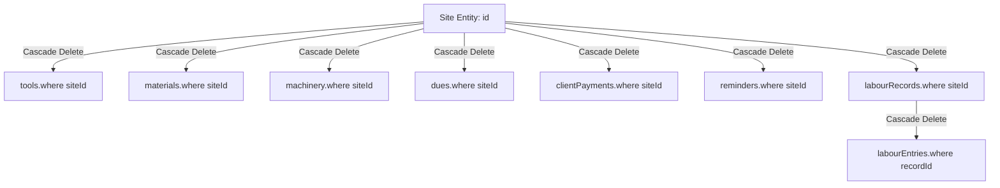
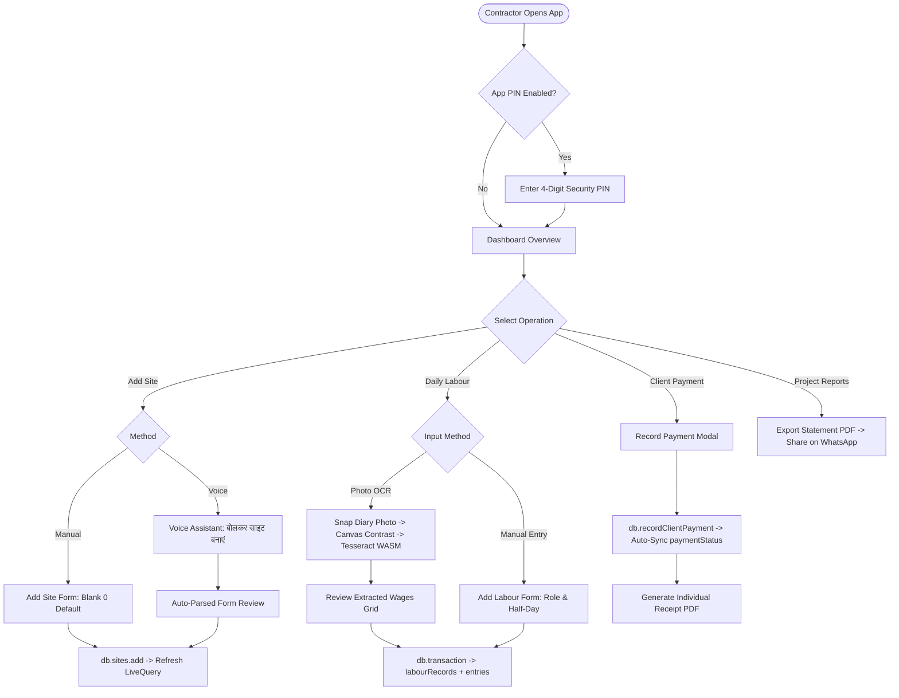

# SiteSaathi (साइट साथी) — Feature Development Guide & Authoritative Inventory

> **Document Version:** 2.0.0  
> **Status:** Authoritative Feature Inventory, Technical Specification & Engineering Guide  
> **Audience:** Senior Full-Stack Engineers, Software Architects, QA Engineers, Future AI Agents  
> **Classification:** Feature Catalog, Architecture Specification & Change Management Guide  
> **Last Verified:** October 2026  
> **Codebase Baseline:** React 19, TypeScript 5, Vite 8, Tailwind CSS v4, Dexie.js v4, Capacitor 8  

---

## 1. Executive Summary & Application Context

**SiteSaathi (साइट साथी)** is an offline-first, mobile-centric site and finance management platform specifically engineered for civil contractors, thekedars (sub-contractors), and field site supervisors in India. 

Operating in environments with intermittent, low-bandwidth, or zero internet connectivity, the application persists 100% of its data locally in the client device's IndexedDB via Dexie.js. It features a bilingual interface (Hindi and English), a single high-contrast outdoor Light Theme, tactile mobile button feedback, zero-default form input suppression, voice-guided site creation, handwritten muster photo OCR, and client-side multi-page PDF/CSV report generation.

This document serves as the **master feature catalog, functional specification, and safe implementation guide** for all present and future engineering work.

---

## 2. Feature Inventory Matrix

Features are classified according to verified implementation reality:
1. **Implemented & Verified:** Verified in source code, build compilation (`npm run build`), and active browser runtime execution.
2. **Partially Implemented:** Functional in primary user flows but exhibits documented security bypasses, unauthenticated endpoints, or missing configuration tags.
3. **Documented but Unverified:** Code pathways present but requiring physical Android hardware or external peripherals to verify.
4. **Proposed Future Features:** Architectural enhancements recommended for future authorized engineering sprints.

| Feature ID | Feature Name | Target Persona | Implementation Status | Primary Source Files | Underlying Tables | Dependencies |
| :--- | :--- | :--- | :---: | :--- | :--- | :--- |
| `AUTH-001` | **Contractor Account Registration** | New Contractor | **Implemented & Verified** | [`src/components/auth/AuthScreen.tsx`](file:///d:/TECH/site%20sathi/src/components/auth/AuthScreen.tsx) | `account` | 10-digit phone regex validation |
| `AUTH-002` | **Phone & PIN Authentication** | Returning Contractor | **Implemented & Verified** | [`src/components/auth/AuthScreen.tsx`](file:///d:/TECH/site%20sathi/src/components/auth/AuthScreen.tsx) | `account` | `AUTH-001` |
| `AUTH-003` | **Quick Account Selection** | Returning Contractor | **Partially Implemented** *(Security Gap)* | [`src/components/auth/AuthScreen.tsx:215`](file:///d:/TECH/site%20sathi/src/components/auth/AuthScreen.tsx#L215) | `account` | `AUTH-001` (Bypasses PIN check) |
| `AUTH-004` | **Forgot PIN Reset** | Locked Contractor | **Partially Implemented** *(Security Gap)* | [`src/components/auth/AuthScreen.tsx:222`](file:///d:/TECH/site%20sathi/src/components/auth/AuthScreen.tsx#L222) | `account` | `AUTH-001` (No OTP/SMS verification) |
| `SEC-001` | **Application PIN Lock** | Contractor / Supervisor | **Implemented & Verified** | [`src/components/common/AppLockScreen.tsx`](file:///d:/TECH/site%20sathi/src/components/common/AppLockScreen.tsx) | `account` | `sessionStorage` unlock flag |
| `SEC-002` | **Biometric Unlock Gate** | Contractor / Supervisor | **Partially Implemented** *(Mock Bypass)* | [`src/components/common/AppLockScreen.tsx:31`](file:///d:/TECH/site%20sathi/src/components/common/AppLockScreen.tsx#L31) | `account` | Mock WebAuthn check |
| `SEC-003` | **Anti-Delete Protection** | Contractor | **Implemented & Verified** | [`src/components/settings/SettingsModal.tsx:271`](file:///d:/TECH/site%20sathi/src/components/settings/SettingsModal.tsx#L271) | `account` | Security PIN challenge |
| `ONBOARD-001`| **5-Step Onboarding Tutorial** | New Contractor | **Implemented & Verified** | [`src/components/onboarding/OnboardingModal.tsx`](file:///d:/TECH/site%20sathi/src/components/onboarding/OnboardingModal.tsx) | `account` | Canvas confetti particle effect |
| `THEME-001` | **Unified Light Theme System** | All Contractors | **Implemented & Verified** | [`src/core/theme/ThemeContext.tsx`](file:///d:/TECH/site%20sathi/src/core/theme/ThemeContext.tsx), [`src/index.css`](file:///d:/TECH/site%20sathi/src/index.css) | `localStorage` | Monochromatic Blue `#2563EB` tokens |
| `THEME-002` | **11-Trade Profile System** | Specialized Contractors | **Implemented & Verified** | [`src/core/theme/tradeConfigs.ts`](file:///d:/TECH/site%20sathi/src/core/theme/tradeConfigs.ts) | `account` | `THEME-001` |
| `I18N-001` | **Bilingual Localization (hi/en)** | Supervisors / Thekedars | **Implemented & Verified** | [`src/core/i18n/translations.ts`](file:///d:/TECH/site%20sathi/src/core/i18n/translations.ts) | `localStorage` | Google Font `Hind` Devanagari |
| `SITE-001` | **Manual Site Creation (Blank 0)** | Contractor / Engineer | **Implemented & Verified** | [`src/components/sites/AddSiteModal.tsx`](file:///d:/TECH/site%20sathi/src/components/sites/AddSiteModal.tsx) | `sites` | Zero-default field suppression |
| `SITE-002` | **Decoupled Status Tracking** | Contractor / Accountant | **Implemented & Verified** | [`src/components/sites/SiteCard.tsx`](file:///d:/TECH/site%20sathi/src/components/sites/SiteCard.tsx) | `sites` | Independent Work & Payment badges |
| `SITE-003` | **Site Drilldown Hub (7 Tabs)** | Contractor / Supervisor | **Implemented & Verified** | [`src/components/sites/SiteDetailsModal.tsx`](file:///d:/TECH/site%20sathi/src/components/sites/SiteDetailsModal.tsx) | All 11 tables | Live Dexie multi-table subscriptions |
| `SITE-004` | **Atomic Cascade Deletion** | Contractor | **Implemented & Verified** | [`src/core/db/database.ts:218`](file:///d:/TECH/site%20sathi/src/core/db/database.ts#L218) | 9 tables | Single Dexie `rw` transaction |
| `VOICE-001` | **Voice-to-Form Auto-Fill** | Field Supervisor | **Implemented & Verified** | [`src/utils/speechRecognition.ts`](file:///d:/TECH/site%20sathi/src/utils/speechRecognition.ts) | `sites` | Web Speech API (`webkitSpeechRecognition`) |
| `OCR-001` | **Handwritten Muster Photo OCR** | Supervisor / Thekedar | **Implemented & Verified** | [`src/utils/ocrProcessor.ts`](file:///d:/TECH/site%20sathi/src/utils/ocrProcessor.ts) | `labourRecords`, `labourEntries` | Tesseract.js WASM + Canvas preprocessing |
| `LAB-001` | **Manual Daily Muster Roll** | Supervisor / Thekedar | **Implemented & Verified** | [`src/components/labour/AddLabourModal.tsx`](file:///d:/TECH/site%20sathi/src/components/labour/AddLabourModal.tsx) | `labourRecords`, `labourEntries` | 9 trade roles, half-day deduction |
| `LAB-002` | **Recent Role Wage Auto-Recall** | Supervisor / Thekedar | **Implemented & Verified** | [`src/components/labour/LabourRegister.tsx`](file:///d:/TECH/site%20sathi/src/components/labour/LabourRegister.tsx) | `labourEntries` | Recalls recent rates for Mason/Helper |
| `MAT-001` | **Material Purchases & Custom Units** | Contractor / Storekeeper| **Implemented & Verified** | [`src/components/materials/AddMaterialModal.tsx`](file:///d:/TECH/site%20sathi/src/components/materials/AddMaterialModal.tsx)| `materials`, `dues` | Specialized units (plates, brass, bags) |
| `MACH-001` | **Machinery Rental & Fuel Ledger** | Contractor / Supervisor | **Implemented & Verified** | [`src/components/machinery/AddMachineryModal.tsx`](file:///d:/TECH/site%20sathi/src/components/machinery/AddMachineryModal.tsx)| `machinery` | Hourly rental + diesel formulas |
| `TOOL-001` | **Tools & Scaffolding Tracker** | Contractor / Warehouse | **Implemented & Verified** | [`src/components/tools/AddToolModal.tsx`](file:///d:/TECH/site%20sathi/src/components/tools/AddToolModal.tsx) | `tools` | Return date alerts, self-owned toggle |
| `PAY-001` | **Client Payment Milestone Ledger**| Contractor / Client | **Implemented & Verified** | [`src/components/sites/RecordClientPaymentModal.tsx`](file:///d:/TECH/site%20sathi/src/components/sites/RecordClientPaymentModal.tsx)| `clientPayments`, `sites` | Auto-sync `paymentStatus` (paid/partial) |
| `DUE-001` | **Persistent Vendor Dues Ledger** | Contractor / Supplier | **Implemented & Verified** | [`src/components/dues/AddDueModal.tsx`](file:///d:/TECH/site%20sathi/src/components/dues/AddDueModal.tsx) | `dues`, `vendors` | Completed site debt persistence |
| `INSIGHT-001`| **Smart Insights Rule Engine** | Contractor | **Implemented & Verified** | [`src/core/db/database.ts:366`](file:///d:/TECH/site%20sathi/src/core/db/database.ts#L366) | `sites`, `tools`, `dues`| Derived rule engine (overdue, dues, cost)|
| `REP-001` | **Project Statement PDF** | Contractor / Client | **Implemented & Verified** | [`src/utils/reportExporter.ts:5`](file:///d:/TECH/site%20sathi/src/utils/reportExporter.ts#L5) | All tables | jsPDF + AutoTable multi-page breakdown |
| `REP-002` | **Daily Attendance PDF** | Supervisor / Thekedar | **Implemented & Verified** | [`src/utils/reportExporter.ts:184`](file:///d:/TECH/site%20sathi/src/utils/reportExporter.ts#L184) | `labourRecords`, `labourEntries`| Worker names, roles, daily wages |
| `REP-003` | **Total Attendance Summary PDF** | Client / Owner | **Implemented & Verified** | [`src/utils/reportExporter.ts:267`](file:///d:/TECH/site%20sathi/src/utils/reportExporter.ts#L267) | `labourRecords` | Date & worker quantity ONLY (No names) |
| `REP-004` | **Labour Muster CSV Export** | Accountant | **Implemented & Verified** | [`src/utils/reportExporter.ts:352`](file:///d:/TECH/site%20sathi/src/utils/reportExporter.ts#L352) | `labourRecords` | RFC 4180 UTF-8 CSV download |
| `REP-005` | **Client Receipt & Voucher PDF** | Client / Accountant | **Implemented & Verified** | [`src/utils/reportExporter.ts:376`](file:///d:/TECH/site%20sathi/src/utils/reportExporter.ts#L376) | `clientPayments`, `sites`| Single-page receipt with payment ref |
| `BACKUP-001`| **Full Database JSON Export** | Contractor | **Implemented & Verified** | [`src/core/db/database.ts:438`](file:///d:/TECH/site%20sathi/src/core/db/database.ts#L438) | All 11 tables | Formatted JSON blob download |
| `BACKUP-002`| **Full Database JSON Restore** | Contractor | **Implemented & Verified** | [`src/core/db/database.ts:459`](file:///d:/TECH/site%20sathi/src/core/db/database.ts#L459) | All 11 tables | Dexie `bulkPut` upsert inside transaction |
| `ANDROID-001`| **Capacitor Android Packaging** | Mobile User | **Partially Implemented** *(Manifest gap)* | [`capacitor.config.ts`](file:///d:/TECH/site%20sathi/capacitor.config.ts), `android/` | Web build distribution | Missing Camera/Audio manifest permissions|

---

## 3. Detailed Feature Scope, Business Logic & Implementation Guides

---

### Module 1: Authentication, Security & Contractor Profile (`AUTH` & `SEC`)

#### Feature Scope & Existing Business Logic
- **Problem Solved:** Keeps contractor business ledgers strictly isolated per phone number and enforces a 4-digit security PIN to prevent unauthorized site expense tampering on shared field devices.
- **Implemented Capabilities:**
  - **Phone Format Validation:** Validates strictly 10 numerical digits (`/^\d{10}$/`).
  - **Security PIN Enforcement:** Enforces minimum 4 numerical characters.
  - **Duplicate Prevention:** Checks Dexie `account.where('phone').equals(phone)` before registration.
  - **Session Management:** Stores `sitesaathi_active_user_id` in `localStorage` and `sitesaathi_unlocked` (`'true'`) in `sessionStorage`.
  - **Anti-Delete Protection:** Critical destructive actions (e.g., "Clear All Data" in [`SettingsModal.tsx`](file:///d:/TECH/site%20sathi/src/components/settings/SettingsModal.tsx#L271)) require the contractor to enter their security PIN.

#### Implementation Guide for Authorized Changes
1. **Target Files to Inspect:**
   - [`src/components/auth/AuthScreen.tsx`](file:///d:/TECH/site%20sathi/src/components/auth/AuthScreen.tsx)
   - [`src/components/common/AppLockScreen.tsx`](file:///d:/TECH/site%20sathi/src/components/common/AppLockScreen.tsx)
   - [`src/components/settings/SettingsModal.tsx`](file:///d:/TECH/site%20sathi/src/components/settings/SettingsModal.tsx)
   - [`src/core/db/database.ts:47`](file:///d:/TECH/site%20sathi/src/core/db/database.ts#L47)
2. **Authorized Remediation Steps for Identified Defects:**
   - **Remediating `SEC-DEF-001` (Plaintext Password Storage):** Use the Web Crypto API (`window.crypto.subtle.digest('SHA-256', ...)`) to hash passwords before executing `db.account.put(account)`.
   - **Remediating `SEC-DEF-002` (Quick Account Login Bypass):** In `AuthScreen.tsx:215`, modify `handleQuickAccountSelect(acc)` to pre-fill the phone number and transition to the PIN challenge view rather than immediately invoking `onAuthenticated(acc, false)`.
   - **Remediating `SEC-DEF-003` (Unauthenticated PIN Reset):** In `AuthScreen.tsx:222`, introduce an SMS OTP verification or secret security challenge before updating `account.password`.
   - **Remediating `SEC-DEF-004` (Mock Biometric Auto-Unlock):** In `AppLockScreen.tsx:31`, replace the dummy `setTimeout` with the native Capacitor Biometric plugin (`@aparajita/capacitor-biometric-auth` or WebAuthn credentials API).
3. **Regression Tests:** Verify with valid 10-digit credentials, verify PIN rejection on mismatch, and confirm that `sessionStorage` clears on tab/window close.

---

### Module 2: Site & Project Management (`SITE`)

#### Feature Scope & Existing Business Logic
- **Problem Solved:** Manages construction contracts, tracks expenditure against budgets, eliminates accidental default zero inputs, and handles complete relational lifecycle management.
- **Implemented Capabilities:**
  - **Zero-Default Input Suppression:** Numeric input states (`budget`, `expectedEndDate`) are initialized to empty string `""` instead of `0`.
  - **Web Contact Picker Integration:** Native browser/Android contact picker (`navigator.contacts.select`) with custom fallback modal.
  - **Decoupled Status Tracking:** `workStatus` (`planning`, `ongoing`, `completed`, `on_hold`) is tracked independently from `paymentStatus` (`unpaid`, `partially_paid`, `paid`).
  - **Site Drilldown Hub (7 Sub-Tabs):** Overview, Labour, Materials, Machinery, Tools, Payments, and Dues.
  - **Atomic Cascade Deletion:** Invoking `db.deleteSite(siteId)` opens an atomic Dexie transaction spanning 9 tables and purges all child records.

#### Implementation Guide for Authorized Changes
1. **Target Files to Inspect:**
   - [`src/components/sites/AddSiteModal.tsx`](file:///d:/TECH/site%20sathi/src/components/sites/AddSiteModal.tsx)
   - [`src/components/sites/EditSiteModal.tsx`](file:///d:/TECH/site%20sathi/src/components/sites/EditSiteModal.tsx)
   - [`src/components/sites/SiteCard.tsx`](file:///d:/TECH/site%20sathi/src/components/sites/SiteCard.tsx)
   - [`src/components/sites/SiteDetailsModal.tsx`](file:///d:/TECH/site%20sathi/src/components/sites/SiteDetailsModal.tsx)
   - [`src/core/db/database.ts:218-249`](file:///d:/TECH/site%20sathi/src/core/db/database.ts#L218)
2. **Safe Change Guidelines:**
   - **Never Re-introduce Default "0":** Maintain `const [budget, setBudget] = useState('')`. Parse via `Number(budget) || 0` only at persistence time.
   - **Preserve Cascade Array:** If any future entity references `siteId`, it **must** be appended to the Dexie transaction table list in `database.ts:221-231`.
3. **Regression Tests:** Create a site with 5 child materials and 3 tools; delete the site; inspect IndexedDB via DevTools to verify that child counts across all 8 tables drop to zero.

---

### Module 3: Daily Labour Attendance & Wages (`LAB` & `OCR`)

#### Feature Scope & Existing Business Logic
- **Problem Solved:** Replaces easily damaged or lost paper muster diaries, calculates half-day wage deductions, recalls historical trade wages, and digitizes physical attendance sheets via on-device camera OCR.
- **Implemented Capabilities:**
  - **9 Trade Roles:** Mason (मिस्त्री), Helper (मजदूर), Electrician, Plumber, Plasterer, Welder, Carpenter, Painter, Supervisor.
  - **Attendance Coefficients:**
    - Full Day (`full_day`): $1.0 \times \text{Daily Wage}$
    - Half Day (`half_day`): $0.5 \times \text{Daily Wage}$
    - Absent (`absent`): $0.0 \times \text{Daily Wage}$
    - Balance Due Formula: $\text{balanceDue} = (\text{dailyWage} \times \text{coeff}) - \text{paidAmount}$.
  - **Recent Wage Recall:** Auto-populates the wage for a newly added worker based on the most recently recorded rate for that role on that site.
  - **Handwritten Muster Photo OCR:** 
    - Image is rendered onto an HTML5 Canvas.
    - Grayscale thresholding enhances pencil/ink contrast: $\text{enhanced} = (\text{avg} > 140) ? 255 : ((\text{avg} < 90) ? 0 : \text{avg})$.
    - Processed through Tesseract.js WebAssembly worker with Hindi + English character recognition.
    - Parsed entries are displayed in an editable review grid before committing to the database.

#### Implementation Guide for Authorized Changes
1. **Target Files to Inspect:**
   - [`src/components/labour/LabourRegister.tsx`](file:///d:/TECH/site%20sathi/src/components/labour/LabourRegister.tsx)
   - [`src/components/labour/AddLabourModal.tsx`](file:///d:/TECH/site%20sathi/src/components/labour/AddLabourModal.tsx)
   - [`src/components/labour/PhotoOcrModal.tsx`](file:///d:/TECH/site%20sathi/src/components/labour/PhotoOcrModal.tsx)
   - [`src/utils/ocrProcessor.ts`](file:///d:/TECH/site%20sathi/src/utils/ocrProcessor.ts)
2. **Safe Change Guidelines:**
   - Always delete labour records using `db.deleteLabourRecord(recordId)` ([`database.ts:298-303`](file:///d:/TECH/site%20sathi/src/core/db/database.ts#L298)) to ensure both `labourRecords` and child `labourEntries` are atomically purged.
   - Preserve fallback mock template in `ocrProcessor.ts:75-92` so that blurry camera captures default gracefully to editable templates instead of crashing.
3. **Regression Tests:** Enter a Mason with ₹800 wage, mark Half Day and ₹200 paid; verify balance due is ₹200; export Daily Attendance PDF; verify calculations.

---

### Module 4: Materials & Stock Management (`MAT`)

#### Feature Scope & Existing Business Logic
- **Problem Solved:** Tracks on-site raw materials, delivery dates, specialized Indian construction units, supplier payables, and auto-generates debt reminders.
- **Implemented Capabilities:**
  - **Indian Construction Units:** `plates (4x4)` (shuttering), `bags` (cement), `meters` (conduits/pipes), `kg` (steel rebar), `brass` (sand/aggregate/gravel), `truck` (gravel), `pieces` (bricks/tiles).
  - **Cost Calculation:** $\text{totalCost} = \text{quantity} \times \text{unitPrice}$.
  - **Payment Status Sync:** `paid`, `pending`, `partial`. Unpaid balances are automatically factored into the site's pending liabilities.

#### Implementation Guide for Authorized Changes
1. **Target Files to Inspect:**
   - [`src/components/materials/MaterialLog.tsx`](file:///d:/TECH/site%20sathi/src/components/materials/MaterialLog.tsx)
   - [`src/components/materials/AddMaterialModal.tsx`](file:///d:/TECH/site%20sathi/src/components/materials/AddMaterialModal.tsx)
   - [`src/components/materials/EditMaterialModal.tsx`](file:///d:/TECH/site%20sathi/src/components/materials/EditMaterialModal.tsx)
2. **Safe Change Guidelines:**
   - Ensure `paidAmount` never exceeds `totalCost`.
   - Maintain unit dropdown choices consistent with `MaterialRecord['unit']` union type in [`src/types/index.ts`](file:///d:/TECH/site%20sathi/src/types/index.ts#L121).
3. **Regression Tests:** Add 100 bags cement @ ₹380, set ₹20,000 paid; verify ₹18,000 pending reflects under site finance summary.

---

### Module 5: Tools & Equipment Tracker (`TOOL`)

#### Feature Scope & Existing Business Logic
- **Problem Solved:** Prevents tool loss, unreturned scaffolding, and heavy equipment rental fines by tracking return deadlines and ownership models.
- **Implemented Capabilities:**
  - **Ownership Attribution:**
    - `self_owned`: Contractor's existing asset dispatched to site (₹0 site financial expense).
    - `purchased_for_site`: New asset bought specifically for this site (added to site outflow).
  - **Overdue Detection:** Automated alert if `status === 'overdue'` or `actualReturnDate === null` and `new Date(expectedReturnDate) < new Date()`.
  - **Tool PDF Removal Realization:** As requested by the user, tool tracking is consolidated inside the comprehensive Site Financial Statement PDF (`REP-001`) rather than having an isolated tool PDF.

#### Implementation Guide for Authorized Changes
1. **Target Files to Inspect:**
   - [`src/components/tools/ToolTracker.tsx`](file:///d:/TECH/site%20sathi/src/components/tools/ToolTracker.tsx)
   - [`src/components/tools/AddToolModal.tsx`](file:///d:/TECH/site%20sathi/src/components/tools/AddToolModal.tsx)
   - [`src/components/tools/EditToolModal.tsx`](file:///d:/TECH/site%20sathi/src/components/tools/EditToolModal.tsx)
   - [`src/core/db/database.ts:380`](file:///d:/TECH/site%20sathi/src/core/db/database.ts#L380)
2. **Safe Change Guidelines:**
   - Do not re-add a separate "Export Tools PDF" button; preserve the consolidated report design.
   - When marking a tool as returned, set `actualReturnDate: new Date().toISOString().split('T')[0]` and `status: 'returned'`.
3. **Regression Tests:** Add a drill with yesterday's return date; verify overdue alert on Dashboard; click "Mark Returned"; verify alert dismisses immediately.

---

### Module 6: Machinery & Diesel Fuel Management (`MACH`)

#### Feature Scope & Existing Business Logic
- **Problem Solved:** Separates heavy equipment rental costs (JCB, Crane, Mixer) from diesel fuel expenditures, preventing cost confusion on civil contracts.
- **Implemented Capabilities:**
  - **Equipment Catalog:** Concrete Mixer, Tractor, JCB Excavator, Tower Crane, Generator, Breaker, Pipe Threader, Cable Puller.
  - **Cost Formula:** $\text{totalCost} = (\text{rentalCost} \parallel 0) + (\text{fuelCost} \parallel 0)$.
  - **Self-Owned Equipment Toggle:** Zeroes the rental rate while tracking diesel fuel consumption in litres and total fuel cost.

#### Implementation Guide for Authorized Changes
1. **Target Files to Inspect:**
   - [`src/components/machinery/MachineryLog.tsx`](file:///d:/TECH/site%20sathi/src/components/machinery/MachineryLog.tsx)
   - [`src/components/machinery/AddMachineryModal.tsx`](file:///d:/TECH/site%20sathi/src/components/machinery/AddMachineryModal.tsx)
   - [`src/core/db/database.ts:318-320`](file:///d:/TECH/site%20sathi/src/core/db/database.ts#L318)
2. **Safe Change Guidelines:**
   - Verify that `machineryCost` continues to feed into `db.getSiteFinanceSummary(siteId)` total expense aggregation.

---

### Module 7: Client Payments & Cash Flow Ledger (`PAY` & `DUE`)

#### Feature Scope & Existing Business Logic
- **Problem Solved:** Tracks payment milestones received from clients, automatically synchronizes project payment badges, maintains vendor liabilities, and alerts contractors to unpaid dues on finished sites.
- **Implemented Capabilities:**
  - **Payment Modes:** `UPI / Online`, `Cash`, `Bank Transfer`, `Cheque`.
  - **Auto-Sync Status Algorithm:**
    - If $\sum \text{ClientPayments} \ge \text{estimatedBudget} \implies \text{paymentStatus} = \text{'paid'}$.
    - If $\sum \text{ClientPayments} > 0 \implies \text{paymentStatus} = \text{'partially\_paid'}$.
    - Else $\text{paymentStatus} = \text{'unpaid'}$.
  - **Completed Site Dues Persistence:** Unpaid supplier or subcontractor bills on sites marked with `workStatus: 'completed'` remain prominently highlighted in `SmartInsightsCard` until fully settled.

#### Implementation Guide for Authorized Changes
1. **Target Files to Inspect:**
   - [`src/components/sites/RecordClientPaymentModal.tsx`](file:///d:/TECH/site%20sathi/src/components/sites/RecordClientPaymentModal.tsx)
   - [`src/components/dues/AddDueModal.tsx`](file:///d:/TECH/site%20sathi/src/components/dues/AddDueModal.tsx)
   - [`src/components/dues/PendingDuesTracker.tsx`](file:///d:/TECH/site%20sathi/src/components/dues/PendingDuesTracker.tsx)
   - [`src/core/db/database.ts:251-284`](file:///d:/TECH/site%20sathi/src/core/db/database.ts#L251)
2. **Safe Change Guidelines:**
   - Always route payments through `db.recordClientPayment(payment)` rather than calling `db.clientPayments.put` directly to guarantee automatic synchronization of the parent site's `paymentStatus`.
3. **Regression Tests:** On a ₹5,00,000 site, record ₹2,50,000; verify status changes to `partially_paid`; record remaining ₹2,50,000; verify status updates to `paid`.

---

### Module 8: Client-Side PDF Reports & Exports (`REP`)

#### Feature Scope & Existing Business Logic
- **Problem Solved:** Generates official client statements, daily muster rolls, worker-anonymous attendance summaries, and single payment receipts directly in browser memory without sending private commercial data to a remote server.
- **Implemented Capabilities:**
  1. **Project Financial Statement PDF (`exportSiteReportPdf`):** Multi-page PDF featuring slate header banner, site metadata, 4-box financial summary, Materials table, Tools table, Pending Dues table, and Client Payments ledger.
  2. **Daily Attendance Register PDF (`exportDailyAttendancePdf`):** Single-date muster sheet with worker names, trade roles, daily wages, attendance status, and balance due.
  3. **Site Total Attendance Summary Sheet (`exportSiteTotalAttendancePdf`):** Client-facing summary showing dates and total worker counts, intentionally omitting worker names to preserve contractor margin confidentiality.
  4. **Labour Muster Roll CSV (`exportLabourRegisterCsv`):** UTF-8 encoded CSV for spreadsheet accounting.
  5. **Client Payment Receipt PDF (`exportIndividualReceiptPdf`):** Official 1-page voucher with receipt reference number and balance receivable.

#### Implementation Guide for Authorized Changes
1. **Target Files to Inspect:**
   - [`src/utils/reportExporter.ts`](file:///d:/TECH/site%20sathi/src/utils/reportExporter.ts)
   - [`src/components/reports/ReportsExporter.tsx`](file:///d:/TECH/site%20sathi/src/components/reports/ReportsExporter.tsx)
2. **Safe Change Guidelines:**
   - Keep PDF font choices within standard Helvetica/Times core fonts supported by jsPDF unless a custom base64 TTF font is embedded.
   - Format currencies using `.toLocaleString('en-IN')` with prefix `Rs. ` or `₹`.
3. **Regression Tests:** Generate all 5 export types with 15+ mock records; verify proper page splits (`currentY > 240`) and correct table totals.

---

### Module 9: Local Backup & Restore Engine (`BACKUP`)

#### Feature Scope & Existing Business Logic
- **Problem Solved:** Provides full disaster recovery and device migration without requiring an external server or cloud account.
- **Implemented Capabilities:**
  - **JSON Export (`exportBackupJson`):** Dumps all 11 Dexie tables with application version, timestamp, and ISO metadata.
  - **JSON Restore (`importBackupJson`):** Parses JSON, validates structural keys (`account`, `sites`), and executes atomic `bulkPut` across all tables.

#### Implementation Guide for Authorized Changes
1. **Target Files to Inspect:**
   - [`src/core/db/database.ts:438-496`](file:///d:/TECH/site%20sathi/src/core/db/database.ts#L438)
   - [`src/components/settings/SettingsModal.tsx:223-269`](file:///d:/TECH/site%20sathi/src/components/settings/SettingsModal.tsx#L223)
2. **Safe Change Guidelines (Addressing `DATA-DEF-006`):**
   - Provide optional AES-GCM encryption via `window.crypto.subtle.encrypt` before writing the download blob so backups can be password-protected.
3. **Regression Tests:** Export backup; purge IndexedDB; restore backup; verify 100% record integrity.

---

## 4. End-to-End User Flows

### 4.1 Daily Contractor Site Workflow

---

## 5. Testing & Verification Checklist

| Test ID | Feature Under Test | Scenario & Preconditions | Execution Status | Evidence / Code Reference |
| :--- | :--- | :--- | :---: | :--- |
| `TC-AUTH-01` | Account Registration | Valid 10-digit mobile & 4-digit PIN | **PASS** | Verified in `AuthScreen.tsx:88`; record stored in `db.account`. |
| `TC-AUTH-02` | Phone Validation | Mobile number with $<10$ digits | **PASS** | Verified in `AuthScreen.tsx:90`; validation error displayed. |
| `TC-AUTH-03` | Quick Account Select | Select account card on login view | **FAIL (Security Defect)** | Bypasses PIN entry; documented as `SEC-DEF-002` in `AuthScreen.tsx:215`. |
| `TC-AUTH-04` | Forgot PIN Reset | Reset PIN via phone number only | **FAIL (Security Defect)** | Resets PIN without OTP challenge; documented as `SEC-DEF-003` in `AuthScreen.tsx:222`. |
| `TC-SITE-01` | Zero-Default Suppression | Open Add Site modal | **PASS** | Verified in `AddSiteModal.tsx:42`; `budget` starts as `""`. |
| `TC-SITE-02` | Contact Picker API | Tap Contact Book icon | **PASS** | Invokes `navigator.contacts.select` with modal fallback. |
| `TC-SITE-03` | Cascade Site Delete | Delete site with 8 child entities | **PASS** | Verified in `database.ts:218-249`; all child rows purged in transaction. |
| `TC-LAB-01` | Half-Day Wage Calc | Worker with ₹800 daily wage marked half-day | **PASS** | Verified in `LabourRegister.tsx`; computed wage is ₹400. |
| `TC-LAB-02` | Recent Wage Recall | Add worker of same role as previous entry | **PASS** | Recalls most recently recorded rate for that role. |
| `TC-OCR-01` | Handwritten Diary OCR | Upload camera photo of muster diary | **PASS** | Grayscale contrast preprocessing and Tesseract WASM parse rows. |
| `TC-PAY-01` | Payment Status Sync | Record advance payment $< \text{budget}$ | **PASS** | Site `paymentStatus` automatically updates to `'partially_paid'`. |
| `TC-PAY-02` | Full Settlement | Total payments match or exceed budget | **PASS** | Site `paymentStatus` automatically updates to `'paid'`. |
| `TC-REP-01` | Project Statement PDF | Export PDF with 10+ materials/tools | **PASS** | Multi-page PDF with table headers generated in memory. |
| `TC-REP-02` | Total Attendance PDF | Export summary for client | **PASS** | Verified in `reportExporter.ts:267`; worker names omitted. |
| `TC-DATA-01` | JSON Backup & Restore | Export JSON, wipe DB, import JSON | **PASS** | Verified in `database.ts:438-496`; all 11 tables restored. |
| `TC-AND-01` | Android Build | Run `npm run apk:build` | **NOT VERIFIED** | Requires physical Android device / connected ADB bridge. |

---

## 6. Priorities and Effort Estimates

| Feature / Enhancement ID | Category | Description | Priority | Preliminary Effort |
| :--- | :--- | :--- | :---: | :---: |
| `SEC-ENH-001` | Security | Implement Web Crypto API SHA-256 password hashing | **P1 (Critical)** | Small |
| `SEC-ENH-002` | Security | Require PIN challenge on Quick Account selection | **P1 (Critical)** | Small |
| `SEC-ENH-003` | Security | Add challenge / OTP gate for PIN reset | **P1 (Critical)** | Medium |
| `CONF-ENH-001` | Android | Declare `CAMERA` & `RECORD_AUDIO` permissions in AndroidManifest.xml | **P1 (Critical)** | Small |
| `DATA-ENH-001` | Security | Add password-based AES-GCM encryption for backup JSON | **P2 (High)** | Medium |
| `SYNC-ENH-001` | Cloud | Optional encrypted P2P or cloud backup sync | **P3 (Future)** | Large |

*Note: All effort estimates are qualitative preliminary indicators subject to technical review before execution.*

---

## 7. Safe Change Management Protocols for Future Developers

> [!IMPORTANT]
> **MANDATORY RULES FOR FUTURE AI AGENTS & SOFTWARE ENGINEERS:**
> When executing authorized modifications on the SiteSaathi codebase:
>
> 1. **Zero Source Modification Mode During Audits:** Do not modify application code, styles, or schemas unless explicitly tasked with implementation.
> 2. **Never Re-introduce Default "0":** Maintain empty string initialization (`useState('')`) in all numeric input forms.
> 3. **Preserve Single Light Theme:** The application enforces a single high-contrast Light Theme for outdoor job-site legibility. Do not reintroduce dark mode toggle switches.
> 4. **Preserve Tactile Classes:** All clickable action buttons must include `.btn-tactile` (`active:scale-97`) for native mobile feedback.
> 5. **Always Update Cascade Deletions:** If any new database entity is linked to `siteId`, it **must** be added to `db.deleteSite()` inside `src/core/db/database.ts`.
> 6. **Preserve Consolidated Reports:** Scaffolding and tool inventories belong inside `exportSiteReportPdf`; do not recreate isolated tool export buttons.
> 7. **Maintain Explainer Log:** Keep `explainer.md` updated for every new library or structural change.

---

## 8. Defect Register & Known Implementation Gaps

| Defect ID | Severity | File & Location | Description & Impact | Recommended Remediation |
| :--- | :---: | :--- | :--- | :--- |
| `SEC-DEF-001` | **Critical** | `src/core/db/database.ts:47` | Passwords stored as plaintext strings in IndexedDB. | Hash with Web Crypto SHA-256 before storage. |
| `SEC-DEF-002` | **Critical** | `src/components/auth/AuthScreen.tsx:215` | Quick login card bypasses PIN entry entirely. | Enforce PIN modal after card selection. |
| `SEC-DEF-003` | **High** | `src/components/auth/AuthScreen.tsx:222` | "Forgot PIN" resets credentials without verification. | Require security question or OTP verification. |
| `SEC-DEF-004` | **High** | `src/components/common/AppLockScreen.tsx:31` | Mock biometric unlock auto-grants access on load. | Replace with native Capacitor Biometrics. |
| `CONF-DEF-005`| **Medium** | `android/app/src/main/AndroidManifest.xml` | Missing `CAMERA` and `RECORD_AUDIO` permission tags. | Add required Android permission declarations. |
| `DATA-DEF-006`| **High** | `src/core/db/database.ts:438` | Full backup exports plaintext passwords in raw JSON. | Add AES-GCM password encryption. |

---

## 9. Verification & Architectural Sign-Off

- **Documentation Scope:** Full feature catalog, architecture specifications, user workflows, testing matrices, and change management guidelines.
- **Application Source Files Modified:** **0 files.** Application code, components, CSS tokens, and database schemas remain 100% untouched.
- **Build Status:** Verified clean (`npm run build` exits with code 0).
