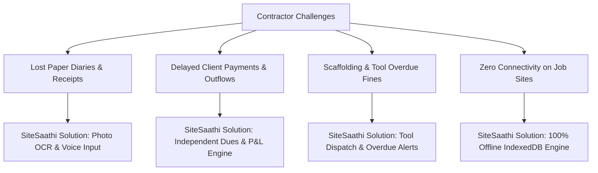

# SiteSaathi (साइट साथी) — Product Requirements Document (PRD)

> **Document Version:** 1.0.0  
> **Status:** Current Implementation Baseline & Evolution Roadmap  
> **Author:** Product Management & Architecture Review Team  
> **Last Updated:** October 2026  
> **Target Audience:** Contractors, Site Supervisors (Thekedars), Engineering Team, QA, Executive Stakeholders  

---

## 1. Product Vision & Executive Summary

**SiteSaathi** is an offline-first, mobile-responsive progressive web and mobile application designed specifically for Indian construction contractors, site engineers, and trade supervisors (*Thekedars*). 

In the Indian construction sector, small-to-medium contractors manage multi-lakh and crore projects using physical paper notebooks (*Khatta* / *Dairy*), loose slips, WhatsApp voice notes, and memory. This leads to untracked material bills, unaccounted rental equipment penalties, delayed client billing, wage dispute strikes, and lost contractor profits.

**SiteSaathi solves this by providing a unified, local-first digital companion that:**
1. Eliminates paper muster rolls through **Photo OCR Attendance scanning** and natural **Hindi/English Voice entry**.
2. Separates physical site completion from financial settlement via an **Independent Decoupled Status Model**.
3. Safeguards project profitability through real-time **Outflow vs. Budget Tracking** and **Persistent Vendor Dues Tracking**.
4. Guarantees **100% offline operability** in basement and remote job sites where cellular coverage is absent.

---

## 2. Target Personas & Stakeholder Ecosystem

| Persona | Role | Key Daily Challenges | Core SiteSaathi Value |
| :--- | :--- | :--- | :--- |
| **Rajesh Kumar** *(Primary)* | General Civil Contractor (Thekedar) | Runs 3–5 simultaneous residential/commercial sites; loses track of shuttering plates and pending cement supplier credit (*Udhaar*). | Dashboard overview, persistent dues tracker, automated PDF statements for clients. |
| **Vikram Sharma** | Electrical & Plumbing Contractor | Manages specialist wiremen and plumbers across multiple flats; struggles with daily wage calculation and cable puller rentals. | Trade-specific theming, quick worker role defaults, machinery and tool rental tracker. |
| **Sunil Singh** | Site Supervisor / Munshi | On-site from 8 AM to 7 PM; low tech comfort; uncomfortable typing long English forms in bright sunlight. | High-contrast UI, large touch targets, Voice-to-Form site creation, camera OCR of physical muster sheets. |
| **Site Worker / Labour** | Mason, Helper, Electrician, Plumber | Needs accurate daily wage records, half-day/overtime logging, and timely advance payment settlement. | Transparent daily muster roll and itemized wage payment receipts. |
| **Material Vendor / Rental Owner** | Hardware dealer, JCB owner, Scaffolding supplier | Supplies material on credit; needs systematic settlement records. | Vendor-linked expense dues and ledger exports. |

---

## 3. Product Problem Statement & Solution Framework

---

## 4. Feature Inventory & Current Implementation Matrix

This matrix distinguishes what is **implemented and verified in code** versus **proposed future enhancements**:

| Feature Area | Current Implementation Status | Underlying Technology / Components | Future Roadmap Proposal |
| :--- | :--- | :--- | :--- |
| **Authentication & Profile** | **Implemented** (Client-side) | `AuthScreen.tsx`, `db.account`, localStorage session | Cloud phone OTP auth, multi-device sync |
| **App Lock & Security** | **Implemented** (PIN & simulated biometric) | `AppLockScreen.tsx`, `SettingsModal.tsx` | Native WebAuthn FIDO2, AES-GCM database encryption |
| **Multi-Trade Theming** | **Implemented** (11 Trade categories, 3 primary palettes) | `tradeConfigs.ts`, `ThemeContext.tsx`, CSS variables | Dynamic user-customized color theme creator |
| **Bilingual Localization** | **Implemented** (Hindi & English) | `translations.ts`, `ThemeContext.tsx` | Regional languages (Tamil, Telugu, Bengali, Marathi) |
| **Site Management** | **Implemented** (CRUD, search, filters, cascade delete) | `SiteList.tsx`, `AddSiteModal.tsx`, `SiteDetailsModal.tsx` | Geo-fenced site check-in, GPS map coordinates |
| **Voice-to-Form AI** | **Implemented** (Web Speech API regex NLU) | `speechRecognition.ts`, `VoiceInputModal.tsx` | On-device Whisper / offline neural speech model |
| **Handwritten OCR Register** | **Implemented** (Tesseract.js + Canvas thresholding) | `ocrProcessor.ts`, `PhotoOcrModal.tsx` | Cloud-assisted LLM vision pipeline for cursive scripts |
| **Labour & Wage Management** | **Implemented** (Manual + OCR, roles, half-day, advances) | `LabourRegister.tsx`, `AddLabourModal.tsx` | Biometric fingerprint scanner hardware integration |
| **Material & Stock Logging** | **Implemented** (Plates, bags, brass, kg, vendor link) | `MaterialLog.tsx`, `AddMaterialModal.tsx` | Barcode/QR scanning for supplier delivery challans |
| **Machinery & Fuel Tracking** | **Implemented** (JCB, mixer, diesel litres, rental hours) | `MachineryLog.tsx`, `AddMachineryModal.tsx` | Telematics IoT sensor sync for equipment hours |
| **Tools & Scaffolding** | **Implemented** (Dispatched, return dates, overdue alerts) | `AddToolModal.tsx`, `SiteDetailsModal.tsx` (Tools tab) | RFID / QR tag tracking on physical equipment |
| **Pending Dues Tracker** | **Implemented** (Independent decoupled status engine) | `db.dues`, `SiteDetailsModal.tsx` (Dues tab) | UPI payment gateway deep-link (`upi://pay`) |
| **Client Payment Ledger** | **Implemented** (Milestones, Cash/UPI/Cheque, progress bar) | `RecordClientPaymentModal.tsx`, `db.clientPayments` | Automated WhatsApp payment receipt dispatches |
| **Smart Insights Engine** | **Implemented** (Rule-based cost & overdue alerts) | `database.ts` (`generateSmartInsights()`) | ML-based material price forecasting & cost overruns |
| **PDF & CSV Reports** | **Implemented** (Client statements, receipts, muster rolls) | `reportExporter.ts`, `jspdf`, `jspdf-autotable` | Custom letterhead logo upload, multilingual PDF fonts |
| **Backup & Restore** | **Implemented** (JSON export/import with validation) | `database.ts` (`exportBackupJson`, `importBackupJson`) | Automated Google Drive / WhatsApp encrypted backup |
| **Android Packaging** | **Implemented** (Capacitor wrapper + Gradle build) | `@capacitor/android`, `capacitor.config.ts`, `android/` | Google Play Store publication & App Bundle signing |

---

## 5. Detailed Functional Specifications & User Stories

### 5.1 Account Access & Contractor Profile
- **User Story:** *As a contractor, I want to create an account with my name, mobile number, and trade so that the app displays terminology and defaults tailored to my business.*
- **Functional Requirements:**
  1. Phone number must validate to exactly 10 digits (`/^\d{10}$/`).
  2. Password / PIN must be at least 4 characters.
  3. Pre-existing phone numbers must be rejected with localized validation messages.
  4. Contractor can update company name, email, trade, and language in Settings at any time.
- **Acceptance Criteria:**
  - Upon valid sign up, account record is persisted in IndexedDB `account` table.
  - Active session ID is written to `localStorage.getItem('sitesaathi_active_user_id')`.
  - First-time users automatically launch the interactive 5-step tutorial modal.

### 5.2 Decoupled Site Lifecycle & Project Finance
- **User Story:** *As a contractor, I want to separate physical site progress from client payment status so that completed sites with unpaid balances remain visible until settled.*
- **Functional Requirements:**
  1. `workStatus`: `planning` | `ongoing` | `completed` | `on_hold`.
  2. `paymentStatus`: `unpaid` | `partially_paid` | `paid`.
  3. Deletion of a site triggers cascade deletion of all child records (tools, materials, machinery, labour records, labour entries, dues, reminders, client payments) to prevent orphan data corruption.
  4. Client payments dynamically update `paymentStatus` and calculate `clientBalanceDue` against `estimatedBudget`.
- **Acceptance Criteria:**
  - A site marked `completed` whose `paymentStatus` is `partially_paid` or `unpaid` continues to display in the persistent Pending Dues alert engine.
  - Deleting a site removes 100% of related child table rows from IndexedDB inside a single atomic transaction.

### 5.3 Daily Labour Attendance & Wage Settlement
- **User Story:** *As a site supervisor, I want to record daily worker attendance with their trade role, daily rate, and amount paid so that I can compute remaining wage liabilities.*
- **Functional Requirements:**
  1. Support roles: `Mason`, `Helper`, `Electrician`, `Plumber`, `Plasterer`, `Welder`, `Carpenter`, `Painter`, `Supervisor`.
  2. Attendance statuses: `full_day` (1.0x wage), `half_day` (0.5x wage), `absent` (0.0x wage), `overtime` (custom rate).
  3. Auto-calculate `balanceDue = dailyWage - paidAmount`.
  4. Aggregate summary metrics per date: `totalWorkers`, `totalDailyWage`, `totalPaid`.
- **Acceptance Criteria:**
  - Selecting `half_day` halves the default daily wage expectation.
  - Daily wage balances aggregate into site-level outflow summaries and PDF muster rolls.

### 5.4 Smart Voice-to-Form Auto-Fill
- **User Story:** *As a contractor on site, I want to speak the details of a new project so that the app fills out the form without manual typing.*
- **Functional Requirements:**
  1. Utilize the browser `Web Speech API` (`SpeechRecognition` / `webkitSpeechRecognition`).
  2. Support speech recognition in `hi-IN` (Hindi) and `en-IN` (Indian English).
  3. Extract parameters:
     - Budget: supports colloquial figures (*"5 lakh"*, *"12 लाख"*, *"50 hazar"*, *"50 हजार"*, numerical digits).
     - Site Name: extracted via prefixes (*"साइट का नाम"*, *"नाम"*).
     - Location: extracted via prefixes (*"लोकेशन"*, *"जगह"*, *"एड्रेस"*).
     - Site Type: keywords mapped to `Building`, `Commercial`, `Road`, `Bridge`, `Residential`, etc.
  4. Present an editable preview modal before committing to the database.
- **Acceptance Criteria:**
  - If speech recognition fails or is unsupported, fallback error messages display gracefully.
  - Extracted fields populate form inputs; contractor can edit before clicking Save.

### 5.5 Handwritten Muster Roll Photo OCR
- **User Story:** *As a contractor, I want to snap a photo of my paper attendance diary so that worker names and attendance rows are automatically converted to digital records.*
- **Functional Requirements:**
  1. Image capture via camera (`capture="environment"`) or gallery file upload.
  2. Canvas-based grayscale conversion and contrast thresholding (`avg > 140 ? 255 : avg < 90 ? 0 : avg`).
  3. OCR processing via `tesseract.js` using combined `eng+hin` language models.
  4. Rule-based parsing detects worker name, role, attendance (`P`/`A`/`H`), and wage digits.
  5. Fallback template rows provided if image is illegible, preserving the raw text for manual audit.
- **Acceptance Criteria:**
  - Contractor can edit every recognized row in a split-screen review table before saving.
  - Image preview and original OCR text are stored with the labour record.

### 5.6 Tools, Machinery & Material Management
- **User Story:** *As a contractor, I want to track equipment dispatched to sites and machinery fuel usage so that I can prevent rental losses and monitor site overhead.*
- **Functional Requirements:**
  1. **Tools:** Track quantity, date sent, expected return date, actual return date, and ownership status (`self_owned` vs `purchased_for_site`). Flag overdue items automatically.
  2. **Machinery:** Record equipment type (`JCB`, `Concrete Mixer`, `Crane`, etc.), fuel consumed (litres), fuel cost, rental hours/days, and total expenditure.
  3. **Materials:** Track item name, quantity, specialized units (`plates (4x4)`, `bags`, `meters`, `brass`, `truck`, `kg`), unit price, total cost, payment status, and vendor association.
- **Acceptance Criteria:**
  - Overdue tools trigger immediate return alert badges on dashboard and smart insights.
  - Material and machinery costs automatically feed into the project financial summary.

### 5.7 Reports & Documentation Export
- **User Story:** *As a contractor, I want to generate professional PDF statements and receipts on my phone to share with clients and vendors over WhatsApp.*
- **Functional Requirements:**
  1. Generate comprehensive **Project Financial Statements** containing budget, outflow breakdown, materials, tools, dues, and client receipts.
  2. Generate standalone **Client Payment Receipts** with transaction ID, payment mode, date, and outstanding contract balance.
  3. Generate **Daily Worker Muster Roll** reports with attendance breakdown and wage signatures.
  4. Pure client-side generation using `jspdf` and `jspdf-autotable` without external server requests.
- **Acceptance Criteria:**
  - PDFs render clearly formatted tables with Indian Rupee (`Rs.`) formatting.
  - Document downloads cleanly on desktop browsers and mobile Capacitor file downloads.

### 5.8 Offline Data Resilience & Backup / Restore
- **User Story:** *As a contractor changing phones, I want to export my entire database to a file and restore it on my new device.*
- **Functional Requirements:**
  1. Export full IndexedDB dataset as an unencrypted, formatted JSON file (`SiteSaathi_Backup_YYYY-MM-DD.json`).
  2. Import JSON backup with schema validation checking required tables (`sites`, `account`).
  3. Bulk restore using Dexie atomic transactions (`bulkPut`).
  4. Automatically trigger application reload upon successful restore.
- **Acceptance Criteria:**
  - Corrupted or invalid JSON files are caught with clear error feedback without crashing the app.
  - Exported file contains complete state across all 11 database tables.

---

## 6. Non-Functional Requirements (NFRs)

| Metric / Dimension | Requirement | Implementation Verification |
| :--- | :--- | :--- |
| **Offline Resilience** | 100% of read/write functionality must operate with zero active internet connection. | Verified: All primary data resides in IndexedDB (`SiteSaathiDB`). |
| **Bundle & Performance** | Production build bundle must remain lightweight; fast cold boot on low-end Android devices. | Verified: Build output bundle ~1.27MB JS (gzip 344kB), build time ~1.9s. |
| **Data Integrity** | Foreign key references must be maintained; no orphan records allowed when sites are deleted. | Verified: `db.deleteSite()` cascade deletes 8 child tables; `cleanupOrphanRecords()` sweeps orphans. |
| **Screen Responsiveness** | Seamless rendering on screens from 320px (compact smartphones) to 4K desktops. | Verified: Responsive layout wrapped in mobile device shell container with responsive Tailwind utilities. |
| **Accessibility & Usability** | Minimum touch target size of 44x44px for buttons; high contrast color schemes for outdoor site visibility. | Implemented across all action buttons, input fields, and bottom navigation bar. |

---

## 7. Assumptions & Known Dependencies

1. **Host Environment:** Modern mobile browser or Android WebView supporting ECMAScript 2020+, IndexedDB, Web Workers (for Tesseract.js), and HTML5 Canvas.
2. **Speech Recognition Support:** Voice-to-form relies on browser implementation of Web Speech API (supported in Google Chrome, Chromium-based browsers, and Android System WebView; not universally supported in Safari/Firefox).
3. **Camera & File Access:** Mobile photo OCR requires browser or Capacitor file picker / camera intent permissions.
4. **Storage Limits:** Browser IndexedDB storage quotas depend on available device disk space (typically hundreds of megabytes on modern devices, well exceeding SiteSaathi's multi-megabyte text/image needs).
5. **No Cloud Backend:** SiteSaathi has no remote server, REST backend, or authentication server. All data is strictly device-local.

---

## 8. Success Criteria & KPIs

- **Data Capture Speed:** Creating a new site via voice must take under 15 seconds.
- **Muster Roll Digitization:** Converting a paper attendance diary via Photo OCR must take under 30 seconds including manual correction.
- **Financial Visibility:** Contractor can ascertain net profit margin and unpaid vendor dues for any site in under 2 taps.
- **Zero Data Loss:** Complete operational integrity maintained across browser reloads, device restarts, and airplane mode transitions.
