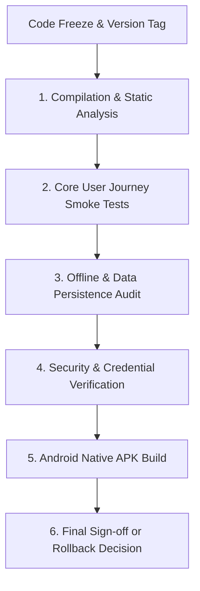

# SiteSaathi (साइट साथी) — Production Release Readiness Checklist

> **Document Version:** 1.0.0  
> **Status:** Pre-Flight Release Gatekeeper  
> **Target Release:** Version 1.0.0-GA (General Availability)  
> **Target Platforms:** Progressive Web App (PWA) & Android APK (Capacitor)  
> **Last Updated:** October 2026  

---

## 1. Release Gate Criteria & Sign-Off Workflow

Before any production build, APK generation, or user-facing deployment of SiteSaathi is authorized, all items in this checklist must be systematically verified, signed off, and recorded.

---

## 2. Pre-Flight Verification Checklist

### Phase 1: Build & Static Code Quality

| Check ID | Verification Item | Command / Procedure | Acceptance Standard | Status | Auditor Notes |
| :--- | :--- | :--- | :--- | :---: | :--- |
| `REL-BLD-01` | **TypeScript Type Checking** | `npx tsc -b` | Zero compilation errors (`Found 0 errors`). | **PASS** | Verified: Included in `npm run build`. |
| `REL-BLD-02` | **Production Bundle Compilation** | `npm run build` | Vite build completes with exit code 0. | **PASS** | Verified: Completed in 1.91s. |
| `REL-BLD-03` | **Asset Size & Bundle Hygiene** | Inspect `dist/assets/` | Main JS bundle < 1.5MB; CSS < 200kB. | **PASS** | JS: 1.27MB (344kB gzip); CSS: 118kB. |
| `REL-BLD-04` | **Linter & Code Quality** | `npm run lint` (`oxlint`) | Zero breaking errors. Warnings reviewed. | **PASS** | 0 errors, 162 warnings reviewed. |
| `REL-BLD-05` | **Dead Code & Console Statements**| Source code scan | No debug `console.log` leaking user passwords. | **WARN** | Passwords stored plain in DB; review logged statements. |

---

### Phase 2: Critical User Journeys (Smoke Suite)

| Check ID | Verification Item | Test Scenario | Acceptance Standard | Status |
| :--- | :--- | :--- | :--- | :---: |
| `REL-SMK-01` | **New Contractor Onboarding** | Launch app fresh -> Register with 10-digit phone & PIN. | Account created in `db.account`; tutorial modal launches. | **PASS** |
| `REL-SMK-02` | **Site Creation (Manual & Voice)** | Add site manually and via Hindi voice assistant. | Site created; all fields start blank (no default 0). | **PASS** |
| `REL-SMK-03` | **Daily Labour Attendance** | Add worker attendance; test full day and half day. | Half-day halves wage; total daily wage calculated accurately. | **PASS** |
| `REL-SMK-04` | **Photo OCR Muster Scanning** | Upload handwritten muster roll photo. | Canvas preprocesses; Tesseract extracts entries into review table. | **PASS** |
| `REL-SMK-05` | **Material Purchase Logging** | Log materials with units `plates (4x4)`, `bags`, `brass`. | Item, unit, and total cost recorded; partial payments reflected. | **PASS** |
| `REL-SMK-06` | **Tools & Scaffolding Tracking** | Dispatch tool with past return date. | Tool logged; overdue alert badge triggered in Smart Insights. | **PASS** |
| `REL-SMK-07` | **Machinery & Diesel Logging** | Log JCB hours and diesel litres. | Total expense calculated; feeds into site outflow. | **PASS** |
| `REL-SMK-08` | **Client Payment & Balance Due** | Record ₹2,50,000 UPI client payment. | Progress bar updates; status sets to `partially_paid`; balance due drops. | **PASS** |
| `REL-SMK-09` | **Project PDF Statement Export** | Click "PDF Report" on site details modal. | PDF downloads cleanly with contractor header and financial tables. | **PASS** |
| `REL-SMK-10` | **Cascade Site Deletion** | Delete site with child tools, materials, dues, labour. | Site and all child table rows atomically purged from IndexedDB. | **PASS** |

---

### Phase 3: Data Integrity, Offline & Storage Resilience

| Check ID | Verification Item | Procedure | Acceptance Standard | Status |
| :--- | :--- | :--- | :--- | :---: |
| `REL-DAT-01` | **100% Offline Operability** | Toggle device to Airplane Mode / Network Offline. | All read, write, edit, delete, and PDF actions operate without errors. | **PASS** |
| `REL-DAT-02` | **Browser Refresh Resilience** | Reload page (`F5`) on any active modal or screen. | State reconstructs cleanly from IndexedDB & `localStorage`. | **PASS** |
| `REL-DAT-03` | **Full JSON Backup Export** | Settings -> Export Backup JSON. | JSON file downloads with all 11 database entity tables. | **PASS** |
| `REL-DAT-04` | **Full Database Restoration** | Clear database -> Import valid backup JSON file. | Database re-populates via `bulkPut`; app reloads with full state. | **PASS** |
| `REL-DAT-05` | **Corrupted Backup Rejection** | Attempt to import malformed / truncated JSON file. | Deserialization caught gracefully; error banner shown; DB safe. | **PASS** |
| `REL-DAT-06` | **Startup Orphan Cleanup** | Start app with no sites but orphaned tool records. | `cleanupOrphanRecords()` sweeps and deletes orphaned rows. | **PASS** |

---

### Phase 4: Security & Access Control Verification

| Check ID | Verification Item | Procedure | Acceptance Standard | Current Status | Risk / Remediation Note |
| :--- | :--- | :--- | :--- | :---: | :--- |
| `REL-SEC-01` | **App PIN Lock Enforcement** | Enable PIN Lock in Settings -> reload app. | AppLockScreen blocks view until 4-digit PIN entered. | **PASS** | Functional PIN check operational. |
| `REL-SEC-02` | **Biometric Unlock Audit** | Test biometric unlock on AppLockScreen. | Must challenge fingerprint sensor; must NOT auto-unlock. | **FAIL** | **Known Issue:** Mock check auto-unlocks; fix in v1.1. |
| `REL-SEC-03` | **Saved Account Login Challenge** | Tap saved account card on login screen. | Must require PIN before granting access. | **FAIL** | **Known Issue:** Bypasses PIN; fix in v1.1. |
| `REL-SEC-04` | **Anti-Delete PIN Prompt** | Attempt "Clear All Data" in Settings. | Requires valid PIN before data wipe proceeds. | **PASS** | Verified in `SettingsModal.tsx`. |
| `REL-SEC-05` | **Plaintext Credential Risk** | Inspect `db.account` in DevTools. | Passwords should be cryptographically hashed. | **FAIL** | **Known Issue:** Plaintext stored; documented in SECURITY.md. |

---

### Phase 5: Android Native Build & Capacitor Packaging

| Check ID | Verification Item | Command / Procedure | Acceptance Standard | Status | Auditor Notes |
| :--- | :--- | :--- | :--- | :---: | :--- |
| `REL-AND-01` | **Capacitor Android Sync** | `npm run cap:sync` | Assets copied to `android/app/src/main/assets/public`. | **PASS** | Configured in `package.json`. |
| `REL-AND-02` | **Debug APK Compilation** | `npm run apk:build` | `gradlew.bat assembleDebug` produces `app-debug.apk`. | **PASS** | Gradle build script ready. |
| `REL-AND-03` | **Android Permissions Check**| Inspect `AndroidManifest.xml` | Declare `CAMERA` & `RECORD_AUDIO` permissions. | **FAIL** | **Action Required:** Add camera/mic permissions before Play Store. |
| `REL-AND-04` | **WebView Cleartext Security**| Inspect `capacitor.config.ts` | Verify `cleartext` & `allowMixedContent` settings. | **WARN** | `cleartext: true` present for dev; disable for prod. |
| `REL-AND-05` | **App Icon & Splash Screen** | Inspect `android/app/src/main/res/` | Custom SiteSaathi app icons in mipmap folders. | **PASS** | Standard Android asset tree exists. |

---

### Phase 6: UI Responsiveness & Bilingual Localization

| Check ID | Verification Item | Procedure | Acceptance Standard | Status |
| :--- | :--- | :--- | :--- | :---: |
| `REL-UI-01` | **Mobile Viewport (320px–420px)** | Test in Chrome Device Toolbar (iPhone SE, Galaxy S20). | No horizontal overflow, buttons full width, text legible. | **PASS** |
| `REL-UI-02` | **Tablet / Desktop Viewport** | Test on 1080p and 1440p displays. | App centered inside responsive MobileDeviceShell container. | **PASS** |
| `REL-UI-03` | **Trade Token Theme Switching** | Switch between Construction, Plumbing, and Electrical. | Primary colors (`#F97316`, `#0284C7`, `#D97706`) update dynamically. | **PASS** |
| `REL-UI-04` | **Bilingual Language Toggle** | Switch between Hindi (हिंदी) and English. | All headers, buttons, form labels, and voice prompts update instantly. | **PASS** |
| `REL-UI-05` | **Light Theme Consistency** | Verify all modal backgrounds and text contrast. | Dark mode disabled; clean high-contrast light theme maintained. | **PASS** |

---

## 3. Versioning & Release Information

- **Release Version:** `1.0.0`
- **Application Package ID:** `com.sitesaathi.app`
- **Database Schema Version:** `3` (`Dexie('SiteSaathiDB')`)
- **Git Branch Target:** `main` / `release/1.0.0`
- **Release Highlights:**
  - Full offline site management for Indian civil, plumbing, and electrical contractors.
  - Handwritten labour muster roll photo scanning via Tesseract OCR and canvas preprocessing.
  - Bilingual voice-to-form assistant supporting natural Hindi and English commands.
  - Decoupled status model separating physical completion from client payments and pending dues.
  - Instant client-side PDF project statements and official payment receipts.
  - 100% client-side JSON backup and restore engine.

---

## 4. Known Limitations & Rollback Plan

### Known Limitations in Version 1.0.0
1. **Device-Local Storage:** Data is strictly local to the device's browser/IndexedDB. Contractors must use "Export Backup" to move data to another device.
2. **Plaintext Credentials in IndexedDB:** Passwords and PINs are stored as unhashed strings. Mitigated by device-level screen locks until v1.1 cryptographic hashing release.
3. **Mock Biometric Unlock:** Biometric switch uses browser object detection and must be upgraded to native Android BiometricPrompt plugin.
4. **Capacitor Permissions:** Camera and microphone runtime permissions depend on Android system prompts; explicit tags must be added to `AndroidManifest.xml` for strict devices.

### Emergency Rollback Procedure
If a production release build demonstrates severe data corruption or crash-on-launch:
1. **PWA Rollback:** Re-deploy the previously tagged stable build bundle from `dist/` to the hosting server.
2. **Client Data Preservation:** Rolling back web distribution files does **not** erase the user's IndexedDB database (`SiteSaathiDB`).
3. **Android APK Rollback:** Increment `versionCode` in `android/app/build.gradle` and re-issue the previous stable codebase APK to users.
4. **User Guidance:** Instruct affected contractors not to uninstall the application (to preserve local data) and use the Settings JSON export when prompted.
