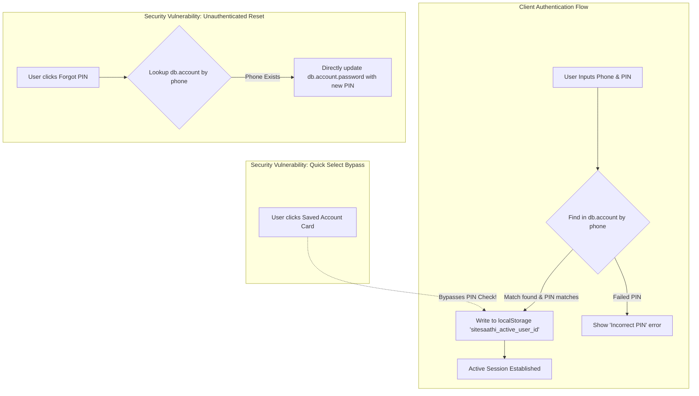

# SiteSaathi (साइट साथी) — Security Assessment & Threat Model

> **Document Version:** 1.0.0  
> **Status:** Completed Application Security Review  
> **Auditor:** Application Security & Threat Modeling Review Team  
> **Classification:** Internal Security Advisory & Hardening Blueprint  
> **Last Updated:** October 2026  
> **Codebase Target:** SiteSaathi Web & Capacitor Android  

---

## 1. Executive Summary & Security Posture

SiteSaathi is an **offline-first, client-side application** designed to manage high-value construction financial ledgers, contractor contracts, daily worker muster rolls, vendor payables (*Udhaar*), and client receipts. 

Because the application does not communicate with a remote cloud server, standard server-side vulnerabilities (SQL injection, SSRF, remote server compromise) are largely non-applicable. However, **client-side storage, local physical access, credential handling, and backup distribution represent significant security attack vectors**.

This audit identified **multiple critical and high-severity security weaknesses** in the current implementation, most notably:
1. **Unencrypted plaintext password and PIN storage in IndexedDB.**
2. **Instant authentication bypass on saved contractor accounts.**
3. **Unauthenticated PIN reset allowing password overwriting without OTP or verification.**
4. **Mock biometric implementation that auto-unlocks the application without challenging the user.**
5. **Unencrypted JSON backup exports exposing all contractor records and client finances.**

---

## 2. Authentication & Session Architecture



### Technical Implementation Audit
- **Account Store:** Accounts reside in the Dexie `account` table (`src/core/db/database.ts:47`).
- **Session Identification:** The application determines active user identity via `localStorage.getItem('sitesaathi_active_user_id')`.
- **Session Duration:** Persistent indefinitely until explicitly cleared via "Log Out" or browser cache erasure.
- **Account Isolation:** **Non-existent at the cryptographic level.** All contractor accounts and all project sites are co-located in the same IndexedDB database (`SiteSaathiDB`). While the UI filters sites by `contractorId`, any script or developer tool can query all records across all contractors on the device.

---

## 3. In-Depth Security Vulnerability Analysis

### 3.1 Plaintext Credential Storage (`CWE-256 / CWE-312`)
- **Severity:** **CRITICAL**
- **Code Trace:**
  ```typescript
  // src/components/auth/AuthScreen.tsx (Lines 141-144)
  const newAccount: ContractorAccount = {
    id: `contractor-${Date.now()}`,
    name: name.trim(),
    phone: cleanPhone,
    password: password.trim(), // Stored in plain text!
    companyName: companyName.trim() || undefined,
    trade: selectedTrade,
  ```
- **Finding:** User passwords and application lock PINs (`pinLock`) are written to IndexedDB without any form of hashing (e.g. SHA-256, PBKDF2, Argon2, bcrypt).
- **Exploitation:**
  1. An attacker gains physical possession of an unlocked phone or inspects browser DevTools -> Application -> Storage -> IndexedDB -> `SiteSaathiDB` -> `account`.
  2. The attacker reads the contractor's plain text password and PIN directly.
- **Remediation:**
  - Before writing credentials to IndexedDB, hash them using the native Web Crypto API:
    ```typescript
    async function hashCredential(pin: string, salt: string): Promise<string> {
      const enc = new TextEncoder();
      const keyMaterial = await crypto.subtle.importKey('raw', enc.encode(pin), 'PBKDF2', false, ['deriveBits', 'deriveKey']);
      const derivedKey = await crypto.subtle.deriveKey(
        { name: 'PBKDF2', salt: enc.encode(salt), iterations: 100000, hash: 'SHA-256' },
        keyMaterial,
        { name: 'AES-GCM', length: 256 },
        true,
        ['encrypt']
      );
      const exported = await crypto.subtle.exportKey('raw', derivedKey);
      return Array.from(new Uint8Array(exported)).map(b => b.toString(16).padStart(2, '0')).join('');
    }
    ```

---

### 3.2 Quick Account Selection Authentication Bypass (`CWE-287 / CWE-306`)
- **Severity:** **CRITICAL**
- **Code Trace:**
  ```typescript
  // src/components/auth/AuthScreen.tsx (Lines 215-220)
  const handleQuickAccountSelect = (acc: ContractorAccount) => {
    localStorage.setItem('sitesaathi_active_user_id', acc.id);
    setTrade(acc.trade);
    setLanguage(acc.language);
    onAuthenticated(acc, false); // Direct login without verifying password or PIN!
  };
  ```
- **Finding:** The "Saved Accounts" list provides one-tap login buttons. Clicking any account card immediately authenticates the user and opens the workspace without requesting their PIN or password.
- **Exploitation:** Anyone picking up a contractor's phone can open the application, click on any saved contractor card, and gain full access to contracts, client payments, worker muster rolls, and cash receipts.
- **Remediation:**
  - Clicking a saved account card must populate the phone number and focus the PIN entry field, requiring the user to type their 4-digit PIN before granting session access.

---

### 3.3 Unauthenticated PIN Reset Flow (`CWE-640`)
- **Severity:** **HIGH**
- **Code Trace:**
  ```typescript
  // src/components/auth/AuthScreen.tsx (Lines 257-270)
  const all = await db.account.toArray();
  const account = all.find((a) => a.phone.replace(/\D/g, '') === clean);
  if (!account) { /* error */ return; }

  // Overwrites password immediately with NO challenge!
  await db.account.update(account.id, { password: newPin.trim() });
  ```
- **Finding:** The "Forgot PIN" dialog only asks for a 10-digit mobile number. If the number matches an existing account, it instantly overwrites the stored password with the newly entered PIN.
- **Exploitation:** Any competitor, disgruntled worker, or third party who knows the contractor's 10-digit phone number can overwrite their PIN, lock them out of their application, and access their financial records.
- **Remediation:**
  - Implement a secondary secret challenge (e.g., Security Recovery Phrase created at sign up) or integrate SMS OTP verification.

---

### 3.4 Mock Biometric Auto-Unlock Bypass (`CWE-287 / CWE-303`)
- **Severity:** **HIGH**
- **Code Trace:**
  ```typescript
  // src/components/common/AppLockScreen.tsx (Lines 20-37)
  useEffect(() => {
    if (typeof window !== 'undefined' && window.PublicKeyCredential) {
      setBiometricAvailable(true);
      if (account.isBiometricEnabled) {
        triggerBiometric(); // Triggered automatically on mount!
      }
    }
  }, [account]);

  const triggerBiometric = async () => {
    try {
      if (typeof window !== 'undefined' && window.PublicKeyCredential) {
        // Simple touch simulation / credential challenge
        onUnlock(); // UNLOCKS IMMEDIATELY WITHOUT HARDWARE CHALLENGE!
      }
    } catch (e) {}
  };
  ```
- **Finding:** The app lock screen checks if `window.PublicKeyCredential` is truthy (which is true in all modern Chromium and WebKit browsers). If the contractor has enabled "Biometric Lock", the lock screen automatically calls `onUnlock()` upon mounting.
- **Exploitation:** Enabling "Biometric Lock" actually makes the app **less secure** than a standard PIN, because it bypasses the PIN lock automatically upon screen load without requiring any fingerprint or facial scan.
- **Remediation:**
  - On Capacitor Android, use `@capacitor-community/biometric-auth` to invoke the native Android `BiometricPrompt` dialog:
    ```typescript
    import { NativeBiometric } from '@capacitor-community/biometric-auth';
    const result = await NativeBiometric.verifyIdentity({
      reason: 'Scan your fingerprint to unlock SiteSaathi',
      title: 'SiteSaathi Security Lock',
    });
    if (result) onUnlock();
    ```

---

### 3.5 Unencrypted Full Database Backup Export (`CWE-312 / CWE-313`)
- **Severity:** **HIGH**
- **Code Trace:**
  ```typescript
  // src/core/db/database.ts (Lines 438-456)
  async exportBackupJson(): Promise<string> {
    const backup = {
      app: 'SiteSaathi',
      version: 2,
      exportedAt: new Date().toISOString(),
      account: await this.account.toArray(), // Includes plaintext passwords!
      sites: await this.sites.toArray(),
      tools: await this.tools.toArray(),
      labourRecords: await this.labourRecords.toArray(),
      dues: await this.dues.toArray(),
      clientPayments: await this.clientPayments.toArray(),
      // ...all tables
    };
    return JSON.stringify(backup, null, 2);
  }
  ```
- **Finding:** Exporting a database backup produces a completely unencrypted, human-readable JSON file. This file contains every worker's name and wage, every client payment and contract budget, all vendor debts, and the contractor's plaintext password.
- **Exploitation:** Contractors frequently share backup files via WhatsApp or email when switching phones. If sent unencrypted, anyone with access to the messaging thread or device storage can view the contractor's entire financial history.
- **Remediation:**
  - Prompt the contractor to enter a Master Backup Password upon export.
  - Encrypt the JSON payload using AES-256-GCM via `crypto.subtle.encrypt()` before triggering the file download.
  - Require the same password to decrypt and verify the backup upon import.

---

## 4. Threat Model: STRIDE & OWASP Mobile Top 10

| STRIDE Threat Category | Real-World Attack Scenario | Likelihood | Impact | Current Defense Posture |
| :--- | :--- | :---: | :---: | :--- |
| **Spoofing** | Attacker selects contractor from "Saved Accounts" card or resets PIN via phone number. | **High** | **Critical** | **Vulnerable**: Quick login and unauthenticated PIN reset permit identity spoofing. |
| **Tampering** | Competitor or laborer edits local muster roll or due balance in SQLite/IndexedDB storage. | **Medium** | **High** | **Partially Mitigated**: Anti-Delete prompt requires PIN, but direct DB access remains unprotected. |
| **Repudiation** | Client or worker denies receipt of payment recorded in clientPayments or labourRecords. | **Medium** | **Medium** | **Mitigated**: Automated PDF receipts and muster rolls generate verifiable audit trails with timestamps. |
| **Information Disclosure** | Device left on job site table; laborer opens app or copies unencrypted backup JSON file. | **High** | **Critical** | **Vulnerable**: Plaintext credentials and unencrypted backup files expose complete project ledger. |
| **Denial of Service** | Unauthorized user clicks "Clear All Data" in Settings to wipe all project records. | **Medium** | **Critical** | **Partially Mitigated**: Anti-Delete setting enforces PIN verification before database wipe. |
| **Elevation of Privilege** | Laborer with physical phone access modifies own daily wage rate in muster roll. | **Medium** | **High** | **Vulnerable**: No multi-tier role permissions (Supervisor vs Worker vs Contractor). |

---

## 5. Mobile & WebView Configuration Review

### Capacitor Android Configuration (`capacitor.config.ts`)
```typescript
const config: CapacitorConfig = {
  appId: 'com.sitesaathi.app',
  appName: 'SiteSaathi',
  webDir: 'dist',
  server: {
    androidScheme: 'https',
    cleartext: true        // Security Concern
  },
  android: {
    allowMixedContent: true // Security Concern
  }
};
```

- **Cleartext Traffic (`cleartext: true`):** Allows unencrypted HTTP traffic inside the Android WebView. While SiteSaathi operates offline, any future HTTP calls (e.g. external font downloads, CDN assets) would be susceptible to Man-in-the-Middle (MITM) interception.
- **Mixed Content (`allowMixedContent: true`):** Permitting mixed content in the WebView reduces browser sandboxing protections. Should be set to `false` for production builds.

---

## 6. Actionable Security Hardening Roadmap

### Phase 1: Immediate Critical Fixes (Sprint 1)
1. **Remove Authentication Bypass:** In `AuthScreen.tsx`, update `handleQuickAccountSelect` to require PIN entry before logging in.
2. **Implement Credential Hashing:** Use Web Crypto API PBKDF2/SHA-256 to hash passwords and PINs before saving to `db.account`.
3. **Fix Biometric Bypass:** In `AppLockScreen.tsx`, disable automatic `onUnlock()` call; enforce PIN fallback until native biometric plugin is integrated.

### Phase 2: High Priority Hardening (Sprint 2)
1. **Encrypted Backup Files:** Implement AES-GCM password-based encryption on all exported JSON backup files.
2. **Secure PIN Reset:** Replace the direct phone number PIN overwrite with a security recovery question or phone OTP challenge.
3. **Harden Android Manifest:** Add explicit runtime permissions for `CAMERA` and `RECORD_AUDIO` in `AndroidManifest.xml`.
4. **Enforce WebView HTTPS:** Set `cleartext: false` and `allowMixedContent: false` in `capacitor.config.ts`.
