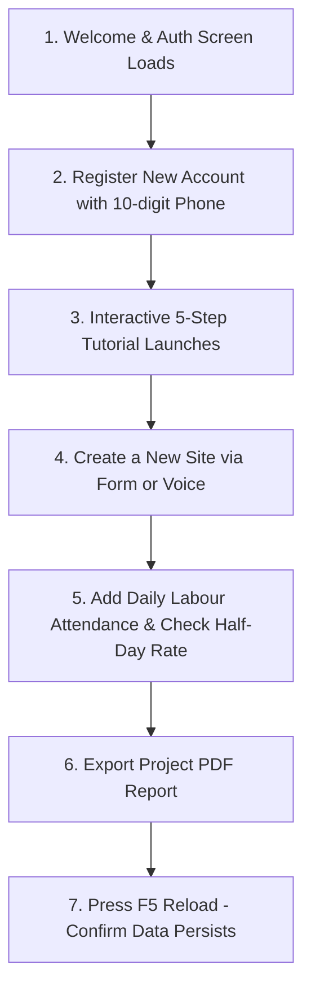

# SiteSaathi (साइट साथी) — Project Setup & Initialization Guide

> **Document Version:** 1.0.0  
> **Target Audience:** Frontend Engineers, DevOps Engineers, QA Testers, AI Coding Agents  
> **Classification:** Project Initialization & Local Environment Guide  
> **Last Verified:** October 2026  
> **Codebase Baseline:** React 19, TypeScript 5, Vite 8, Tailwind CSS v4, Dexie.js v4, Capacitor 8  

---

## 1. Project Overview

**SiteSaathi** is an offline-first, mobile-responsive web and Android application designed for Indian construction contractors and site supervisors (*Thekedars*). It provides a digital companion for job-site budgeting, daily worker muster rolls (*Haziri*), equipment rental tracking, material stock purchases, machinery fuel logging, client advance receipts, and client-side PDF project statements.

### Core Architectural Realities for Setup
- **100% Client-Side:** The application runs entirely inside the client's browser engine or Android WebView.
- **Zero Backend Servers:** There is **no Node.js/Express API server, Python backend, or remote database** to install, configure, or run.
- **Embedded Persistence:** All application data is stored in the browser's local **IndexedDB** engine using **Dexie.js**. No Docker containers, PostgreSQL, MongoDB, or Redis instances are required.
- **No Third-Party Cloud Dependencies:** The application does not require Firebase, Supabase, AWS, or external API keys to function in development or production.

---

## 2. System Prerequisites

Before setting up SiteSaathi locally, ensure your workstation meets the following verified requirements:

| Component | Minimum Required Version | Recommended Version | Verification Command | Notes / Purpose |
| :--- | :--- | :--- | :--- | :--- |
| **Operating System** | Windows 10, macOS 12+, Ubuntu 20.04+ | Windows 11 / macOS 14 / Ubuntu 22.04 | `systeminfo` / `uname -a` | Windows development environment verified in current repository. |
| **Node.js** | `v18.0.0` or higher | `v20.x` (Active LTS) | `node -v` | Required for Vite bundler, React 19, and TypeScript compilation. |
| **npm** | `v9.0.0` or higher | `v10.x` | `npm -v` | Primary package manager; matches `lockfileVersion: 3` in `package-lock.json`. |
| **Git** | `v2.30+` | Latest stable | `git --version` | Version control & repository management. |
| **Code Editor** | Any modern editor | VS Code (with Tailwind & TypeScript plugins) | — | Standard web development IDE. |
| **Web Browser** | Chromium-based browser | Google Chrome v120+ / Microsoft Edge v120+ | — | **Critical:** Required for native Web Speech API and Canvas OCR processing. |

### Optional Prerequisites for Android Native Development (Capacitor)
If you intend to build the native Android APK (`apk:build`), the following native SDKs are required:

| Android Tool | Required Version | Verification Command | Notes |
| :--- | :--- | :--- | :--- |
| **Java Development Kit (JDK)** | JDK 17 or JDK 21 | `javac -version` | Required by Android Gradle Plugin; set `JAVA_HOME`. |
| **Android Studio** | Ladybug (2024.2+) or later | Android Studio About dialog | Provides Android SDK Manager and virtual device emulators. |
| **Android SDK Platform** | API Level 34 or 36 (`compileSdkVersion 36`) | SDK Manager in Android Studio | Minimum supported device: API Level 24 (`minSdkVersion 24` / Android 7.0). |
| **Android Build Tools** | `v34.0.0` or `v36.0.0` | SDK Manager | Compiles Android DEX and resource packages. |

---

## 3. Project Directory Structure

```
d:/TECH/site sathi/
├── package.json                    # Project metadata, dependencies, and NPM scripts
├── package-lock.json               # Deterministic dependency tree (lockfileVersion: 3)
├── vite.config.ts                  # Vite bundler configuration with Tailwind CSS plugin
├── capacitor.config.ts             # Capacitor configuration (appId: com.sitesaathi.app)
├── tsconfig.json                   # Root TypeScript project references configuration
├── tsconfig.app.json               # Application-specific TypeScript compilation rules
├── tsconfig.node.json              # Tooling and bundler TypeScript rules
├── .oxlintrc.json                  # Static code analysis configuration for Oxlint
├── index.html                      # Single-page application entry point & font links
├── public/                         # Static assets served at root (logos, icons, images)
│   └── images/
│       └── builder_character.jpg   # 3D interactive mascot asset
├── docs/                           # Authoritative Documentation Suite
│   ├── Product Requirements Document.md # Product Requirements Document
│   ├── Architecture.md             # Technical Architecture & Data Flow
│   ├── Design.md                   # Visual Identity, Tokens & UX Guidelines
│   ├── Database.md                 # Database Schema, ERD & Integrity Rules
│   ├── Test Plan.md                # 42-Test Case Risk-Based Plan
│   ├── Test Report.md              # Execution Audit & Discovered Defect Register
│   ├── Security.md                 # Threat Model, STRIDE Audit & Hardening
│   ├── User Guide.md               # Bilingual Contractor Field Manual
│   ├── Release Checklist.md        # Pre-Flight Release Gatekeeper
│   ├── Feature Walkthrough.md      # Feature Walkthrough & Verification Summary
│   ├── reports/                    # Generated Progress & Architecture Reports
│   └── Setup.md                    # This Project Setup Guide
├── android/                        # Native Android Capacitor Project
│   ├── build.gradle                # Root Gradle configuration
│   ├── gradlew.bat                 # Windows Gradle wrapper execution script
│   ├── variables.gradle            # Android SDK versions (minSdk: 24, compileSdk: 36)
│   └── app/
│       ├── build.gradle            # Android app module configuration
│       └── src/main/
│           ├── AndroidManifest.xml # Android permissions and activity manifest
│           └── assets/public/      # Web distribution destination (populated by cap:sync)
└── src/                            # Application Source Code
    ├── main.tsx                    # React DOM root bootstrapping
    ├── App.tsx                     # Top-level state orchestrator & view hub
    ├── index.css                   # Global styles, CSS variable design tokens
    ├── types/                      # Canonical TypeScript data models & interfaces
    ├── core/                       # Database, Theme, and i18n core stores
    ├── components/                 # Modals, navigation, cards, and module views
    └── utils/                      # Voice parser, OCR engine, PDF exporter, date formatters
```

---

## 4. Installation & Dependency Preparation

Follow these step-by-step instructions to prepare the repository for local development.

### Step 1: Clone the Repository
```bash
git clone https://github.com/vishesh-i-tech/SiteManager.git
cd SiteManager
```

### Step 2: Verify Your Node.js & npm Versions
```bash
node -v
# Output should be v18.x or v20.x (e.g. v20.18.0)

npm -v
# Output should be v9.x or v10.x (e.g. v10.8.2)
```

### Step 3: Install Project Dependencies
Because the repository includes a committed `package-lock.json` (`lockfileVersion: 3`), install dependencies cleanly using:

```bash
# Recommended for standard development:
npm install

# Alternatively, for clean deterministic continuous integration builds:
npm ci
```

> [!WARNING]
> **Do not delete `package-lock.json` or run `npm update` unnecessarily.** The project relies on specific compatible versions of React 19 (`^19.2.8`), Tailwind CSS v4 (`^4.3.3`), and Capacitor 8 (`^8.5.3`).

---

## 5. Environment Variables

### Verified Configuration Finding
```
Required Environment Variables: NONE
Optional Environment Variables: NONE
Environment File (.env):        NOT REQUIRED
```

- **No Remote API Keys:** The application does not require any `.env`, `.env.local`, or secret configuration files to run locally.
- **Client Storage:** All persistence takes place inside the browser's origin-bound **IndexedDB** database (`SiteSaathiDB`).
- **CDN Assets:** Font resources are loaded directly from Google Fonts in `index.html`. Tesseract language data (`eng+hin.traineddata.gz`) is fetched automatically by `tesseract.js` from the jsDelivr / GitHub CDN into client IndexedDB cache on first OCR scan.

---

## 6. Database & Local Storage Setup

### How Persistence Works
1. **Zero Database Installation:** You do **not** need to install PostgreSQL, MySQL, SQLite, or Redis.
2. **Automatic Initialization:** When the application is launched in a browser or WebView, Dexie.js (`src/core/db/database.ts`) automatically initializes `'SiteSaathiDB'` and applies Schema Version 2 and Version 3.
3. **Pristine State Sweep:** On a brand-new run, `src/App.tsx` performs a one-time startup check (`sitesaathi_pristine_final_user_test`) to ensure all tables start 100% clean without demo or orphan records.

> [!CAUTION]
> **Browser Storage Warning:** Because data resides in the browser's IndexedDB storage:
> - Clearing browser cookies and site data will **permanently erase** your local database.
> - Private / Incognito windows will erase all data immediately upon closing the window.
> - To preserve test data, always use the **"Export Backup"** feature located in **Settings** (`SettingsModal.tsx`).

---

## 7. Running the Application Locally

The following scripts are defined in `package.json`:

| Command | Underlying Action | Purpose & Expected Result |
| :--- | :--- | :--- |
| `npm run dev` | `vite` | Starts the Vite local development server on `http://localhost:5173/`. Provides hot-module replacement (HMR). |
| `npm run build` | `tsc -b && vite build` | Type-checks the entire TypeScript codebase and compiles optimized production bundles into `dist/`. (Verified: passes in ~1.9s). |
| `npm run preview` | `vite preview` | Serves the production build bundle locally from `dist/` to verify production performance and minification. |
| `npm run lint` | `oxlint` | Executes fast Rust-based static code analysis across all source files. (Verified: passes with 0 errors, 162 warnings). |
| `npm run cap:sync` | `npm run build && npx cap sync android` | Compiles web production bundle and copies assets into `android/app/src/main/assets/public`. |
| `npm run cap:open` | `npx cap open android` | Launches the native Android Studio IDE with the `android/` project loaded. |
| `npm run apk:build` | `npm run build && npx cap sync android && cd android && gradlew.bat assembleDebug` | Compiles web assets, syncs Capacitor, and executes Gradle to generate `app-debug.apk`. |

### Starting the Local Development Server
```bash
npm run dev
```

Console Output:
```text
  VITE v8.2.2  ready in 240 ms

  ➜  Local:   http://localhost:5173/
  ➜  Network: use --host to expose
  ➜  press h + enter to show help
```

Open `http://localhost:5173/` in **Google Chrome** or **Microsoft Edge**.

---

## 8. Installation Verification Checklist

After launching `http://localhost:5173/`, verify basic system functionality using this manual smoke checklist:



- [ ] **1. Application Load:** Browser renders the clean, high-contrast light theme without console errors.
- [ ] **2. Bilingual Toggle:** Click the language pill in the top header; verify UI switches between Hindi (हिंदी) and English instantly.
- [ ] **3. Account Creation:** Click "Sign Up", enter a name, 10-digit mobile number, and 4-digit PIN. Verify account creation succeeds.
- [ ] **4. Site Creation:** Tap "+ Add Site". Verify that Budget and Target Completion Date start **completely blank** (no pre-filled `0` or arbitrary dates).
- [ ] **5. Daily Muster Roll:** Navigate to "Workers" tab -> tap "+ Daily Muster". Add a worker with role "Mason" and select "Half Day". Verify daily wage automatically divides by 2.
- [ ] **6. PDF Report Generation:** Open any site -> tap "PDF Report". Verify browser downloads a multi-page PDF project statement containing tabular breakdowns.
- [ ] **7. Persistence Check:** Reload the browser tab (`F5`). Verify the active session, sites, and worker entries remain intact from IndexedDB.
- [ ] **8. Data Backup:** Open Settings -> tap "Export Backup". Verify a `.json` backup file downloads to your local disk.

---

## 9. Android Development & APK Build Workflow

To build and run SiteSaathi as a native Android application using Capacitor:

### Step 1: Ensure Native Prerequisites
Verify that JDK 17+ is installed and configured in your environment:
```bash
# Verify Java installation
javac -version

# Ensure JAVA_HOME points to your JDK directory:
# Windows (PowerShell):
$env:JAVA_HOME = "C:\Program Files\Android\Android Studio\jbr"
```

### Step 2: Build Web Assets & Synchronize Capacitor
Run the sync command to build `dist/` and copy web assets to the Android native wrapper:
```bash
npm run cap:sync
```

### Step 3: Compile the Android Debug APK
Run the full automated build pipeline:
```bash
npm run apk:build
```

### Output APK Location
Upon successful Gradle compilation, the installable debug APK will be generated at:
```
android/app/build/outputs/apk/debug/app-debug.apk
```

### Installing on a Physical Android Phone via ADB
Connect your Android phone with **USB Debugging** enabled and run:
```bash
adb install android/app/build/outputs/apk/debug/app-debug.apk
```

---

## 10. Troubleshooting & Common Issues

| Issue / Error Symptom | Likely Cause | Verified Solution |
| :--- | :--- | :--- |
| **`npm ERR! code ERESOLVE` during install** | Node.js version mismatch or conflicting global packages. | Run `npm install --legacy-peer-deps` or ensure you are running Node.js v18/v20 LTS. |
| **Port 5173 is already in use** | Another development server or Vite process is running. | Run `npm run dev -- --port 5174` to bind to an alternative local port. |
| **`tsc -b` fails with compiler errors** | TypeScript type mismatches in edited files. | Run `npm run build` to view exact line numbers and fix typing mismatches. |
| **Microphone not listening in Voice Input** | Browser microphone permissions blocked or denied. | In Chrome address bar, click the site settings padlock icon -> set **Microphone** to **Allow**. |
| **OCR scan taking a long time (10-25s)** | Tesseract.js downloading language models on slow network. | Allow initial download to complete (~15MB); subsequent scans use local IndexedDB cache. |
| **`gradlew.bat` fails: `JAVA_HOME is not set`** | Java Development Kit environment variable missing. | Install JDK 17 or point `JAVA_HOME` to Android Studio's bundled JBR directory (`C:\Program Files\Android\Android Studio\jbr`). |
| **Android build fails: SDK location not found** | `android/local.properties` file is missing. | Create `android/local.properties` and add: `sdk.dir=C:\\Users\\<YourUsername>\\AppData\\Local\\Android\\Sdk`. |
| **Database records disappear after browser close** | Testing inside Private / Incognito browser window. | Use standard browser profile so origin-partitioned IndexedDB storage is preserved. |

---

## 11. Security & Data Safety Guidelines for Developers

1. **Never Commit Secrets:** Although the project currently uses no remote API keys, never commit `.env` files, production keystores (`.jks`), or private client records to version control.
2. **Protect User Backup Files:** Exported JSON backup files contain unencrypted passwords and financial ledgers. Do not upload backup JSON files to public repositories or unencrypted ticketing systems.
3. **Preserve Database Cascade Logic:** When creating new data entities that reference `siteId`, always update `db.deleteSite()` in `src/core/db/database.ts` to ensure child records are purged atomically when sites are deleted.
4. **Adhere to the Single Light Theme:** Do not reintroduce dark mode toggles or ad-hoc primary colors. Maintain the verified single monochromatic blue `#2563EB` aesthetic across all components.

---

## 12. Known Limitations & Setup Caveats

1. **No Automated Test Runner:** `package.json` currently has no `npm test` script configured. Functional verification relies on `npm run lint`, `npm run build`, and manual smoke testing.
2. **Web Speech Browser Compatibility:** Speech recognition utilizes the browser's native Web Speech API, which works reliably in **Google Chrome, Chromium, and Android System WebView**, but is unsupported in Mozilla Firefox or Safari.
3. **Android Permissions:** `android/app/src/main/AndroidManifest.xml` currently declares only `INTERNET` permission. For strict physical Android devices, explicit `<uses-permission>` tags for `CAMERA` and `RECORD_AUDIO` must be declared before production Play Store deployment.
